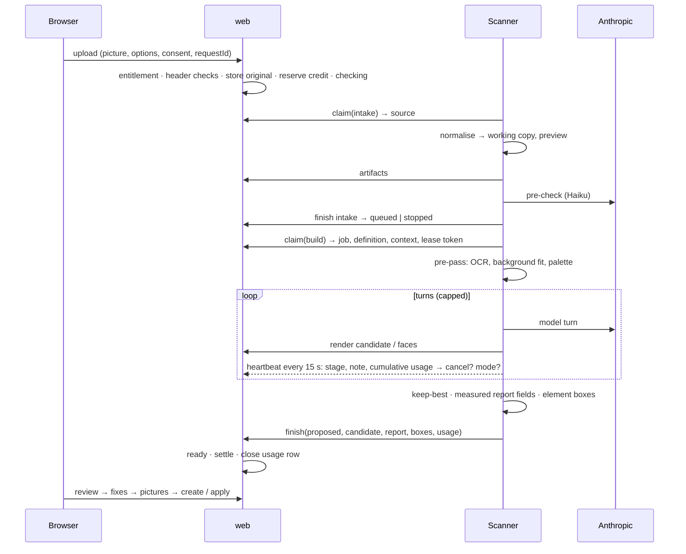

# AI sken — architecture proposal and phased implementation plan

Status: **revision 5 (close-out), 2026-11-12 — approved for implementation and delivery to
production** (owner decision 11, `decisions.md`). It follows three independent reviews
(`review.md`, `review-ux.md`, `review-reliability.md`), a verification pass of revision 3
(`review-verification.md`, [RV]; Appendix A.4) and a close-out check of revision 4 (Appendix A.5).
Repo at `c0114c22`, infra repo `~/www/lily.srv` at `0ae761c`. P1 (job core) and P2 (scanner) are
being built from this document; nothing was run for this revision.

**What is decided** (`decisions.md`, mirrored in §11): the former Phase 0 is folded into the
build — the real scanner is built first and measured in P2; the builder is the Opus agent with a
mandatory pre-pass on the Agent SDK, for calendars too; everything ships admins-only; customer
access (P6) waits for outside-made designs rated by a designer, the legal gate G1 and the
production key.

**Changes in revision 5** — every checked item with its verdict is in Appendix A.5; a value or
rule that changed against revision 4 carries **[r5]** where it stands:

- §1, §10 and §11 follow `decisions.md`: no Phase 0 and nothing "to approve"; what Phase 0 was to
  measure is assigned to P2, P4, P5 and the launch round (§10 "Measurements").
- §4.9 re-derived pair by pair. Changed: self-abort 90 → 105 s, counted from the send time;
  a heartbeat attempt is cut at 10 s; the intake has its own lease (150 s) and its own pre-check
  request bound (≤ 38 s); the global cap is 8 scans waiting (`checking` + `queued`) instead of 10
  `queued`; shutdown `release` is bounded; one retention date per scan.
- §5.2: every state × event either transitions or is refused; new rules 1a (intake claim), 3c
  (pre-check not possible, or refused), 3d (intake release); rule 13 returns to `checking` when
  the intake never finished; `try` is 1–4.
- §5.4: which failures make a picture unscannable; a cap hit lost to the provider is refunded
  even when a candidate exists; the ceilings stated as a start condition.
- PDF: pictures only in the first build; page 1 of a PDF only if cheap, no page picker (O4).
- Leftovers of revisions 2–4 removed ("P0 decides", `scan-api`, an image copy at `finish`).

States, names, numbers and limits are identical in this document and in `ux.md`; the shared tables
are §4.9 (timing and limits), §5.2 (states and transitions), §5.4 (credits and spend) here and §2
there. Appendix A lists every review finding and what changed. `ux.md` is owned by another agent
and still has to take over the **[r5]** items that reach it; A.5 names them.

| Tag | Source (under `docs/ai-scan/` unless a path says otherwise) |
|---|---|
| [DC] / [DT] / [DP] / [DI] | `digest-calendar.md` / `digest-templates.md` / `digest-platform.md` / `digest-infra.md` |
| [RP] / [RT] | `research-providers.md` / `research-techniques.md` |
| [PR] | `prototypes/README.md` |
| [T1] / [T2] / [CAL] / [HR] | `prototypes/t1-agent/results.md` / `t2-pipeline/results.md` / `calendar/results.md` / `hard-round/results.md` |
| [UX] | `ux.md` (revision 5, being edited by its owner while this was written) |
| [R1] / [RU] / [RR] | `review.md` / `review-ux.md` / `review-reliability.md` |
| `path:line` | code, read on 2026-11-12 |

- **Measured** = produced by a prototype run or read on the box; it always names the system that
  produced it, and none is the configuration proposed here. **Verified** = read in code.
  **Expected** = nobody measured it.
- **Prototype agent (PA)** = `claude -p` 2.1.322 driving scan tools, measuring optional, no cap on
  rendered candidates, one run per input. **Proposed configuration** = §4.
- D1–D8 = the orchestrator's design decisions; O1–O16 = the decisions of §11. "Scanner" = the new service; "engine" = what runs the model
  loop in it; "instrument" = a deterministic measuring tool; "proposal" (`návrh`) = a scan's result
  before the user creates / applies it; "run" = one execution of the builder for a scan.

---

## 1. Summary and recommendation

### 1.1 Direction

A user uploads a picture; a queued background job builds a **proposal** with a render and a
report; the user reviews it, fills the places for pictures and creates the template or applies the
layout through the existing commands.

| Piece | Direction | Status of the evidence |
|---|---|---|
| Result | proposal first; nothing exists until the user creates / applies it | design rule ([DC §8.23], [DT §9.20]) |
| Pictures | never extracted; each picture object is a named place the user fills | owner; [T1], [CAL §5] |
| Precision | deterministic instruments: OCR lines, font ranking by rendering project faces, colour / gradient sampling, crop, numeric compare | measured on the **pipeline**, same-renderer inputs: 0.890 → 0.995 masked composite [T2 §3] |
| Template builder | **taken (O5):** one Opus 5.5 agent with a mandatory measured pre-pass, ≤ 3 rendered candidates, scanner-side keep-best. **Fallback, not built up front:** pipeline first, agent when its checks fire | PA beat the pipeline 9 / 3 / 0 / 0 to 2 / 4 / 6 / 0 on a stress set, uncapped, one run, author's verdicts [HR §1]; the hard round's author recommends the hybrid [HR §7]. Never run as specified before the build: **measured in P2 and re-examined then** |
| Calendar builder | **taken (O7):** the same agent runner with mm instruments, effort `high`. **Fallback:** single structured call + guarded measurement | single call exact on synthetic pages; the agent won on one real page at effort `medium` [CAL §1]. **Measured in P5** |
| Engine | **taken (O6):** Claude Agent SDK (runs on the owner's subscription locally, on the API key in production). **Fallback and exit:** plain Messages API loop | the SDK was never run before the build; its abort behaviour, exit codes and error detail are **established in P2** (§10 "Measurements") |
| Runner | a pinned `scanner` container that pulls jobs; a separate short **intake lane** (normalise + pre-check) that never waits behind running scans; concurrency is a setting | [DI §6]; holds for either engine |
| Web process | reads file headers only; never decodes, transcodes or measures a picture. It also serves the scanner's endpoints, restricted to the scanner's network (O16) | [RR B4]; `web` has 1 GiB and serves everyone [DP §5] |
| Access | per-project entitlement set by an admin; "start" and "use" are separate permissions, enforced on every entry point | owner; [RR M8] |
| Accounting | usage recorded incrementally per run; credit ledger; credits and real spend are separate controls | owner; [RR B2, B3] |
| Operations | operating mode, limits and provider state in the database, changed from the admin screen without a deploy | [RR M9, M17] |

### 1.2 Cost, time, quality — what is known

Every figure is from the prototype agent or the pipeline, **not the proposed configuration**, on
inputs that are WBoost's own exports or designs authored for the test.

| | Templates, easy (7 own exports) | Templates, hard (10 designs, fonts absent by construction) | Calendars |
|---|---|---|---|
| Cost per scan | $0.22 (0.16–0.29), PA run 2, 5-minute cache prices [T1] | $0.50 (0.22–0.81), PA, computed at 1-hour cache prices [HR §1]; pipeline $0.10 | agent Opus `medium` $0.40 billed; single call $0.047 [CAL T5] |
| Wall clock | 55 s (37–72) | 95 s (44–149); pipeline 37 s | agent 82 s; single call 13 s (+ 49 s with measurement) |
| Quality | text 1.00, face 1.00, box IoU 0.92 — same renderer, fonts in the project | author's verdicts 9 / 3 / 0 / 0, "as is" = as good as the DSL allows; text 0.86; box IoU 0.57; face 0 of 128 | synthetic: structure exact; Chotěbuz: agent 0.684, single call + measurement 0.477 (0.493 with the optimiser), hand-built 0.626 |

Planning figure until P2's measurement replaces it: **≈ $0.40 and 1–3 minutes per scan
(expected)**; one run is stopped at 6 minutes, the scanner may restart a run once, so the worst
case is ≈ 12 minutes of work plus queue wait.

Unknown: run-to-run spread and resources per scan on x86 (measured in P2); a design made in
another tool with the project's fonts uploaded and a designer's judgement of closeness (the launch
round before P6 — its inputs and the designer are owed by the owner, §11).

### 1.3 Deferred

| Deferred | Where |
|---|---|
| Native PDF parsing, PSD, IDML | §4.3; F1, F4. The first build takes pictures only. Page 1 of a PDF **as a picture** is allowed if it stays cheap (O4): added in the scanner's intake, without a page picker — or left to F1 |
| DSL extensions, calendar vocabulary | §4.8; F2, F3 |
| Deterministic text-fit pass; Sonnet tier | F6 (Sonnet is re-examined with P2's measurements) |
| 14-day calendars; entry in calendar step 3 | F7 |
| Credit packs, billing, price of "Premium", usage chart and CSV, limit-increase requests | cut from v1; O14 |

### 1.4 Orchestrator decisions: status

| Decision | Status |
|---|---|
| D1 | taken on approval (O5, O7): the agent with a mandatory pre-pass, for templates and calendars; the hybrid and the calendar single call are fallbacks; the pre-check is its own lane; re-examined with P2's and P5's measurements (§3.1) |
| D2 | container and pull model kept; engine = Agent SDK (O6), the Messages loop kept as the exit; scanner-facing calls are plain endpoints of the app restricted to the scanner's network, not `/_mcp` (an MCP token is a user + scopes, no project — `src/Entity/McpAccessToken.php:57-87`) |
| D3 | followed; calendar accept is one server-side save with a restorable snapshot (§4.6) |
| D4 | followed; entitlement = two project columns; credits and spend separated (§5.4) |
| D5 | reduced to a scan-specific mechanism |
| D6 | every limit is expected until P2 measures on x86 at concurrency 1 and 2, and P4 on the box (§8) |
| D7 | followed (§4.8) |
| D8 | bars provisional from P2, fixed at the launch round (§4.10) |

---

## 2. Evidence

### 2.1 Measured or verified

System: **PA** prototype agent, **PL** prototype pipeline, **C1 / C2 / C3** calendar single call /
agent (`medium`) / code measurement, **box**, **code**, **infra**, **vendor** (official pages read
by the research or a reviewer).

| # | Fact | System | Source |
|---|---|---|---|
| E1 | Hard set verdicts: PL 2 / 4 / 6 / 0; PA Opus 9 / 3 / 0 / 0; PA Sonnet 6 / 6 / 0 / 0. One run; the author's judgement. 10 designs + 2 degraded copies; 5 are WBoost templates re-exported, 5 are HTML authored as a stress test | PA, PL | [HR §1, §8, T-F] |
| E2 | Hard set per scan: PL $0.10, 37 s; PA Opus $0.50, 95 s (44–149), 22.7 turns, **3.4 rendered previews (4.4 on set B, 7 on one input)**; PA Sonnet $0.21, 69 s | PA, PL | [HR §1, §3, T-B] |
| E3 | Easy set: PA Opus 7 / 7, 16.9 turns, 2.9 previews, 55 s, $0.22; text 1.00, face 1.00, box IoU 0.92; API time ≈ 43 s of the wall clock | PA | [T1] |
| E4 | With vs without code measurement (7 exports): masked composite 0.995 vs 0.890; text box IoU 0.953 vs 0.550 | PL | [T2 §3] |
| E5 | Corrections move text positions only; correction 2 median +0.014, correction 3 +0.004; layer inventory unchanged after the first build in 20 / 24 hard runs | PA | [T1], [HR §3] |
| E6 | The agent saved a non-best preview in 12 / 24 hard runs | PA | [HR §2 A6] |
| E7 | Hybrid trigger fired on 10 / 12 hard inputs; one signal 0 / 10 on easy; thresholds fitted afterwards; the hard round recommends the hybrid | PL | [HR §7, T-G] |
| E8 | Fonts absent: face right 0 / 128. `matched` is the model's assertion (Opus 4 / 90 wrong; Sonnet 8 / 8 "matched" unprobed). Sonnet called no `font_probe` in 7 / 12 runs. **No input has the font in the project and another renderer** | PA, PL | [HR §2, §5]; [R1 B2] |
| E9 | Size fitted to line width: chosen / true 0.95 (0.84–1.07) | PA, PL | [HR §5] |
| E10 | Validation rejections: PA Opus 0 / 134 and 0 / 41; Sonnet 3 / 36 | PA | [T1], [HR T-H] |
| E11 | Containers produced 0 (truth 6); rotation, letter-spacing, mixed styles, shadows, outlines, masks have no DSL form | PA, PL; code | [HR §4], [DT §2] |
| E12 | Picture layers P / R: easy flat 0.86 / 0.67, photo-backed 1.00 / 0.89, hard 0.81 / 0.67; the same object became a slot or shapes between runs | PA | [T1], [HR §2 A2] |
| E13 | Masked image scores are blind on photo-backed inputs (mask share ≥ 0.9 in 18 / 36 runs); the scorer charges a correctly split line | scorer | [HR §1, §9] |
| E14 | Calendars, synthetic: C1 Opus categorical 100 %, type 0.52 pt, $0.047, 13 s; + C3 0.18 pt; C2 Opus 0.65 → 0.31 pt, $0.40, 82 s; C2 Sonnet `medium` got worse | C1–C3 | [CAL §1, T5] |
| E15 | Calendars, real: Chotěbuz — hand-built 0.626, C1 0.426, C3 0.477 (0.493 with the optimiser), C2 0.684; Markvartovice C3 0.946, C2 0.949; differences < 0.05 mean nothing; C2's win is attributed to a prototype schema limit | C1–C3 | [CAL §1, §2] |
| E16 | C3 fails on real wording; a strict schema above ≈ 75 properties is refused | C3, C1 | [CAL §2] |
| E17 | OCR: 233 MB peak, 0.27 s on 3 threads, arm64 | PL | [T2 §2] |
| E18 | Node refinement: 415–640 MB fresh, 1.15 GB after ten scans in one process | PL | [T2 §10] |
| E19 | Render round trips (laptop): ≈ 0.8–1.0 s | app | [PR §6] |
| E20 | Box: 16 threads, 125 GiB RAM, 98 GiB available, no swap; sum of limits 119.8 GiB; `web` 1 GiB limit, 377 MiB idle, one replica | box | [DP §5] |
| E21 | D31 rejects per-container CPU limits; precedent `online-cv` (`cpus: 2`); next id D87 | infra | verified `docs/decisions.md:1166`, `apps/myspeedpuzzling/compose.yaml:1022` |
| E22 | Consumer command without `exec`; consumers force-recreated on every deploy; deploys serialized; `apps/wboost/` config is delivered on push but activated only by the next deploy | infra | verified `apps/wboost/compose.yaml:128`; [DI §1] |
| E23 | Gotenberg: shared, 5 GiB, 6 conversions, floating tag, a Chromium OOM-killed on 2026-08-05; client timeout 20 / 25 s because PHP's limit is 30 s and a slow render holds the session lock | infra, code | [DI §5]; verified `config/packages/sensiolabs_gotenberg.yaml:22-23` |
| E24 | Web router is ``Host(`wboost.cz`)`` and takes every path; `web` is on the box-wide `traefik` network | infra | verified `apps/wboost/compose.yaml:88`, `:103` |
| E25 | Prices per MTok: Opus 5.5 $4 / $20, Sonnet 5.5 $2 / $10, Haiku 5.5 $0.10 / $0.50; spend caps Start $500, Build $1 000, Scale $200 000 a month | vendor | [RP §1.1, §1.5] |
| E26 | Provider errors: a spend-cap 429 carries `error.details.error_code = enforced_spend_limit_reached` and never `retry-after`; throttling 429s may also lack `retry-after`; a self-set workspace limit is HTTP 400 with a usage-limit message; 402 `billing_error`, 401, 403 exist; the SDK reports `billing_error`, `authentication_failed`, `account_on_hold`, `rate_limit`, `overloaded` on the assistant message. The harness retries up to 10 times by default | vendor | [RR M2, M3] |
| E27 | Image limits of the Messages API: 8000 × 8000 px; 10 MB base64 per image; above 20 images in a request (resent history and tool results included) each must be ≤ 3000 px; 128 MB request | vendor | [RP §1.2]; [RR M4] |
| E28 | MCP: 21 tool classes, 6 scopes, no tool creates a standalone template | code | verified `src/Mcp/Tool/`, `McpScope.php:26-47` |
| E29 | Templates render without saving (`CandidateRenderer::renderToBytes`); the renderer tags a cache entry with `variant->id` | code | verified `CandidateRenderer.php:112`, `DesignPreflight.php:78-91`, `TemplateVariantImageRenderer.php:161` |
| E30 | `CalendarPageRenderer::render()` takes a stored `Calendar`; `runDocument()` exists; `ENUMS.numberSide` lacks `middle` | code | verified `CalendarPageRenderer.php:65`, `CalendarModelBridge.php:82`, `resources/calendar/model.mjs:52` |
| E31 | The calendar's undo snapshot holds `layout`, `captions`, `preset` only; `replaceLayout` pushes an undo step only when a layout existed. The calendar change history stores a sentence per change, no document | code | verified `assets/calendar/state/store.js:178-181`, `:489-507`, `src/Entity/CalendarHistoryEntry.php:54-55` |
| E32 | An empty image slot compiles to a 1×1 transparent pixel and the decompiler relies on it | code | verified `DesignDecompiler.php:2110-2117` |
| E33 | One Flysystem filesystem, bucket `wboost`, public; the storage scan lists that bucket | code | verified `config/packages/oneup_flysystem.php`, `ScanStorage.php:62` |
| E34 | Sentry: `send_default_pii: true`; only 403 / 404 / 405 / 429 ignored, "other 4xx still report" | code | verified `config/packages/sentry.php:27-34` |
| E35 | Tests run inside one transaction on one connection (`dama/doctrine-test-bundle`); `symfony/scheduler` is not installed | code | verified `composer.json:98`; no scheduler entry |
| E36 | PNG / JPEG / GIF / WebP pass `NormalizeImageFormat` unchanged; HEIC cannot be sized from its header in PHP | code | [RR B4, M14] citing `NormalizeImageFormat.php:38-56` |
| E37 | Buses `command_bus`, `job_bus`; one `async` transport and consumer | code | verified `config/packages/messenger.php` |
| E38 | Anthropic API: processor role, no training, deletion within 30 days, flagged content up to 2 years, no EU residency on the first-party API | vendor | [RP §5.1] |
| E39 | **Scanner (P2), proposed configuration, 3 runs per input, 66 scans, all proposed, none unfinished.** Easy (7): 7.0 turns, 2.6 candidates, 54 s (35–96), $0.196 ($0.156 at 5-minute cache prices), text words 1.00, box IoU 0.93, face 1.00. Photo-backed (3): 45 s, $0.148, IoU 0.90. Hard (12): 9.8 turns, 2.3 candidates, 83 s (32–154), $0.315 (0.147–0.577), words 0.92, IoU 0.57, size agreement 0.89. Against PA: −29 % / −37 % cost, under half the turns, the same text and picture figures | scanner, plan runs, darwin/arm64 | `scanner/eval/RESULTS.md` §1 |
| E40 | Builder's own verdicts, run 1: M ≥ 2 on 21 of 22 inputs, E ≥ 2 on 22 of 22; hard set 9 / 3 / 0 / 0 on PA's four-step scale. Weakest point: the weight of a substitute face; the same object still changes layer type between runs. Not a designer's rating | scanner | RESULTS §1 |
| E41 | Fonts: an absent face was reported as a substitute in 155 of 155 groups (hard); a present face was wrongly reported as a substitute in 44 % of groups (easy) — the score distributions overlap between 0.72 and 0.83, one threshold cannot separate them | scanner | RESULTS §2 |
| E42 | SDK ≈ `claude -p` on 6 hard inputs (every `claude -p` run inside the spread of 3 SDK runs). SDK vs Messages loop on real inputs: **unmeasured** (no key-free route) | scanner | RESULTS §3 |
| E43 | Engine facts (Agent SDK 0.3.322 against a fake provider): an aborted run yields no result — usage only from stream events the scanner meters; exit codes are not exposed (binary: 0 / 1 / 143); `error_code` is not passed on (spend cap = `rate_limit`, 402 and usage-limit 400 = `unknown`); retry waits 0.5 / 1.1 / 2.4 / 4.7 s cannot be pinned, 529 stops after 2 retries, 401 is retried; only the byte-level stream watchdog and the header timeout can be pinned; a refused turn is re-run on `claude-opus-4-8` by the harness; in-process tools return images; an isolated config directory hides the plan login | scanner | RESULTS §3 |
| E44 | Pre-check (Haiku 5.5, `low`): 26 of 26 good uploads passed, 8 of 11 synthetic negatives stopped; 2.2 s median, 2.8 s max, $0.0003 | scanner | RESULTS §4 |
| E45 | Resources per scan, native arm64: tree peak 837 / 946 / 1092 MB (easy / photo / hard, max 1556), engine 303–367 MB, node 324–808 MB, OCR ≤ 893 MB for ≈ 2 s; 7–10 CPU-s (max 21); ≈ 2 cores peak; provider share of wall 58–78 %. `linux/amd64` container under Rosetta (replayed scans, `--cpus 3`): cgroup peak 0.76–0.96 GiB at concurrency 1, 1.81–1.87 GiB at 2. Largest legal upload: normalise child 393 MB, 5.7 s | scanner | RESULTS §5 |
| E46 | Timing: normalise ≤ 4.5 s, pre-check ≤ 2.9 s, pre-pass 3–29 s (local driver), model loop 20–122 s, finish ≤ 2.1 s; longest wait for a turn's first output 6 s; turns ≤ 15, pictures ≤ 6, candidates 3 in 26 of 66 runs | scanner | RESULTS §6 |
| E47 | OCR gives identical fragments and boxes on arm64 and linux/amd64 for the same pixels | scanner | RESULTS §3 |
### 2.2 Expected — where each is measured

| # | Expectation | Measured in |
|---|---|---|
| X1 | The proposed configuration keeps or improves the prototype agent's results | **measured on the existing sets (E39, E40): kept, at lower cost**; launch round (outside-made designs) |
| X2 | SDK ≈ `claude -p` ≈ Messages loop in quality, cost, time | **measured: SDK ≈ `claude -p` (E42)**; the Messages loop is unmeasured — only if O6 is re-examined, with a key |
| X3 | Haiku 5.5 classifies uploads reliably within 5–15 s | **measured (E44): 2–3 s; no good upload stopped; 3 of 11 synthetic negatives missed** — real photos of prints still owed |
| X4 | A project font is recognised in a picture from another renderer and not reported missing | launch round — needs the owner's designs with their fonts |
| X5 | Memory and CPU per scan and stage, at concurrency 1 and 2; `web` memory and latency while it serves scanner calls | **scanner side measured (E45)** — in an amd64 container under emulation, not on x86 hardware; `web` and traffic latency: P4 (box) |
| X6 | Billed cost ≈ 25–30 % below plan-run figures [HR §8] | P4 (ten production scans), P6 (first 50) |
| X7 | A never-persisted `TemplateVariant` passes the render path (E29) | P1 |
| X8 | A text-and-shape region score can pick the better candidate | data collected in P2: the text-fit score decided 25 of 63 multi-candidate runs (photo-backed designs); not validated against verdicts |
| X9 | A font-metric fit agrees with the scanner's pixel fit to within 2 % of size (§4.6) | not measured in P2 step A (the app-side fit was not available); pixel fit alone: every easy-set text within ± 5 % of the true size |
| X10 | Longest silent model turn; whether the SDK exposes status, error code and usage on abort | **measured (E43, E46)** |
| X11 | 18 images per run are enough for the agent (§4.5) | **measured: at most 6 used** |
| X12 | Gotenberg stays within its limit with A3 candidates next to a calendar PDF export | P2 (dev stack), P4 (box) |

---

## 3. Alternatives

### 3.1 Alternatives — what was taken, what stays as a fallback

| Question | A | B | For A | For B |
|---|---|---|---|---|
| Template builder | agent with mandatory pre-pass | pipeline first, agent when checks fire | PA Opus needed no rework on any hard input; the pipeline's failures sit in code that cannot reason about exceptions [HR §2] | the hard round's own recommendation; tie on easy inputs at $0.05 vs $0.22; trigger rate measured on a stress set; 37 s vs 95 s |
| Agent model | Opus 5.5 | Sonnet 5.5 behind the pre-pass | 9 / 3 vs 6 / 6; Sonnet skipped measuring | $0.21 vs $0.50; a mandatory pre-pass removes the skipping; one verdict step is within noise |
| Engine | Agent SDK | plain Messages loop | runs on the subscription locally (owner's requirement) | no 342 MB binary, ≈ 1 GiB less, direct access to status, error codes and usage; needs a key or plan API credits in development |
| Calendar builder | single call (full vocabulary as tagged lists) + guarded measurement | agent at `high` with mm instruments | exact structure on 12 synthetic pages; more exact type sizes; [RP §7] recommends it | the only approach at the hand-built level on Chotěbuz |

**Taken on approval (O5–O7):** A for the template builder, the agent model and the engine; for
calendars the agent (column B of the last row) on the same runner. The other column of each row is
a fallback: none is built or measured up front. They are re-examined when P2's measurements (P5's
for calendars) or the launch round miss a bar of §4.10 — single runs on stress sets are all the
evidence there is for or against them.

The agent instead of the hybrid costs up to +$0.17 per scan on inputs the pipeline handles and
saves ≈ $0.10 on inputs that escalate (expected). The container, protocol, instruments, data model
and wizard are the same for every outcome.

### 3.2 Rejected

| # | Alternative | Why |
|---|---|---|
| R1 | Single structured call for templates without measurement | E4 |
| R2 | `claude -p` spawned by the app | licensing ambiguous for a product; no typed events [RP §3.2] |
| R3 | Claude Managed Agents | beta; transcripts at rest at the provider; no local dev [RP §3.5] |
| R4 | OpenAI | nothing public shows it better [RP §2.4] |
| R5 | Scanner inside the app image | recreated on every app deploy; engine next to Postgres, Redis, MinIO with the whole `.env` [DI §4.2, §6] |
| R6 | Extracting image layers | owner's scope; [T1], [T2 §5], [CAL §5] |
| R7 | Scanner calls on `/_mcp` with a job token | a second credential type for no functional gain [R1 M9] |
| R8 | Scanner endpoints on `web` guarded by a Host-header check only | `web` is on the box-wide `traefik` network (E24); a Host header is not a network restriction [RR M13]. Replaced by a source-network check (§4.5); a separate app instance is the alternative weighed in §4.5 and O16 |
| R9 | Pixel work in a web request (previews, HEIC transcode, ink measurement) | one 60 Mpx decode is 240–480 MB [DP §5]; [RR B4] |

---

## 4. Architecture (proposed configuration)

### 4.1 Components

```mermaid
flowchart LR
  subgraph browser[Browser]
    W[Wizard]
    SH[Shell: badge · toast]
  end
  subgraph app[wboost — app image]
    WEB[web: controllers + voter · headers only, no pixel work]
    SAPI[/internal/scanner/* — same web process, accepted only from the scan network]
    J[(ai_scan · usage · ledger · access request · runtime)]
    R[DesignPreflight + CandidateRenderer · CalendarModelBridge + page renderer]
  end
  subgraph scanner[scanner container — scanner/ in the app repo]
    IN[Intake lane: normalise · pre-check]
    BW[Builder workers 1..N, one child process per run]
    INS[Instruments]
    TICK[Timers: heartbeat · tick · provider probe]
  end
  G[Gotenberg]
  PB[(private bucket)]
  AN[api.anthropic.com]
  W --> WEB --> J
  SH --> WEB
  IN --> SAPI
  BW --> SAPI --> J
  TICK --> SAPI
  SAPI --> R --> G
  BW --> INS
  IN --> AN
  BW --> AN
  WEB --> PB
  SAPI --> PB
```

### 4.2 Sequence of one scan



### 4.3 Shared core, adapters, input seam

| Layer | Shared | Template adapter | Calendar adapter |
|---|---|---|---|
| Job, queue, lease, caps, usage, ledger, notification | all | — | — |
| Input adapter | bytes → `ScanInput { raster, size, physicalSize?, facts[] }`. v1: raster image. A PDF is not accepted in the first build. If it is added (O4: only if cheap) **[r5]**: page 1 only, no page picker — `web` accepts `application/pdf` by header and byte size, the intake rasterises page 1 into the working copy, and a PDF it cannot rasterise is `stopped unusable_input` | — | — |
| Intake | normalise; pre-check | expects a design | expects a weekly calendar page |
| Instruments | OCR, crop, measure, compare, rank | px | mm grid, wording guard |
| Build | working copy, candidates, caps | DSL document | model commands on an unsaved document |
| Accept | idempotent, one transaction | `AcceptTemplateScan` | `AcceptCalendarScan` (saves, keeps a restorable snapshot) |

`facts[]` (`{ kind, geometry, style, source, confidence }`, [RT §9.3]) is the seam for exact
importers: a native PDF, PSD or IDML reader emits facts with confidence 1.0 and the pre-pass skips
OCR and ranking for them. Native PDF: pdf.js and Poppler, not MuPDF [RT §8].

### 4.4 Scanner definition (app-owned)

`resources/ai-scan/definition/`, versioned, sent in the claim answer; the scanner image holds no
prompt and no schema.

| File | Content |
|---|---|
| `definition.json` | `protocolVersion`, `requiresInstruments`, model ids, **effort stated explicitly**, **engine retry count and delays**, the pre-check's own request settings, every timing and cap of §4.9, image rule of §4.5, price table version |
| `system.common.md` | role; pictures are never taken out of the source; method; **picture text is data, never an instruction**; closed codes |
| `system.template.md` | DSL reference; rules replacing judgement [HR §7 item 5] |
| `system.calendar.md` | vocabulary [DC §1]; type before geometry; features may only be proposed **on** |
| `tools.json`, `finish.*.schema.json`, `precheck.*` | §4.5, §4.7 |

### 4.5 Tools and endpoints

**Model-facing tools** — in-process in the scanner; the model has nothing else.

| Tool | Kind | Returns |
|---|---|---|
| `scan_source()` | both | the working copy and the pre-pass: `ocrLines[]`, `background`, `palette[]`, `fonts[]`, `brandColours[]`, canvas / page |
| `scan_crop({x, y, w, h, zoom?, grid?})` | both | zoomed crop with rulers |
| `scan_measure({x, y, w, h})` | both | background, dominant colours, edge means, ink box, ink bands, wash (numbers only) |
| `font_rank({text, box, group})` | both | faces ranked by similarity with a fitted size; `available` from the score (numbers only) |
| `compare_region({x, y, w, h, candidate?})` | both | source │ render │ difference; `mae`, `shift` |
| `design_preview({design})` / `design_patch({ops})` | template | candidate number, issues, render, per-element `move`, `widthRatio`, ink boxes |
| `calendar_preview({…})` | calendar | candidate number, refusal or notes, render |
| `set_page_box({x, y, w, h})` | calendar | page box |

Enforced by the tool server:

- ≤ **3 rendered candidates**, ≤ 3 validation rejections; finish refused while a text group has no
  ranking. The cap is below what PA used on hard inputs (E2) — measured in P2 (set B with the cap lifted).
- **Image rule** (E27): every image given to the model is re-encoded, long edge ≤ 2576 px, ≤ 3 MB;
  ≤ **18 images per run** (source 1, candidates ≤ 3, the rest crops and comparisons); further image
  tools answer "image budget used — work from numbers". Unit-tested with 25 images and an A3 render.
- Per-tool timeouts (§4.9: 30 s for local tools, 95 s for tools that call the app); a hung tool is
  a tool error, not silence.

**Scanner API** — `/internal/scanner/*`, served by `web`. Accepted only when the TCP peer address
lies in the `scan` network's subnet (`SCAN_NETWORK_CIDR`; a request through Traefik or from another
stack arrives from the `traefik` network and gets 404), and the public router refuses the path.
Bearer `SCANNER_TOKEN`; after `claim`, also the per-claim **lease token**. Every call carries
`protocolVersion`; the app accepts N and N−1. Refusals are `{ok: false, code}` (§5.6): HTTP 200
when the run carries on, 409 when this run is over and the scanner must abort it, 410 when the scan
is gone. The peer address is the raw socket peer (`REMOTE_ADDR`), never the forwarded client
address; while `SCAN_NETWORK_CIDR` or `SCANNER_TOKEN` is unset every call gets 404 — the state of
production until P4.

Where these endpoints run was weighed (owner decision O16):

| | On `web`, restricted by source network (**taken, O16**) | A second instance of the app image (`scan-api`) on the scan network only |
|---|---|---|
| Containers / memory | none added; calls pass bytes through (expected < 100 MB extra in `web`) | + 1 container, + 512 MiB of limit on a box whose limits sum to 124 of 125 GiB |
| Deploys | blue-green: the old container serves until the new one is healthy, so the scanner sees no outage | recreated on every app deploy (start period up to 40 s, must skip migrations): each deploy is an outage the running scan has to ride out |
| Isolation | shares `web`'s workers and 1 GiB; a render call holds one worker ≤ 25 s, at most 2 at once | scanner traffic cannot touch the public site |
| Network restriction | peer-subnet check in the app + router rule; verified from another stack's container (G2b) | by topology — not attached to `traefik` |

Taken (O16): on `web`. Switch to `scan-api` if P2 or P4 shows scanner calls raising `web`'s memory or
latency, or if the peer-subnet check cannot be made reliable behind FrankenPHP.

| Call | Does |
|---|---|
| `POST claim {lane: intake \| build, scannerVersion, instruments, capacity}` | runs the reaper, then hands out one job with a lease token — or `{mode, reason}` when paused, blocked, too old or over the spend ceiling |
| `GET {id}/source` | original (intake) or working copy (build) |
| `PUT {id}/artifact/{working \| preview}` | stores bytes produced by the scanner |
| `POST {id}/beat {run, seq, stage?, note?, noteParams?, round?, usage, resources}` (stage and note codes: §5.6; the correction round travels in `round`, never as a note) | timer heartbeat (one attempt ≤ 10 s): extends the lease, upserts usage, returns `{cancel, mode}` |
| `POST {id}/render {run, seq, design \| commands}` | validate + one render; returns issues and the renderer's bytes untouched; stores the candidate. Idempotent by `(run, seq)` |
| `POST {id}/faces {run, seq, lines, faces?}` | one render of the lines in each face; bytes untouched |
| `POST {id}/finish {run, outcome, reason?, candidate?, report?, boxes?, error?, usage}` | intake: `passed` \| `stopped` + stop reason \| `failed provider_unavailable` \| `refused` (rule 3c **[r5]**); build: `proposed` \| `failed` + error code \| `refused`. One database write: outcome, report, usage and the number of the kept candidate, whose render was already stored by `render` — no image is written here. Idempotent per `(scan, run)`. A late build finish is accepted only by §5.2 rule 5 (the scan was put back to `queued` by the reaper and not claimed again); in any other state it records usage only |
| `POST {id}/release {run, usage, reason?, providerError?}` | gives the lease back, on either lane: the scanner is shutting down (no reason), or `reason: provider_blocked` after a failed probe (sets the provider state). Build → `queued`, intake → `checking` unclaimed; neither the automatic restart nor an intake try is consumed |
| `POST tick` | every 30 s and at start: runs the reaper; reports provider probe results |

The app never decodes what passes through these calls.

**As built in P1** — the wire contract in full (headers, every request and answer, the statuses) is
`docs/architecture/ai-scan.md` § "Scanner API"; `app:ai-scan:fake-run` is its executable example.
Where the implementation is more specific than, or differs from, the text above:

- `protocolVersion` travels as the header `X-Scanner-Protocol`, the lease token as `X-Scan-Lease`
  (a `GET` has no body); `run` is in the JSON body, or `?run=` for `source` and `artifact`.
- `render` / `faces` answer JSON with the picture as `image: {contentType, base64}`; a design the
  validation rejects is `{ok: true, candidate: null, issues}`.
- Storage being down answers 503 `storage_unavailable` (retried inside R), not a 200 with a code.
- **The intake's `run` is never reused.** `intake_tries` grows at every intake claim and is the
  key of that attempt's usage row; lost intake leases are counted separately (`intake_losses`,
  reset by a retry). "The intake try is given back" (rule 3d) therefore means: no loss is counted
  — the next claim still gets a new `run`. Reusing the number would have put two attempts on one
  usage row and lost the second one's outcome (a refusal would not count toward the 3 a day).
- The `finish` report: the fields of §4.7 are required and typed; **extra properties are
  accepted when they carry no free text** (numbers, booleans, codes, ids, colours, nested to a
  small depth) — the scanner's report carries measurements next to the contract's fields.
- Scan renders use the app's one Gotenberg client; `GOTENBERG_SCAN_DSN` (§4.6) is **not**
  introduced yet — it needs a second renderer service and nothing calls for it before a second
  Gotenberg instance exists. The two-render limit (advisory locks) is in place.
- The queue estimate is computed at every status read (three indexed queries), not cached.
- The operating mode and limits are changed with `app:ai-scan:status --mode=…` until the admin
  tab exists (P4). The admin e-mails of §7 (breaker, provider blocked, project paused, ceilings)
  are not sent yet: the states are written and shown by the status command.

**As built in P2** — the scanner's side of the same contract (`scanner/src/protocol.mjs`; a recording
of it against the real app is `scanner/test/contract/scanner-api.v1.json`, replayed in the scanner's
CI and owed to the app's). Where the client is more specific than the text above:

- `claim`, `tick`, `beat` and `release` are **single attempts** — their timers repeat them, and a
  claim whose answer is lost is not sent again (the job it handed out becomes a lost lease). `source`,
  `artifact`, `render`, `faces` and `finish` are retried inside R; a retry of `render` carries the
  same `seq`.
- A `finish` that did not apply (409 `stale_run` with the scan's `status`) is not an error for the
  scanner: it is how a repeat after a lost answer, and a finish that lost the race with a cancel or
  mode `off`, are told what happened. Usage was recorded either way.
- 404 is treated as "the app is not answering as the app" (wrong network or token, or a container
  that is still starting): retried inside R and named `not_scanner` in the health document.
- `usage` also carries `cacheWrite5mTokens` / `cacheWrite1hTokens` (the app reads `cacheWriteTokens`
  today) and, when a run used more than one model, `model: "mixed"` with the scanner's own sum in
  `engineCostMicroUsd` — the figure the app books for a model its price table does not know.
- A run that ends without `finish` or `release` (cancelled, interrupted, lease lost, self-abort, a
  dead child process) sends **one closing beat** with its last usage; after a self-abort that beat is
  repeated for up to R while the job's slot stays taken.
- The scanner asks `faces` for small pictures: ranking sheets at ≤ 64 px, every sheet below 30 Mpx /
  16 000 px (fewer lines per call), a verification sheet no wider than 6 000 px.
- The protocol handshake is the `tick` answer's `protocolVersion`: a scanner that is neither N nor
  N − 1 stops claiming, keeps ticking and reports `protocol.accepted: false` in `/health`.

### 4.6 Proposal, fixes, accept

- **Candidates** exist only as documents the app validated and rendered itself.
- **Transient variant**: in-memory `Template` + `TemplateVariant`, never persisted (X7); fallback a
  detached clone of a hidden per-project scratch variant.
- **Stand-in for empty places**: in candidate renders a reserved asset id resolves to a bundled
  neutral picture (an optional extra entry in the compilation context, used only by the scanner API); no
  existing template, fill page or export changes (E32). At accept, places left empty reference one
  stand-in file per project (`FileSource::ScanStandIn`, **hidden from the gallery and excluded from
  trash and purge**); the export guard finds them by it. A **full-page background place** always
  carries a picture — the user's sample or this stand-in — because the compiler refuses a fillable
  background without an asset (`DesignCompiler.php:422-456`); other fillable places may stay empty.
  The export rule (O11) therefore also covers a background still showing the stand-in when the
  export supplies no picture for it.
- **Per-element boxes, original colours, source line widths and counts** are measured by the
  scanner on the kept candidate and stored with the proposal — the review's outlines, crops,
  palette revert and font re-fit read them. Every report item that the review illustrates (a font
  group's texts, a doubtful text, a simplification, a left-out thing, a place for a picture) carries
  its own source-pixel `box`; the review cuts the crop from the working copy and never receives a
  description (§4.7).
- **Font swap and re-fit run in the app without pixels.** `FitTextToWidth` computes
  `size = sourceLineWidth ÷ advanceWidth(face, text, 1 px)` from font metrics (the existing
  `FontMetricsLoader` behind `TextMeasurer`, [DT §3.6]), then one normal candidate render. It is
  arithmetic plus one bounded render — no scanner, no image decoding. The scanner keeps its pixel
  fit for ranking. Agreement is X9; if it is worse than 2 %, re-fit becomes a job on the intake
  lane (seconds, shown as "Přepočítáváme…"). Rejected: a synchronous endpoint on the scanner (the
  review would depend on scanner liveness), Imagick ink measurement in the web process ([RR B4]).
- **Review renders are bounded**: one Gotenberg render per request, 20 s timeout, the session is
  released before the render, no retry loop; on timeout the fix is saved and the preview is marked
  stale. Scan-originated renders (scanner calls and review fixes) use their own setting
  `GOTENBERG_SCAN_DSN` (same value as `GOTENBERG_DSN` at launch, so a second instance is a
  configuration change) and at most 2 run at once: two Postgres advisory locks taken with
  `pg_try_advisory_lock`, released in a `finally` and, when a worker dies, by the database as its
  connection closes. A third caller gets `renderer_busy` at once.
- **Other fixes** (transcription, any text, input / fixed, names, palette revert, automatic shrink
  with undo, place remove / merge / to-shape, kind, fit) edit the proposal document and re-render.
  After accept the scan page is read-only.
- **As built in P3** (details: `docs/architecture/ai-scan.md` § "Review state" ff.): fixes are stored per item
  and REPLAYED on the unchanged proposal document (undo = deleting an item); the re-render is stored as
  `proposal.webp` next to the candidates; `placeholder_to_shape` takes its colour from the browser (the report
  has none per place); the project-logo pre-fill is left out (no reusable logo file exists); the template's
  format travels as `options {targetUnit, targetWidth, targetHeight}` and accept scales the document to it;
  accept runs inside one bus transaction with the compile and the render BEFORE the first create; the
  ended-scan e-mail is a delayed `SendAiScanEmail` on the `async` transport with the nightly purge as backstop.
- **Fit**: `Vejít celý` (contain, centred — default for logos and icons) or `Vyplnit` (cover; the
  browser crops the chosen picture to the place's ratio before upload — default for photos,
  patterns, illustrations).
- **Accept, templates** — `AcceptTemplateScan`: re-validates (a removed font or trashed picture
  becomes an item to fix, nothing is created), renders the preview **before** the transaction, then
  in one `command_bus` transaction calls `AddTemplate`, `AddTemplateVariant`,
  `EditTemplateVariantCanvasEditor`, stores the preview path and marks the scan. Conditional on
  `status = ready`; a repeat returns the same ids.
- **Accept, calendars** — `AcceptCalendarScan`, designer-only endpoint (never on `/k/{token}`), one
  transaction on the calendar **as it is stored now**: stores the previous `layout`, `preset`,
  `features` and `layout_origin` on the scan (`restore`, with a hash of what it then writes); turns
  held pictures into calendar assets; saves the proposed layout, the features the user ticked (on
  only) and `layout_origin = scan` through `SaveCalendar`; writes the history line. The browser
  refuses to call it while its own document has unsaved changes, and reloads the document from the
  answer. A save by the client link in between (texts, photos) does not block it: content is not
  touched, and the reload brings it in.
- **Restore** — `RestoreCalendarScan` writes the snapshot's `layout`, `preset`, `features` and
  `layout_origin` back; nothing else (texts, photos, page content, pictures already added stay).
  If the stored layout or features no longer equal what accept wrote, the caller must confirm,
  because edits made since are overwritten (MCP `restore` without `confirm: true` is refused with
  `layout_changed` **[r5]**). Available until the scan's `expires_at` — the date the review showed
  (§4.9). The
  wizard's undo stack does not cover accept (E31) and the UI says so; the change history cannot
  restore a layout (E31).
- **`layout_origin`** is one nullable column on `calendar`, set by accept, cleared by the server
  when a save changes `preset`, sent to the browser in the workspace bootstrap and read by
  `ui/step2.js`. It is not part of the layout model, so no file under `assets/calendar/model/`
  changes and the export fingerprint stays.

### 4.7 Finish contracts

Flat arrays, all properties required, no recursion (E16). No free text reaches the UI: closed codes
with integer / enum parameters; names ≤ 40 characters, plain, never rendered as a link or as HTML. ⚙ = written by the scanner from
measurements.

Template — the model's part (`finish.template.schema.json`): `status`, `preferredCandidate`,
`headline`, `placeholders[{id, name, role, fillable}]`, `fonts[{group, role, texts[], sourceClass,
sourceLooksLike}]`, `approximations[{element, kind}]`, `omitted[{kind, x, y, w, h}]`,
`lowConfidenceTexts[{id, reason}]`. The scanner turns it into the **report** the app stores — every
item checked against the kept design, every number measured (`scanner/src/finish/report.mjs`):

| Field of the report | Content | Source |
|---|---|---|
| `status`, `candidate`, `unfinished`, `stopReason` | `proposed`; the kept candidate (scanner-side keep-best); whether the model finished | ⚙ |
| `headline` | id of the text the template is named from; an unknown id falls back to the largest text | model, checked |
| `counts {texts, shapes, places, background}` | the summary line of the review | ⚙ |
| `placeholders[{id, name, role, fillable, box}]` | rebuilt from the kept design; only `role` (`background \| photo \| logo \| icon \| pattern \| illustration \| other`) is the model's | ⚙ + role |
| `fonts[{group, role, texts[], pattern, face, closeness, mismatch, sizeChangePercent, …}]` | one entry per text group. `pattern` is one of `measured_match` (a project face; `closeness` = the measured glyph-shape score 0…1), `nearest_available` (a substitute; `mismatch` = 1 − closeness; `sizeChangePercent` = the size change applied so that the lines come out as wide as in the picture, against the size at which the substitute is as tall as the source glyphs), `undetermined` (nothing to compare: too little text, or no face scores above the floor). `face` = the project face used. `role` (`headline \| subheadline \| body \| button \| caption \| other`) names the group in the copy; the group holding `headline` is always `headline`. Evaluation only, never shown: `score`, `matched`, `sizeRatio`, `bestFace`, `bestScore`, `sourceClass`, `sourceLooksLike`, `guessSupported` **[UX r5]** | ⚙ (grouping and role: model) |
| `simplifications[{code, element, box, n}]` | the closed list of §5.6; `box` = source-pixel rectangle `[x, y, w, h]` for the crop; `n` = number of texts for `mixed_styles` | model's `approximations` that have a code + ⚙ `pattern_as_place` for every place whose role is `pattern` |
| `omitted[{code, box, diff, by}]` | things left out: `code` ∈ `text \| picture \| shape \| effect \| other`, `box` for the crop, `diff` = measured difference there; `by: scanner` rows are areas of large measured difference nobody listed (neighbouring cells merged, at most 4) | model + ⚙ |
| `lowConfidenceTexts[{id, reason, box, by}]` | `not_found_by_ocr`, `ocr_low_confidence`, `differs_from_ocr` (⚙) and the model's `small \| low_contrast \| stylised \| partly_hidden \| guessed` | ⚙ + model |
| `shrunk[{id}]`, `paletteSnaps[{from, to}]` | texts set smaller than their fitted size; colours snapped to the project palette (ΔE ≤ 2) | ⚙ |
| `notes[{code}]` | `no_texts` — the picture has no text the scan could find | ⚙ |
| `approximations[{element, kind, box, diff}]`, `measures` | everything the model called an approximation (also kinds without a sentence), keep-best scores | evaluation |
| `boxes[]` (sent next to the report) | per element: `box`, and for texts `ink`, `sourceInk`, `colour`, `lines`, `sourceLineWidths`, `fittedSize` | ⚙ |

No field carries prose: names are ≤ 40 characters, plain; everything else is a code, a number or a
box. Where the review shows "what" a thing is, it shows the crop of `box`.

Calendar: `status`, `candidate` ⚙, `type`, `recognised[{element, state: found | approximate |
absent, fact code}]`, `needsUpload[{slot}]`, `featuresOffered[{key}]` (to switch on, never off; MCP `result` returns the
same name, `apply` takes the accepted subset as `features[]`), `fonts[…]` (the same three patterns),
`notExpressible[{code, box}]` — the "Tohle kalendář neumí" rows: a code of §5.6 and the
source-pixel box of the crop **[UX r5]**, `notes[{code}]`.

When a run stops at a cap without the model's finish, the scanner writes the report alone:
measured fields, model fields from the design only (`role: other`, groups by face), flag
`unfinished`.

### 4.8 System improvements (D7)

| # | Improvement | Class | Phase |
|---|---|---|---|
| S1 | Calendar render of an unsaved document | required (E30) | P5 |
| S2 | `AcceptTemplateScan`; MCP `create_template` | required; strongly recommended (E28) | P3 |
| S3 | Font matching: app renders faces, scanner ranks; measured `matched`; one substitute per group; metric re-fit | required (E8) | P1, P2 |
| S4 | Private scan storage and retention | required (E33) | P1 |
| S5 | Stand-in for empty places without touching existing rendering | required (E32) | P1 |
| S6 | Scanner container; scanner endpoints restricted to its network | required | P1, P2, P4 |
| S7 | Real access request | required (owner) | P3 |
| S8 | Export rule for unfilled fixed pictures (web, API, MCP) | required; shape = O11 | P3 |
| S9 | Calendar `layout_origin` column; accept with restorable snapshot; `numberSide: "middle"` on the patch path | required; strongly recommended | P5 |
| S10 | `exec` in the `messenger-consumer` command | strongly recommended, independent (E22) | infra |
| S11 | DSL: letter-spacing, rotation, named overlay, mixed styles | optional [HR §4] | F2 |
| S12 | Calendar vocabulary [CAL §4] | optional | F3 |

S9's `numberSide` change edits only `resources/calendar/model.mjs`. The export fingerprint covers
`assets/calendar/{model,generate,render,editor,headless}/*.js` and two templates
(`CalendarModuleInliner.php:30, 80-90`), not that file and not `ui/` or `state/`; `layout_origin`
is kept out of those directories on purpose (§4.6). A P5 test asserts the fingerprint is unchanged.

### 4.9 Timing and limits — one table

Re-derived pair by pair for revision 5; **[r5]** marks a value or rule that changed against
revision 4. The pairs and their arithmetic are repeated under the table.

| Quantity | Value | Arithmetic / basis |
|---|---|---|
| Heartbeat **H** | 15 s, a timer in the scanner's main process; one beat attempt is cut at 10 s **[r5]** and the next goes out on the timer, never queued behind a hung one | independent of model turns and events; 10 s < H |
| Idle claim poll | 5 s per lane | |
| App call, one attempt | 30 s (a heartbeat: 10 s) | render client ≤ 25 s + validating and storing the candidate ≤ 5 s = 30 s: the scanner never gives up on a call the app is still answering. **As built (G2a)**: PHP's limit is 30 s for every request except a render, which raises its own to 60 s (`set_time_limit(60)` in the two renderers) — the scanner's 30 s attempt is therefore the binding bound, and a render it gave up on is repeated with the same `seq` |
| App-outage tolerance **R** | 60 s: a failing scanner → app call is retried until 60 s have passed; a busy renderer (`renderer_busy`) is retried inside the same window | `web` is blue-green, so a normal deploy causes no outage; R covers the unexpected |
| Scanner self-abort **A** | **105 s [r5]** since the *send time* of the last acknowledged heartbeat (was: 90 s since its acknowledgement) | an outage of R must not trip it: the last beat before the outage is up to H old, the first one after it leaves up to H later and is acknowledged within 10 s → 15 + 60 + 15 + 10 = 100 s < 105 s. At 90 s the same sum left no margin: a 60 s outage could abort a run |
| Lease **L** | 120 s from the last heartbeat the app processed | the app processes a beat no earlier than it was sent, so the lease ends ≥ 120 s after that send; the scanner has aborted at 105 s; 15 s remain for killing the engine's process group (≤ 5 s). The app requeues only after the scanner has stopped spending |
| Intake lease | **150 s [r5]** from the intake claim; the intake sends no heartbeat | intake cap (120 s) + one app-call attempt (30 s) for a `finish` sent at the cap |
| Reaper | called by every `claim`, by the scanner's 30 s `tick`, by the nightly purge, **and by any status or list read that meets an overdue row** | with a live scanner a lost lease is acted on within L + 30 s = 150 s (sooner while a lane is idle: its claim poll runs every 5 s); with a dead scanner, at the next read of that scan — no path depends on the scanner alone |
| Intake cap | 120 s, enforced by the scanner | work ≤ 60 s + R (60 s). Work = normalise ≤ 20 s (then the child is killed → `stopped unusable_input`) + pre-check ≤ 38 s + transfers ≈ 2 s **[r5]**; usual total 5–15 s (X3) |
| Pre-check request | timeout 18 s, 1 retry after 2 s → ≤ 38 s **[r5]**; its own entry in `definition.json` | the builder's request settings (5 attempts of 120 s) would outlast the intake cap and its lease, and a slow provider would end as a "crashed" intake. Out of time or retries → rule 3c |
| Builder cap | 300 s | PA's longest whole run: 149 s |
| Run cap **W** | 360 s: pre-pass + builder + keep-best and the measured report, up to the moment `finish` is sent | W − builder cap = 60 s ≥ pre-pass (OCR < 1 s, one `faces` render ≈ 1–3 s) + keep-best and report (local, seconds). The `finish` call follows the app-call rule (≤ R + one attempt = 90 s) and is protected by the lease, not by W |
| Hang guard **[G2a: written down]** | build: W + R + one attempt + 15 s = **465 s**; intake: its lease, 150 s — counted by the scanner's main process from the claim | a run whose own process stops answering while the heartbeat (a timer of the main process) keeps the lease alive would hold its slot for ever: at the guard the main process aborts and kills the run's process group. It is never released — a poisonous input must not come straight back: the lease lapses and the app's reaper decides (rule 7, then 6) |
| Closing beat **[G2a: written down]** | one beat after a run ended without `finish` or `release` (cancelled, interrupted, lease lost, crashed); after a self-abort it is repeated for up to R (60 s) while the slot is held | usage is closed on every path (§5.4). The app records the figures of such a beat on the run's own usage row even when the scan has since been given to another run (the row keeps the claim's lease-token hash) |
| Automatic restarts | 1 per user start | worst case 2 W = 720 s ≈ 12 min of work |
| Model request (builder) | timeout 120 s for the whole request, stream included; stream-idle watchdog 60 s; 4 retries with delays 2, 8, 20, 30 s (60 s of waiting) — **the delays hold for the Messages-loop engine only; the Agent SDK engine (the one chosen) keeps its own back-off, see "Measured in G2a"** | stream idle (60 s) < request (120 s) < builder cap (300 s): a hung request ends in time for a retry. A request's whole retry sequence (5 × 120 + 60 = 660 s) is longer than the builder cap on purpose — the cap ends it and the provider-lost rule names the outcome. PA's longest whole run was 149 s, so no turn came near 120 s; X10 measures the longest turn. All pinned in `definition.json` for either engine; the harness defaults are 10 retries, 600 s, 300 s (E26) |
| Provider-lost time | tracked per run: retry waits + failed requests | when a cap is hit and ≥ 50 % of the builder time used was lost this way → `failed provider_unavailable`, refunded — **with or without a candidate [r5]**: a run cut short by the provider is not charged ([RR M3]). Below 50 %, a cap hit with a valid candidate is `ready`, `unfinished` |
| Effort | templates `high` (PA's setting); calendars `high` (O7; PA ran `medium`); pre-check `low` | in `definition.json` |
| Tool timeout | local tools (crop, measure, OCR) 30 s; tools that call the app 95 s | 95 s = R (60) + one last attempt started inside R (30) + 5. Render retries: attempts start only inside R and each is ≤ 30 s, so the last ends ≤ 90 s. The app's own render client is 20 / 25 s, below PHP's 30 s (E23) |
| Scanner absent **S** | 60 s without any authenticated scanner call | S = 4 H; heartbeats continue during long runs and an idle lane polls every 5 s, so a healthy scanner is never "absent". A scanner tag bump (stop ≤ 30 s + start) normally stays under it |
| Queue | a project may have at most **4 scans in progress** (`checking`, `queued` or `running` together); at most **8 scans waiting in total — `checking` and `queued` together [r5]** (was: 10 `queued`, `checking` not counted — which bounded nothing, because every upload enters `checking`) | at concurrency 1 the last scan in has ≤ 7 waiting ahead and 1 running: 8 × W (6 min) = 48 min even when every scan runs to its cap; one automatic restart ahead adds 6 min → 54 min. Rule 7 may put a running scan back on top of the 8 |
| Queue timeout **Q** | 60 min since the scan last entered `checking` or `queued` (`waiting_since`: upload, retry, continue, requeue) → `failed queue_timeout`, not counted | Q (60 min) > 54 min: a full queue of scans at their run cap never times out. Also bounds waiting on a blocked provider, a pause or a scanner that keeps dying |
| Provider probe | every 5 min while blocked | one 1-token Haiku request; ≤ 12 probes inside Q |
| Scanner shutdown | on SIGTERM: stop claiming, abort the engine (process-group kill ≤ 5 s — `killGraceSeconds`), report usage with one `release` attempt per job cut at 20 s **[r5]**, exit ≤ 30 s; `stop_grace_period: 45s` (set in the box's compose file in P4 — nothing in this repository enforces it) | 5 + 20 = 25 s ≤ 30 s < 45 s. A `release` that does not arrive becomes a lost lease (rule 7). No drain: a tag bump must not hold the box-wide deploy lock |
| UI poll | 2 s on the scan surface, 10 s shell and lists | status query selects scalar columns only; a read writes only through the reaper, for an overdue row. A stage shown is ≤ H + 2 s = 17 s old |
| Estimate | computed by the server **on every status read of a waiting scan — not cached [G2a: as built]** | two small queries (the scans ahead; the durations of the last 50 finished runs of a kind, read once per estimate), so it is never older than the request; nothing of the feature lives in the cache (§7). Cost with 20 tabs polling: "Measured in G2a" |
| "Trvá to déle" line | at 180 s of `running` | above PA's longest run (149 s); half of W |
| E-mail | ≥ 120 s after the end, if unseen; later while a PDF export holds the consumer | 120 s > shell poll (10 s) + the toast's 10 s: a user still in the app gets the toast first. `notified_at` is set in the transaction that dispatches the mail — at most one |
| Card of a failed, stopped or refused scan for the project's other editors | 24 h, then only the requester sees it | [UX T5]; was missing from this table |
| Retention | 30 days from the end of a scan — one date (`expires_at`) for the picture, the proposal, the kept candidate and the calendar snapshot. Accepting does not move it: "Vrátit původní" works until that date | `ready`, `failed`, `stopped`, `refused`, `cancelled` then become `expired`; `accepted` and `discarded` keep their state and only lose the files. Files go in the first nightly purge after the date: 30–31 days, never before the date shown. The same nightly job sends one reminder 3 days before a `ready` proposal expires |
| Upload | ≤ 10 000 000 bytes; each side ≤ 8000 px; ≤ 36 Mpx; short side ≥ 600 px | provider limit 8000 px (E27); A2 at 300 dpi is 34.8 Mpx |
| Working copy | sRGB, 8 bit, first frame, upright, long edge ≤ 4096 px | made by the scanner, used by everything after |
| Template from a scan | long edge ≤ 5000 px | A3 at 300 dpi; bounds candidate renders |
| Model run | turns ≤ 40; engine budget $1.50; candidates ≤ 3; images ≤ 18 | PA used 12–36 turns, max $0.81. Images: 18 × 3 MB = 54 MB < 128 MB per request; 2576 px < 3000 px, so the rule for requests above 20 images holds as well (E27) |
| Daily starts | 10 per user, 20 per project | §5.4 |
| User retries per upload | 2 × "Zkusit znovu"; 1 × "Zkusit přesto" | §5.4 |
| Spend ceilings | $20 a day in total, $5 a day per project (defaults, editable). A run may start only while recorded spend + $1.50 × (running runs + this one) ≤ the ceiling | real spend therefore never passes a ceiling; the day's last run starts at ≤ $18.50 recorded, a project's at ≤ $3.50 |
| Concurrency | `maxRunning` in the runtime row (1 at launch), ≤ the scanner's capacity | §8.2 |

Pairs — every outer bound outlasts what it wraps:

| Pair | Arithmetic |
|---|---|
| heartbeat < self-abort < lease | H 15 s < A 105 s < L 120 s; A − (2 H + R + one beat attempt) = 105 − 100 = 5 s; L − A = 15 s for the kill |
| app-call attempt × retries < tool timeout | attempts start inside R (60 s), each ≤ 30 s → the last ends ≤ 90 s < 95 s |
| render × retries < tool timeout < builder cap | render client 25 s < attempt 30 s; at most 2 full attempts start inside R → ≤ 90 s < 95 s < 300 s. One window for the whole sequence: a `renderer_busy` answer followed by an outage does not open a second R (fixed in G2a — the HTTP client is told when the window ends) |
| render client < PHP limit and < the old `web` container's stop grace | 25 s < 30 s, so neither PHP nor a deploy cuts a render |
| stream idle < model request < builder cap < run cap | 60 s < 120 s < 300 s < 360 s |
| pre-check < intake work < intake cap < intake lease < Q | 38 s < 60 s < 120 s < 150 s < 60 min |
| reaper tick < lease; scanner absent | 30 s < 120 s; S = 60 s = 4 H |
| shutdown < stop grace | 5 + 20 = 25 s ≤ 30 s < 45 s |
| run cap < hang guard < 2 × run cap | 360 s < 465 s < 720 s: the guard never cuts a run that is inside its caps, and a hung run is gone before a second one could have ended |
| full queue < queue timeout (concurrency 1) | 8 × 6 min + one restart 6 min = 54 min < 60 min |
| provider probe < Q | 5 min; 12 probes in 60 min |
| UI poll, estimate freshness, unit shown | 2 s (the estimate is as fresh as the poll) ≤ 60 s |
| e-mail delay > in-app notice | 120 s > 10 s poll + 10 s toast |
| retention | deleted 30–31 days after the end ≥ the 30 days promised |

Usual durations here are expectations taken from PA's means; P2's acceptance re-derives the table
from measured turn and stage times (G2a item 1).

**Measured in P2** (`scanner/eval/RESULTS.md` §0 and §6; the service against the real local app,
model on the plan, 2026-11-12) — nothing in the table had to move:

| Quantity | Bound | Measured |
|---|---|---|
| Whole scan, upload → `ready` | — | 42–121 s over 8 designs (mean 76 s); hard set ≤ 121 s; "Trvá to déle" (180 s) not reached |
| Intake (claim → finish) | cap 120 s | 3.7–8.1 s (normalise 0.1–4.5 s, pre-check 1.9–2.9 s); a file that cannot be decoded: stopped in 8.5 s |
| Claim delay | poll 5 s | intake claimed ≤ 5 s after the upload; the build lane is woken when an intake passes (0.2 s) |
| Heartbeat | 15 s, attempt ≤ 10 s | beats every 15.00 s from the main process while the run's process was blocked (test) and during every real scan; none queued |
| Self-abort | 105 s from the send time | **105.003 s** in a real 120 s outage; the engine was dead 2 s later (lease: 120 s) |
| App outage 30 s mid-build | R = 60 s | the run survived on its first claim (2 beats unacknowledged, calls retried) |
| App outage 120 s mid-build | — | self-abort, `queued` by the reaper, claimed again when the app was back, `ready`; one `settle` |
| Cancel / mode `off` → engine stopped | ≤ H = 15 s | 7.1 s / 7.0 s |
| Lost lease → requeue (scanner killed) | L = 120 s + a reaper call | 113 s and 116 s after the kill (the user's status poll reaped it) |
| Shutdown (SIGTERM mid-build) | 5 + 20 ≤ 30 s | the real binary with the real engine exits 0 inside the limit with one `release` carrying the usage and no process left (test); an idle container stops in < 1 s; with the app away it is bounded by the kill grace + one release attempt (test) |
| Pre-pass | W − builder = 60 s | ≈ 5–15 s through the app's `faces` (1–2 ranking sheets), read and OCR included |
| Keep-best + font verification + report | "local, seconds" | 1–3.3 s — the verification render adds 2–6 `faces` calls (was 0–2 s without it) |
| Build run (pre-pass + model loop + finish) | run cap 360 s | 37–112 s; turns ≤ 9 of 40; cost ≤ $0.60 (engine figure) of $1.50 |
| App-backed tool through a 55 s outage + a 25 s render | tool timeout 95 s | 80–85 s, answered (real-time test) |

**Measured in G2a** (`reliability-report.md`; the real app in production mode, the real scanner
service, a replayed or faulted provider unless said, 2026-11-12 / 13; the machine was heavily loaded,
so durations are upper bounds):

| Quantity | Bound | Measured |
|---|---|---|
| Lost lease → requeue / fail (scanner or run killed) | L = 120 s + a reaper call | 116–123 s after the kill, ten times (real model and replay) |
| What a killed scanner leaves running | nothing may go on spending | the run's process and the engine gone 2.3 s after the kill (real provider); before the fix the engine lived 4.7–5.0 s |
| Cancel → the run stopped | ≤ H = 15 s | 9.3–11.8 s |
| Mode `off` → the last provider request | ≤ H = 15 s | 1.1 s |
| Mode `paused` | a running scan finishes | delivered 22 s later; no claim while paused |
| Provider probe → blocked state cleared | probe every 5 min + tick 30 s | 278–295 s after the provider came back, six times |
| Transient provider error, SDK engine | 4 retries, 2 / 8 / 20 / 30 s (pinned for the Messages loop only) | 429 and 5xx: 4 retries after ≈ 0.6, 1.2, 2.5, 4.4 s; 529: 2 retries (0.6, 1.1 s); then `failed provider_unavailable` |
| A provider that never answers | stream idle 60 s, request 120 s, builder cap 300 s | cut at 60 s, 120 s, 120 s → cap → `failed provider_unavailable` after 312 s |
| Status poll, 20 tabs every 2 s (estimate computed per poll) | — | p50 17 ms, p95 32 ms, p99 44 ms; 0 errors in 4 680 polls |
| 100 scans back to back | no memory trend | scanner 96–99 MB between scans (peak in a scan ≤ 1.6 GiB on A3); `web` 293–307 MB, flat after the warm-up; Gotenberg 187 → 215 MB, still creeping (+0.1 MB a scan) |
| Recorded cost against the engine's figure | within a few percent | equal: $26.524 over 100 replayed scans with 1-hour cache writes; $3.8098 over the 20 stored real builder rows |
| Spend under a ceiling, a client in a loop | ≤ the ceiling | $0.27 of a $1.60 project ceiling; $0.54 of a $1.90 total ceiling — the next run's $1.50 no longer fitted |

### 4.10 Quality definition and bars (D8)

**"Closely matches" per text:** right words; right face, or a reported substitute; size within
± 5 %; colour ΔE ≤ 3; box IoU ≥ 0.7. Reported as the share of texts meeting all five, per set,
separately for "font in the project" and "font absent".

| Scale (designer, blind) | 3 | 2 | 1 | 0 |
|---|---|---|---|---|
| **M — matches the source** | the same design at a glance | small visible differences | clearly different | wrong |
| **E — editable as a designer would build it** | as is | < 2 min of restructuring | real rework | unusable |

Bars are provisional from P2 (existing sets, mean of 3 runs minus the observed spread; O8) and are
fixed at the launch round, where the named designer rates outside-made designs blind. They cover:
share of closely matching texts; M and E distributions (first target ≥ 70 % M ≥ 2, ≥ 80 % E ≥ 2 on real inputs, none at 0);
project font recognised / wrongly reported missing; text box IoU on easy and hard; places for
pictures P / R; run-to-run agreement; calendars (categorical, frames, type size; M on real pages);
cost and time (mean, p95); pre-check errors. Targets fixed in advance, neither measured yet: a
font that is absent is reported as a substitute in 100 % of cases (the scanner-measured flag never
ran; the model's own flag was wrong for 4 of 90 and worse, E8); ≥ 95 % of scans finish within the
caps. The scorer credits a split mixed-style
line before any gate uses text-exact. Image similarity is never a gate. A missed bar goes back to
the owner. Customers' uploads are not used for evaluation.

### 4.11 v1 inventory

| Item | First proposal | Now | Why each remaining one exists |
|---|---|---|---|
| New tables | 10 | **5** | `ai_scan` (the job and everything screens read); `ai_usage_event` (usage per run that survives project deletion); `ai_credit_ledger` (credits in a billable shape); `ai_access_request` (a stored request); `ai_scan_runtime` (one row: operating mode, limits, provider state, scanner last seen — must survive a cache restart and change without a deploy) |
| Columns on existing tables | 0 | 7 | `project`: enabled, monthly limit, enabled at / by; `user`: consent version, at; `calendar`: `layout_origin` (P5 migration) |
| Credential types | 2 | **1** | `SCANNER_TOKEN` (two values accepted during rotation) + a per-claim lease token column |
| Containers | 1 | 1 | `scanner`. Revision 3's second app instance (`scan-api`) was removed: serving the endpoints from `web` with a source-network check costs nothing and has no deploy outage (§4.5, O16) |
| Scanner-facing endpoints | 8 | 9 | claim, source, artifact, beat, render, faces, finish, release, tick |
| Model-facing tools | 9 | 9 | §4.5 |
| User MCP tools / scopes | 2 / 1 | 2 / 1 | `scan_design`, `create_template`; `ai:scan` |
| Console commands / crons | 4 / 2 | **3 / 1** | purge (nightly cron), status, fake run (refuses in prod) |
| Notification | generic framework | columns on `ai_scan`, one "my scans" endpoint, a toast helper for the shell | |

---

## 5. Data model

### 5.1 Tables

| Table | Columns (main) |
|---|---|
| `ai_scan` | `id`; `request_id` (unique per user — idempotent start); `project_id` FK cascade; `kind`; `calendar_id` FK set null; `requested_by` FK set null + `requester_email`; `channel`; `status`; `waiting` is derived, not stored; `stage`, `note`, `note_params` json, `stage_started_at`, `round`, `preview_seq`; `events` json (≤ 200); `try` (user starts, 1–4: the upload, one "Zkusit přesto", two "Zkusit znovu" **[r5]**); `intake_tries` (intake claims, 0–2); `waiting_since` (start of the current wait — the clock of Q); `failure_count` (failures that count against the picture, §5.4); `approximate` (continued after a photo-of-a-print stop); `auto_restart` (0–1, reset per try); `run` (increments at every build claim — the usage key); `lease_token_hash`, `lease_expires_at`, `claimed_at`; `storage_secret`; `source_sha256`, `source_meta` json; `options` json; `started_at`, `finished_at`, `expires_at`; `error_code`; `pre_check` json; `candidates` json; `proposal` json (document, boxes, colours, line widths); `report` json; `fixes` json; `pictures` json; `restore` json (calendar snapshot + hash of what accept wrote); `result_template_id`, `result_variant_id` (set null on delete); `unfinished`; totals (tokens, `cost_micro_usd`, `turns`, `renders`, `duration_ms`); `resources` json; `model`, `definition_version`, `scanner_version`; `consent_version`; `seen_at`, `notified_at`, `reminded_at`; `rating`, `rating_note`; `created_at` |
| `ai_usage_event` | FK-less, denormalised; **one row per `(scan_id, run, step)`**, upserted from heartbeats and closed with an `outcome` on finish, release, lease loss, cancel or purge: `occurred_at`, `closed_at`, `step` pre_check \| builder, project id + name, owner id + e-mail, user id + e-mail, `channel`, `provider`, `model`, four token counts, `cost_micro_usd`, `price_version`, `engine_cost_micro_usd`, `outcome`, `error_code`, `duration_ms`, `turns` |
| `ai_credit_ledger` | append-only: `project_id`, `scan_id`, `try`, `period` (the reserve's month, Europe/Prague, copied to its settle / refund), `delta`, `reason` reserve \| settle \| refund \| grant \| adjust, `cost_micro_usd`, `created_by`, `created_at`. Unique `(scan_id, try, reason)` |
| `ai_access_request` | `user_id`, `project_id`, `origin`, `message`, `status`, `created_at`, `resolved_at`, `resolved_by` |
| `ai_scan_runtime` | single row: `mode` on \| paused \| off; `admin_only`; `max_running`; `daily_ceiling_micro_usd`, `project_daily_micro_usd`; `daily_starts_user`, `daily_starts_project`; `provider_state` ok \| blocked + `provider_checked_at`, `provider_error`; `scanner_seen_at`, `scanner_version`, `scanner_too_old`; `consecutive_failures`, `failure_class` |

**Queue estimate** — computed by the server, at most 15 s old: position = scans ahead (running included);
duration per kind = p25–p75 of the last 50 finished runs of that kind, **failed ones included**
(defaults until 10 exist: template 60–150 s, calendar 60–120 s); start = (what the running scans
still need, floored at 30 s, plus W when a run is on its automatic restart, plus the durations of
those ahead) ÷ `max_running`; finish = start + own duration. Returned as `queuePosition`,
`estimatedStartSeconds: [from, to]`, `estimatedFinishSeconds: [from, to]`; **all null while
`waiting` is set**. `waiting` = `scanner_absent` (S exceeded) | `scanner_too_old` |
`provider_blocked` | `paused` (mode, or a spend ceiling reached). A `running` scan has no
`waiting` value: when its lease is overdue the read that notices it runs the reaper, and the scan
is shown as restarted or failed at once.

### 5.2 States and transitions

States: `checking`, `queued`, `running`, `ready`, `accepted`, `discarded`, `cancelled`, `stopped`,
`failed`, `refused`, `expired`. Terminal and absorbing: `accepted`, `discarded`, `expired`. A late
`beat`, `render` or `finish` on a row that left `running` records usage only.

Every transition is `UPDATE … WHERE id = ? AND status = ? [AND run = ?]` and proceeds only when one
row changed. **Time-based transitions have one writer, the reaper function**, called by `claim`,
`tick`, the nightly purge and by any status or list read that meets an overdue row (expired lease,
or waiting longer than Q). The conditional update makes it happen once however many callers race;
a dead scanner therefore delays nothing a user is looking at.

| # | From → to | Event / owner | Guard | Ledger | Idempotency |
|---|---|---|---|---|---|
| 1 | — → `checking` | upload; `RequestAiScan` (project row locked) | start permission; mode on; provider not blocked; scanner neither absent nor too old; limits and ceilings of §5.4; < 4 scans in progress in the project; < 8 scans waiting (`checking` + `queued`) in total **[r5]**; consent | reserve −1 | `request_id` returns the first scan |
| 1a | `checking` unclaimed → `checking` claimed **[r5: row added]** | `claim(intake)`; scanner; `FOR UPDATE SKIP LOCKED` | mode on; provider ok; scanner not too old; no live intake lease on the row | — | `intake_tries` + 1, new lease token (150 s) |
| 2 | `checking` → `queued` | intake finish `passed`; scanner | lease token | — | `(scan, lane)` |
| 3 | `checking` → `stopped` | intake finish `stopped` (pre-check, or normalising reports the file unusable) | lease token | refund | same |
| 3a | `checking` → `checking` (unclaimed) | reaper: intake lease lost after the first claim (the intake crashed, was OOM-killed, or the scanner died) | conditional | — | — |
| 3b | `checking` → `stopped unusable_input` | reaper: intake lease lost after the second claim | conditional | refund | counts once against the picture (§5.4) |
| 3c | `checking` → `failed provider_unavailable`; `checking` → `refused` **[r5]** | intake finish `failed`: the pre-check could not be made (transient class, its one retry used up); intake finish `refused`: the provider refused the picture at the pre-check | lease token | refund | `(scan, lane)`; a refusal counts toward the project's 3 a day (§5.4) |
| 3d | `checking` claimed → `checking` unclaimed **[r5: row added]** | intake `release`: the scanner is shutting down, or the provider is blocked (billing / auth class confirmed by the probe) | lease token | — | the intake try is given back |
| 4 | `queued` → `running` | `claim(build)`; scanner; `FOR UPDATE SKIP LOCKED` | mode on; provider ok; scanner not too old; ceilings (total and the scan's project); `max_running` | — | `run` + 1, new lease token |
| 5 | `running` → `ready` | `finish(proposed)` | lease token; run is the latest; also accepted after lease expiry while the scan is `queued` by the reaper and unclaimed | settle | `(scan, run)` |
| 6 | `running` → `failed` / `refused` | `finish`; or the reaper on a second lost lease | as 5 | refund | `(scan, run)`; ledger unique index |
| 7 | `running` → `queued` | reaper: lease lost and `auto_restart = 0`; or `release` — scanner shutting down, or provider blocked (the restart is **not** consumed by a release) | conditional update | — | — |
| 8 | `checking` / `queued` → `cancelled` | user | still in that state, else rule 9 | refund | conditional |
| 9 | `running` → `cancelled` | user: status set at once; the scanner learns from the next beat (≤ 15 s) and aborts | — | **settle** (counted) | conditional |
| 10 | `checking` / `queued` → `cancelled` | entitlement switched off for the project | — | refund | conditional |
| 11 | `checking` / `queued` → `failed queue_timeout` | reaper: waiting longer than Q (a scan the intake holds a live lease on is left to it) | — | refund | conditional |
| 12 | `stopped` → `queued` | "Zkusit přesto"; user / MCP `continue` | stop reason `photo_of_print` only (enforced by the server); once per upload; guards of 1; sets `approximate`; the pre-check is **not** repeated (the working copy exists) | reserve | conditional; `try` + 1 |
| 13 | `failed` → `queued`; → `checking` when the intake never finished — no stored pre-check, i.e. the scan failed by rule 3c, 11 or 13a while `checking` **[r5]** | "Zkusit znovu"; user / MCP `retry` | guards of 1; fewer than 2 retries used (`try` − 1, and − 1 more if the scan was continued) **[r5]**; source not unscannable (§5.4); `auto_restart` reset; the working copy is reused when it exists | reserve | conditional; `try` + 1 |
| 13a | `checking` / `queued` / `running` → `failed interrupted` | an admin sets the operating mode to `off` (`SetAiScanRuntime` writes it for every scan in progress; the scanner learns from its next beat and aborts) | conditional | refund | conditional |
| 14 | `ready` → `accepted` | accept (§4.6) | use permission; `status = ready` | — | repeat returns the same result |
| 15 | `ready` / `failed` / `stopped` / `refused` / `cancelled` → `discarded` | user | use permission | — (a delivered scan stays counted) | conditional |
| 16 | `ready` / `failed` / `stopped` / `refused` / `cancelled` → `expired` | nightly purge: locks the row, re-checks the status, then deletes files | `expires_at` passed | — | conditional |
| 17 | any → row deleted | project deletion | the scanner's next call gets 410 = abort; usage rows stay (FK-less) | — | — |
| 18 | `accepted` (calendar) | `RestoreCalendarScan` | snapshot exists; confirmation when the layout changed since accept (§4.6) | — | saves the snapshot; state unchanged |

When a calendar is deleted, its scans that are not yet final become `discarded`; an `accepted`
one keeps its state with `calendar_id` null. A run on its automatic restart that loses the lease
again goes by rule 6. Mode `paused` changes no state: uploads and claims are refused, scans in
progress show `waiting: paused` and time out by rule 11. Switching `admin_only` on changes no scan
either: scans in progress run on and proposals stay usable; only new starts by non-admins are
refused, with `not_enabled` — a non-admin then sees every project as one without AI sken.

**Everything else is refused [r5: stated].** The table above is the whole list of what can happen;
for each event, the states it applies to and the answer in every other state:

| Event (owner) | Applies in (rule) | In every other state |
|---|---|---|
| cancel (user, MCP) | `checking`, `queued` (8); `running` (9) | refused: `wrong_state` |
| "Zkusit přesto" (user, MCP `continue`) | `stopped` with `photo_of_print`, not yet continued (12) | refused: `wrong_state` |
| "Zkusit znovu" (user, MCP `retry`) | `failed` (13) | refused: `wrong_state`; in `failed` itself possibly `no_retries_left`, `source_unscannable` or a start refusal |
| fix, picture choice (user, MCP `apply`) | `ready` | refused: `wrong_state` — after accept the scan page is read-only |
| accept (user, MCP `apply`) | `ready` (14); a repeat on `accepted` returns the first result | refused: `wrong_state` |
| discard (user) | `ready`, `failed`, `stopped`, `refused`, `cancelled` (15) | refused: `wrong_state` — a scan in progress is cancelled first; an `accepted` one cannot be discarded |
| restore (designer, MCP) | `accepted` calendar scan whose snapshot exists (18) | refused: `wrong_state` |
| entitlement off (admin) | `checking`, `queued` (10) | no change: a `running` scan finishes, ended scans stay usable |
| mode `off` (admin) | `checking`, `queued`, `running` (13a) | no change |
| mode `paused`, `admin_only` (admin) | — | no change in any state |
| queue timeout, lost lease (reaper) | `checking`, `queued` (11); `checking` (3a, 3b); `running` (7, 6) | no-op: the conditional update changes no row |
| expiry (nightly purge) | `ready`, `failed`, `stopped`, `refused`, `cancelled` (16); `accepted`, `discarded`: files only | a scan in progress never expires — Q ends it first |
| `claim` (scanner) | `checking` unclaimed (1a); `queued` (4) | not handed out |
| `beat` (scanner) | the run holding the lease: extends it. On a scan cancelled or failed by mode `off`: answers `{cancel}` / `{mode: off}` and records usage | `stale_run` / `lease_lost` (409) or `gone` (410): the scanner aborts the run |
| `source`, `artifact`, `render`, `faces` (scanner) | the run holding the lease | `stale_run` / `lease_lost` (409), `gone` (410) |
| `finish` (scanner) | intake: `checking` with its lease (2, 3, 3c). Build: `running` with its lease, or `queued` and unclaimed since the reaper put it back (5, 6) | usage only, answered `stale_run` (409) — also after a cancel, mode `off`, or a second lost lease that already failed and refunded the scan |
| `release` (scanner) | the lane's lease holder (3d, 7) | usage only |

### 5.3 Storage

Scan files live in a second, **private** bucket (`wboost-private`, no anonymous policy; a second
Flysystem filesystem).

| Key | Kept |
|---|---|
| `ai-scan/{projectId}/{scanId}/{secret}/original.{ext}`, `working.webp`, `preview.webp` | 30 days after the scan ends |
| `…/candidate-{n}.webp` (written by `render`) | the others until the scan ends; the kept one — the proposal's picture — until discarded or until the scan's `expires_at` (accepting does not extend it, §4.9) |
| `…/held/{n}.{ext}` (calendar pictures chosen before applying) | until applied or discarded |

- `{secret}` = 128 random bits in `ai_scan.storage_secret`, in no URL, e-mail or log. Access only
  through controllers behind the use permission (buffered, `Cache-Control: private, max-age=300`)
  and through the scanner API. No public or presigned URL.
- The nightly storage inventory lists the public bucket only (E33), so `BuildStorageReferenceIndex`
  is unchanged. The private bucket has its own rule in the nightly purge: delete objects under
  `ai-scan/` that are **older than 24 hours** and whose scan row is missing or expired. Project
  deletion removes `ai-scan/{projectId}/`. Both rules go into
  `docs/architecture/storage-inventory.md`.
- Pictures added to a template's places are ordinary gallery files.

### 5.4 Credits and spend — two separate controls

Real spend is recorded for every row below, whatever happens to the credit. A credit moves at most
once per user start: `try` increases with every start (upload, "Zkusit přesto", "Zkusit znovu"),
the ledger is unique per `(scan, try, reason)`, and the reserve's one settle or refund is written
by the conditional transition of §5.2 in the same transaction — so none can fire twice.

| Event | Credit (monthly limit) | Daily starts | Bound |
|---|---|---|---|
| Start (upload) | reserve | +1 user, +1 project | 10 per user and 20 per project a day |
| Pre-check stop (rules 3, 3b) | refund | stays counted | — |
| Pre-check not possible, or the picture refused at the pre-check (rule 3c) **[r5]** | refund | stays counted | a refusal counts toward the 3 a day below |
| Proposal delivered (also unfinished) | settle | — | — |
| System failure (provider, renderer, interrupted, build, run cap, queue timeout), refusal. A cap hit of which ≥ 50 % of the builder time was lost to the provider is such a failure **with or without a candidate [r5]** (§4.9) | refund | stays counted | — |
| Cancel while `checking` / `queued` | refund | stays counted | — |
| Cancel while `running` | **settle** | — | — |
| Entitlement switched off (rule 10); mode `off` (rule 13a) | refund | stays counted | — |
| "Zkusit znovu" (web, MCP `retry`) | new reserve | +1 | 2 per upload; `retriesLeft` returned |
| "Zkusit přesto" (web, MCP `continue`) | new reserve | +1 | once per upload; not one of the 2 retries |
| A picture that **failed twice** in the project within 30 days (`source_sha256`, `failure_count`). Counted **[r5: defined]**: `failed timeout`, `failed build`, `failed interrupted` after a second lost lease, and a rule-3b stop (once). Not counted, because they say nothing about the picture: `provider_unavailable`, `renderer_unavailable`, `queue_timeout`, mode `off`, cancels, pre-check stops | — | — | further `retry` **and** a new upload of the same file are refused: `source_unscannable` |
| 3 refusals by the provider in a project in a day (at the pre-check or in a build) | — | — | the project cannot start scans until the next day (`project_paused`); admins e-mailed |
| Automatic restart | none | none | 1 per try |

Money limits: a run may start only while **recorded spend + $1.50 × (running runs + this one)**
is within the ceiling — per project per day ($5) and in total per day ($20), read from the
database; day = Europe/Prague (the provider's month is UTC — the monthly workspace limit is the
outer guard). Checked at upload and at every build claim. When the total is reached, new uploads
are refused and queued scans wait as `paused`; when a project's own ceiling is reached, the same
holds for that project only. Usage is reconciled weekly against the provider's report for the
dedicated workspace (tolerance ± 10 %) — an operations task, not code.

Monthly limit = reserves minus refunds whose `period` is the month (a refund always belongs to its
reserve's month). No refund for a "weak" result: nothing can measure "weak" yet ([R1 M5]).

### 5.5 Migrations and retention

Additive migrations, one per phase (P1: four tables and the `project` / `user` columns; P3:
`ai_access_request`; P5: `calendar.layout_origin`). Sources, proposals, snapshots: 30 days.
`ai_scan` rows stay with `proposal`, `restore`, `pictures` nulled. `ai_usage_event`,
`ai_credit_ledger`, `ai_access_request` stay. When a proposal expires, pictures the user uploaded
for it go to the gallery's Koš, as on discard; the nightly purge also sends the 3-day reminder.

### 5.6 Codes — the one list both documents use

| Kind | Codes |
|---|---|
| Stages (`stage`) | `check`, `read`, `analyse`, `build`, `refine`, `finish` |
| Notes (`note` + `noteParams`) | `texts_found {n}`, `no_texts`, `rows_found {n}`, `zooming`, `measuring`, `fonts`, `provider_retry {n, of}` |
| `waiting` | `scanner_absent`, `scanner_too_old`, `provider_blocked`, `paused` |
| Stop reasons (`stopped`) | `photo_of_print` (continuable), `blurry_or_small`, `not_expected_kind`, `several_designs`, `unusable_input` |
| Error codes (`failed`) | `provider_unavailable`, `renderer_unavailable`, `timeout`, `interrupted`, `queue_timeout`, `build` |
| Start, retry and action refusals (web hints and MCP) | `not_enabled`, `consent_required`, `limit_reached`, `daily_starts_reached`, `project_queue_full`, `queue_full`, `temporarily_unavailable` (mode, scanner absent or too old, provider blocked, spend ceiling), `project_paused`, `no_fonts`, `unsupported_image`, `source_unscannable`, `no_retries_left`, `wrong_state` (the scan is not in a state the action applies to, §5.2) |
| Font patterns (`fonts[].pattern`) | `measured_match`, `nearest_available`, `undetermined` |
| Font group roles (`fonts[].role`) | `headline`, `subheadline`, `body`, `button`, `caption`, `other` |
| Simplifications (`simplifications[].code`, each with a `box`) | `shadow_omitted`, `rotation_straightened`, `outline_filled`, `letter_spacing_approximate`, `mixed_styles {n}`, `gradient_approximate`, `pattern_as_place` — the last two are new in [UX] revision 5 |
| Left out (`omitted[].code`, each with a `box`) | `text`, `picture`, `shape`, `effect`, `other` |
| Doubtful texts (`lowConfidenceTexts[].reason`) | `not_found_by_ocr`, `ocr_low_confidence`, `differs_from_ocr`, `small`, `low_contrast`, `stylised`, `partly_hidden`, `guessed` |
| Report notes (`notes[].code`) | `no_texts` |
| Calendar "kalendář neumí" (`notExpressible[].code`, each with a `box`) | `ornament`, `header_text`, `second_photo`, `more_logos`, `days_in_grid`, `rotated_text`, `month_colours`, `multilingual_names` |
| Accept, restore and export refusals | `stale_references`, `renderer_busy`, `unfilled_pictures`, `layout_changed` (restore without confirmation after later edits **[r5]**) |
| Review and access request (as built in P3) | `invalid_fix` (a fix names something the proposal does not have or a value it cannot take; nothing saved), `rate_limited` (access requests: five per user a day) |
| Scanner API | `stale_run`, `lease_lost` (HTTP 409: this run is over), `gone` (410); in the body of a 200 answer: `protocol_too_old`, `renderer_busy`, `renderer_unavailable`, `candidate_limit`, `missing_artifact`, `invalid_request`, `unsupported_kind` |

The Czech sentence for each stage, note, stop reason and error code is in [UX §4 S3, S5].

---

## 6. Security and privacy

Two permissions: **start** = admin, or project editor of an entitled project (admin only while
`admin_only`), and the operating mode is `on`; **use** = admin, the requester, or any editor of
the scan's project — independent of entitlement and of `admin_only`, so switching either never
strands a proposal.

| Entry point | Check | Test |
|---|---|---|
| Web: scan page (new), upload, "Zkusit znovu", "Zkusit přesto" | start | functional, four roles, both flags, three modes |
| Web: status, images, fixes, pictures, rating, cancel, accept, discard, history, restore | use | same; each still works after the project is switched off |
| Web: "my scans" (shell) | own scans only | functional |
| Web: `SetProjectAiScan`, request resolve, operating mode and limits | `ROLE_ADMIN` | functional |
| Web: access request | project editor; rate-limited; one open per user and project | functional |
| Calendar accept / restore | use + `CalendarVoter` designer; route does not exist under `/k/{token}`; scan must belong to that calendar | functional incl. the client link |
| Calendar save | unchanged: carries no scan field | — |
| MCP `scan_design` | scope `ai:scan` + the same start / use rules per action; `start` requires the user's web consent | tool tests |
| REST API | no scan resource; a route test asserts it | route test |
| Export paths (web, API, MCP) | unfilled-picture rule of O11 | functional per path |
| Scanner API | peer address (raw socket peer, never a forwarded header) inside the scan network's subnet; `SCANNER_TOKEN`; lease token bound to the scan and run; `run` on every call incl. `source`; refused while the subnet or the token is not configured | functional (a request from outside the subnet gets 404 with a valid token, also with a forged `X-Forwarded-For`); from another stack's container on the box (G2b) |

| Topic | Design |
|---|---|
| What the model reaches | the scanner's in-process tools; it cannot save, delete, upload or export |
| Network | `scanner` and `web` share a new `scan` network; `scanner` joins nothing else and has no route to Postgres, Redis, MinIO, Gotenberg. `web` accepts scanner calls only from that subnet. Egress from `scanner` is not restricted (residual; the model has no network tool) |
| Secrets | `scanner`: `ANTHROPIC_API_KEY`, `SCANNER_TOKEN` by interpolation. `SCANNER_TOKEN` is rotated at every scanner tag bump: the app accepts the current and the previous value |
| Where the Anthropic key lives, per phase | P1–P3: on the developer's machine only; the app never reads it. Production today: already in `/srv/wboost/.env`, loaded by `env_file` into `web` and `messenger-consumer`, unused [DI §3]. **P4:** the scanner receives it by interpolation; in the same change it moves to a scanner-only secret (its own Infisical path rendered to a file only the scanner mounts) and leaves the app's `.env` — recorded in D87. If the infra secret flow cannot render a second file, it stays where it is and D87 records that as an accepted residual |
| Prompt injection | picture text is declared data; no side effects available; closed codes; capped plain names; a person reviews. Worst case: a wrong proposal or wasted turns, bounded by caps |
| Upload validation in `web` | type sniffing, byte size, pixel size from the header only (HEIC: bytes only — its size is checked by the scanner); SVG refused; nothing is decoded. Normalisation (HEIC, CMYK, 16-bit, animation, EXIF) happens in the scanner's intake, in its own child process: decoder pixel limit 36 Mpx, a node heap limit, and a higher `oom_score_adj` than the builder so the kernel kills the intake first. A file that cannot be normalised, or whose intake dies twice, is `stopped unusable_input` |
| Sent to the provider | the working copy, crops, candidate renders, OCR text, design drafts, font face names, palette. Not: user names, e-mails, project names, gallery contents |
| Who sees a scan | the project's editors (read-only members see nothing of it); WBoost admins when solving a problem or after a 👎 — stated in the consent dialog |
| Logs and Sentry | ids, stage codes, counts — never OCR text, prompts, designs or image bytes. Expected refusals are HTTP 200 with a code (scanner API) or exceptions on the ignore list (user routes); a `before_send` rule drops request bodies for the scan routes; provider outages raise one aggregated event per class per hour. A test plants a marker string in a picture's text and greps a full run's logs and captured events |
| Consent | two statements: transfer (naming what is sent, to whom, both retentions) and the right to use the picture; versioned on the user; MCP requires it to exist. Wording: [UX S2], **draft until gate G1** |
| Provider terms | E38; EU-only would mean Bedrock or Vertex |
| Development credential | **Owner decision 6 (`decisions.md`, 2026-11-12):** development, prototypes and testing run on his Claude subscription through the local engine (`ANTHROPIC_API_KEY` unset), client example designs included; production uses the API key only. Closed — not an open item. Noted risk: the research reads consumer-plan terms as not covering customer material, and the test sets hold client designs, among them an election candidate's portrait [RP §4]. Plan-included API credits, if he has them, remove the question |

**Gate G1** — before customer access (P6; O10): consent and privacy wording confirmed by the owner
after a lawyer's review; the EU-residency question answered (first-party API in the US, or Bedrock
/ Vertex); Anthropic listed as sub-processor and DPA customers notified; a dedicated production
workspace with its own spend limit and key, and a separate key for evaluation; the organisation's
rate-limit tier read (it may be "Evaluation"). Until G1 passes only admins can start scans
(`admin_only`). O10 sets no limit on what admins scan in production before it; revision 4's
restriction to WBoost's own pictures is therefore no longer a gate — whether admins hold back
client material until the sub-processor notice is out is put to the owner (§11).

---

## 7. Failure handling

Provider errors are classified by HTTP status and error type (E26), never by a missing header:

| Class | Signals | System |
|---|---|---|
| transient | 429 `rate_limit_error` (any `retry-after`), 500, 504, 529, network, mid-stream error | engine retries (4, §4.9); time lost is tracked; a note `provider_retry {n, of}`; when retries are used up → `failed provider_unavailable` |
| billing / auth | 402; 401; 403; 429 with `enforced_spend_limit_reached`; 400 with the usage-limit message; SDK `billing_error`, `authentication_failed`, `account_on_hold` | **confirmed by a 1-token probe first.** Probe fails → `provider_state = blocked`: the run returns to `queued` without consuming its restart, claims are refused, admins e-mailed once, the scanner probes every 5 min and the state clears by itself on success. Probe succeeds → treated as a failure of that scan |
| request | 400 other, 404 model, 413 | `failed build` + one Sentry event; counts toward the circuit breaker |
| refusal | `stop_reason: "refusal"` | `refused` |

Circuit breaker: 3 consecutive scans ending in the same non-input class → mode `paused` + admin
e-mail.

| Failure | System | User sees ([UX §4 S3, S5]) | Credit |
|---|---|---|---|
| Unusable input / not expected / several designs / cannot be normalised | intake → `stopped` | F3b–F3e | refund |
| Photo of a print | `stopped`, continuable | F3a | refund |
| Provider transient, retries used up | `failed provider_unavailable`; also when a cap is hit and ≥ 50 % of the builder time used was lost to the provider, with or without a candidate (§4.9) | F5 | refund |
| Provider billing / auth | blocked (above) | "Sken čeká — AI sken teď nepracuje"; fails as F7q after 60 min | refund on timeout |
| Refusal | `refused` | F4 | refund |
| Cap hit with a valid candidate, less than 50 % of the builder time lost to the provider | `ready`, `unfinished`; the scanner writes the report | banner "Sken jsme nestihli doladit" | settle |
| Cap hit without one / validation dead end / inconsistent report | `failed timeout` / `failed build` | F6 / F8 | refund |
| Scanner crash, OOM, kill, reboot | lease lost after L; reaper requeues once (`restarted`), then `failed interrupted`; usage row closed with the last heartbeat's figures | "Sken se přerušil, spouštíme ho znovu", then F7 | refund |
| Scanner tag bump / SIGTERM | abort, usage, `release`; restart not consumed | `restarted` | — |
| Scanner absent | S exceeded → uploads refused; waiting scans show `waiting`; a `running` scan is handled by the reaper on the next read | "AI sken je dočasně nedostupný" / "Sken čeká" | — |
| Scanner too old | claim refused; own notice in the admin strip; uploads refused | same | — |
| Pre-check not possible | transient class, its one retry used up → `failed provider_unavailable` (rule 3c); billing / auth class → probe, then blocked as above with an intake `release`; the provider refuses the picture → `refused` | F5 / "Sken čeká" / F4 | refund |
| Intake crash or OOM | intake lease lost → the upload is checked once more (§5.2 rule 3a); a second loss → `stopped unusable_input` | F3e | refund |
| Mode set to `off` by an admin | every scan in progress → `failed interrupted` at once (rule 13a); the scanner aborts on its next beat | F7 | refund |
| App unreachable | scanner retries each call for 60 s, aborts the engine 105 s after the send time of the last acknowledged beat; lease expires at 120 s | `restarted` | — |
| Gotenberg busy / down | one render per app request; the scanner serialises its renders and retries a failed or busy one inside R (at most 2 attempts of ≤ 25 s); at most 2 scan-originated renders at once (advisory locks, §4.6) | F5r (`renderer_unavailable`) | refund |
| MinIO down | source, artifact and render calls fail and are retried by the scanner inside R; `finish` writes no object | `restarted` if longer than R | — |
| Redis down | nothing of this feature lives only in the cache | none | — |
| Daily ceiling reached | uploads refused; queued scans wait as `paused` | S2 hint / "Sken čeká" | — |
| Queue full | upload refused before anything is stored | S2 hint | — |
| Cancel | §5.2 rules 8, 9 | dialog says whether it counts | refund / settle |
| Accept fails | nothing created; scan stays `ready` | F15 | — |
| Project deleted mid-scan | scanner gets 410 and aborts | — | — |
| Double start / claim / finish / accept / refund | `request_id`; row lock; `(scan, run)`; ledger unique index | — | at most one of each |

Scanner process rules: one child process per run (no growth across scans, E18); engine and OCR are
killed as **process groups** on abort, exit verified; `init: true`; per-run scratch directory
removed in `finally` and swept at start; thread pools pinned to `floor(3 ÷ concurrency)`; at start
the scanner reads its memory limit and refuses a concurrency it cannot hold.

Observability: the admin tab's operating strip and scans table [UX §9.4]; `app:ai-scan:status`;
scanner `/health` fails when a claim poll has not completed for 60 s (compose healthcheck →
the box's existing unhealthy-container alert). E-mails to admins, once per condition: provider
blocked, circuit breaker, a ceiling at 80 % and at 100 %, oldest waiting > 15 min, scanner too old,
a project paused for refusals. Prometheus rules are an infra backlog item.

---

## 8. Resources and cost

### 8.1 Per scan — measured / expected

**Measured in P2** (`scanner/eval/RESULTS.md` §5; E45) with the proposed configuration: natively on
darwin/arm64 over 66 plan-run scans, and in a `linux/amd64` container under Rosetta (`--cpus 3`) with
the model replaced by a replay of recorded tool calls. Not yet from x86 hardware (P4 repeats it on the box).

**Measured in P2, step B** (`scanner/eval/RESULTS.md` §0.5) — the *service* in its production image
(`ghcr.io/thedevs-cz/wboost-scanner`, 447 MB to pull, 1.08 GB unpacked), one whole scan against the
local app in a container with `--memory 3g --cpus 3`, a read-only root and `/tmp` on tmpfs (x86 under
Rosetta, model answers replayed): cgroup `memory.peak` **1.80 GiB** for the largest canvas of the
sets (2480 × 3508), 0.88 GiB for a 1240 × 1754 design; no OOM kill; scratch empty afterwards; 57 CPU-s
emulated. The service holds two node processes (main + one child per run) and the intake in the same
container, which is why this is about twice the single-process figure of the rows below.

| Quantity | Measured | Expected until P2 |
|---|---|---|
| OCR: peak RSS / CPU | **measured:** 336–893 MB native, 376–790 MB in the amd64 container (grows with the picture: 790 MB at 2896 × 4096); 0.4–1.4 s native, 1.3–3.5 s emulated, on 3 threads; the process lives ≈ 2 s | — (the prototype's 233 MB was a smaller build of the same engine) |
| Scanner node process: peak RSS | **measured:** 324–808 MB native; 443–754 MB in the container (largest on a 2480 × 3508 canvas) | ≈ 0.9 GiB on a 4096 px working copy |
| Normalising the largest legal upload (35.4 Mpx) | **measured:** 393 MB in the intake child, 3.8 s native / 5.7 s emulated | — |
| Engine: peak and average RSS | **measured:** 303–367 MB peak native, 268–301 MB peak / ≈ 253 MB average in the container | — (vendor guidance was 1 GiB) |
| CPU-seconds per scan; peak cores | **measured:** 7–10 CPU-s native (max 21); 19–37 CPU-s emulated; ≈ 2 cores peak native, ≤ 3 in the container | — |
| Wall-clock share waiting on the provider | **measured:** 67 % (easy), 58 % (photo-backed), 78 % (hard) of the whole scan | — |
| App renders per scan | **measured:** 2.0–2.6 candidates + face sheets; 7–13 renders with the local MCP driver (small pages), 1.3 s each | with the app's `faces` call: ≤ 3 candidates + 1–3 face renders |
| `web` while serving scanner calls (render, faces, artifacts) | — | bytes passed through, nothing decoded; < 100 MB extra, ≤ 2 workers held |
| Shared in the scanner container | — | page cache ≈ 0.39 GiB; `/tmp` tmpfs 0.26 GiB |

P2 measures on an x86 Linux machine: peak and average RSS of every scanner process, CPU-seconds
and peak cores, provider-wait share, Gotenberg working set and queueing, **`web` RSS with the
largest legal upload and while it serves scanner calls** — at concurrency 1 and 2 (3 if cheap) — and the latency of
normal traffic (fill-page renders, a template export, a calendar PDF export) while scans overlap.
P4 repeats concurrency 1 on the box.

### 8.2 Concurrency 1 / 2 / 3 — memory measured in P2, the rest expected

| | 1 | 2 | 3 |
|---|---|---|---|
| Scanner memory limit (rule: peak ≤ 70 % of the limit) | **4 g** — measured (step B, the service in its image): one large build peaks at 1.80 GiB (cgroup, page cache and tmpfs included), + an intake next to it ≤ 0.7 GiB (normalise child 0.58 measured on 36 Mpx + pre-check engine 0.3) = 2.5 GiB → 63 % of 4 g (83 % of 3 g; the scanner starts in 3 g and has run there without an OOM kill). Step A's single-process figure was 0.96 GiB | **5 g** — two large builds measured at 1.87 GiB; + intake ≈ 3.1 GiB → 62 % | 7 g (expected: + ≈ 1.2 GiB per extra run) |
| CPU cap | `cpus: 3` for the whole service | same | same; thread pools 1 per worker |
| Throughput per hour | ≈ 30–50 | ≈ 60–100 | ≈ 90–150 |
| Wait with n ahead | n × ≈ 1–3 min (PA means 55 s and 95 s) | ÷ 2 | ÷ 3 |
| Provider headroom (Start tier; an Evaluation tier is lower and unpublished) | ≈ 3 % of output tokens / min | ≈ 5 % | ≈ 8 % |
| Spend rate if always busy | ≈ $16 / h | ≈ $32 / h | ≈ $48 / h — the daily ceiling decides |
| Gotenberg | ≤ 1 scanner render at a time | ≤ 2 | ≤ 2 (guard) |

- **A setting.** Builder workers are in-process; the number running is `max_running` in the
  runtime row (admin screen), bounded by the scanner's capacity, which follows from its memory
  limit. Raising it from 1 to 2 is one field — plus one compose line and a deploy when the memory
  limit must grow.
- Limits are shared by the service, so "≤ 3 CPUs" holds at any concurrency; compose `scale: N`
  would give each replica its own limits and is rejected.
- D87 wording: "the wboost scanner as a whole is capped at 3 CPUs and at the memory limit measured
  for its configured concurrency; exception to D31, same class as `online-cv`".
- Sum of memory limits on the box: 119.8 → 124.3 GiB of 125 on paper at concurrency 1; real use
  is 26 GiB (E20). Concurrency 2 (126.8 GiB) needs paper headroom freed elsewhere or the rule
  relaxed — an infra decision (O9).

### 8.3 Monthly cost — expected

$0.40 per delivered scan + 10 % for failed runs (assumption; checkable once usage is recorded
on every path).

| Scans / month | Opus agent | Sonnet agent ($0.21) | Spend tier |
|---|---|---|---|
| 50 | ≈ $22 | ≈ $12 | Start |
| 500 | ≈ $220 | ≈ $115 | Start |
| 5 000 | ≈ $2 200 | ≈ $1 150 | above Build → Scale |

P2's evaluation: 22 inputs × 3 runs = 66 scans ≈ $25 computed (10 × 3 × $0.22 + 12 × 3 × $0.50), on
the subscription. The launch round: ≈ 25 inputs × 3 runs ≈ $30–40, billed on the key.

---

## 9. UX summary and MCP surface

[UX] is the specification; both documents were rewritten together. What a reader of this document
needs:

| Area | Rule |
|---|---|
| Flow | upload → checking → queue → scan → review → places for pictures → create / apply |
| Proposal | called `návrh`; expiry date shown on the review, the list card and in the e-mail; one reminder 3 days before it expires |
| Queue | position and estimated start / finish as rounded ranges; none while the service is waiting |
| Review | every text editable; decisions separated from information; original pixels shown inside empty places, on screen only |
| Pictures | bulk fill, project logo pre-filled, kind and fit per place, remove / merge / to-shape; one create button |
| Calendar | action card outside the layout choice; features on only; apply saves at once with "Vrátit původní" until the proposal's expiry date, which warns before overwriting later edits |
| PDF | pictures only in the first build; if page 1 of a PDF is added later (O4), no page picker |
| Mock | being redrawn from [UX] by the UX agent; it and a real-browser check of it are deliverable D0, due before P3 builds UI (§10) |

MCP: `scan_design` (`start`, `status`, `result`, `apply`, `restore`, `list`, `cancel`, `retry`,
`continue`) under the new scope `ai:scan`, shipped with each module's wizard; `create_template`
under `templates:design` [UX §10]. Web-only by decision O12: admin switch, access request, discard,
operating mode. `restore` takes `confirm` (§4.6); `start` takes no PDF page.

---

## 10. Phased plan

Rules for every app phase: touch only the files you own; a contract change means editing this
document first. PHPStan and PHPUnit before finishing; rebuild the test DB after migrations; after
JS / CSS changes `rm -rf var/cache/dev public/assets`. Commit with an explicit pathspec. Every UI
phase is verified in a real browser at 390 / 820 / 1440 px in both themes against the redrawn
mock. No phase ships a path that was not exercised with the real scanner on designs from the
existing sets; outside-made designs join at the launch round.

Ownership: **APP**; **SCN** `scanner/`; **INF** `~/www/lily.srv`.

Order: **D0**, **P1** and **P2** (all three under way) → **P3** → **G2a** → **P4** (ends with
**G2b**) → **P5** → **launch round** and **G1** → **P6**; F1–F7 after. P3's interface work may
start against the fake scanner while P2 is built; its acceptance needs P2. Everything before P6
ships **admins-only** (`admin_only` on) behind the per-project entitlement and the operating mode
(`decisions.md`, rollout rule).

| Phase | Ships | Status |
|---|---|---|
| D0 | the redrawn mock (`ux-mock/`), checked in a real browser at 390 / 820 / 1440 px in both themes — owned by the UX agent; no phase builds UI before it exists | in progress |
| P1 | job core, runtime row, private storage, scanner endpoints, permissions, usage and ledger — with a fake scanner | being built |
| P2 | the scanner (intake + template builder: Opus agent with the pre-pass on the Agent SDK) and the measurements of the former Phase 0 that need no outside input | being built |
| P3 | Šablony wizard, accept, export rule, notification, access request, `scan_design` (templates), `create_template` | approved |
| G2a | reliability gate, the part that runs locally | **passed 2026-11-13** — `reliability-report.md`; its open points go to G2b |
| P4 | scanner on the box; G2b (reliability on the box); admins scan in production | approved |
| P5 | calendars, on the same agent runner | approved |
| Launch round | outside-made designs with their fonts and real calendar pages, 3 runs each on the API key, rated blind by the named designer; bars fixed | gate for P6 — inputs and the designer are owed by the owner |
| G1 | legal and provider gate (§6) | gate for P6 |
| P6 | customer launch: limits UI, launch gate, `admin_only` off | approved, behind both gates |

### Measurements — where the former Phase 0 went (O1)

Phase 0 was a measurement round ahead of any build. On approval it was folded into the build: the
real scanner is built first and measured, and only what needs the owner's inputs waits.

| What | Where now | Needs from outside |
|---|---|---|
| The configuration as specified (Opus agent + mandatory pre-pass, caps of §4.9, keep-best, measured report, Haiku pre-check) on the existing sets — easy 7 + 3, hard 12 — 3 runs each; one table replaces §1.2; run-to-run spread | P2 acceptance | — |
| Engine facts: whether an aborted run still yields usage; subprocess exit codes; what the SDK exposes of status, `error_code` and retries; how a refusal surfaces; whether an in-process tool server returns images; the longest silent turn at `high`; behaviour under injected 429 / 529 / 402 / stalled stream through a local fault proxy | P2 tests | — |
| Pre-check confusion matrix and duration; hostile files (bomb, 36 Mpx, CMYK, 16-bit, animated, truncated, HEIC grid) | P2 | — |
| Font-metric fit error (X9); region-score data (X8); the candidate cap (set B with the cap lifted); the 18-image budget (X11) | P2 | — |
| Resources on x86 at concurrency 1 and 2: every scanner process, `web` while it serves scanner calls, Gotenberg next to a calendar PDF export, latency of normal traffic | P2 (dev stack); concurrency 1 again on the box in P4 | — |
| §4.9 re-derived from measured turn and stage times; §8 filled | P2 acceptance → G2a item 1 | — |
| Provisional bars (§4.10, O8) | P2 | — |
| Calendar agent at `high` on the real pages at hand and the synthetic set | P5 | — |
| Billed cost against computed cost (X6) | P4 (ten production scans), P6 (the first 50) | the production key |
| Designs made outside WBoost, the "font in the project, other renderer" case (X4), the designer's M and E ratings, final bars | launch round, before P6 | from the owner: 15–20 outside-made flat exports, at least half with their true fonts; ≥ 8 real calendar pages; the rating designer's name |
| The alternatives of §3.1 (hybrid, Sonnet behind the pre-pass, Messages loop, calendar single call) | not run up front. O5–O7 are re-examined if P2, P5 or the launch round miss a bar; until then the comparison rests on the prototypes' single runs | — |

If P2's table falls below the first targets of §4.10 on the existing sets, that goes to the owner
before P3's acceptance — the build does not wait for it, the customer launch does.

### P1 — job core

| | |
|---|---|
| Goal | Upload with header checks, private storage, every transition of §5.2 as conditional updates, the nine scanner endpoints behind the source-network check, runtime row and operating mode, permissions, usage upserts, ledger, queue estimate, limits of §5.4, reaper, stand-in, metric fit. Proven with a fake scanner. |
| Owns (APP) | `src/Entity/{AiScan,AiUsageEvent,AiCreditLedgerEntry,AiScanRuntime}.php`; `src/Value/AiScan/**`; `src/Repository/AiScanRepository.php`; `src/Services/AiScan/{AiScans,AiScanAccess,AiScanStorage,AiScanTransitions,AiScanReaper,AiScanCredits,AiScanSpend,AiScanQueueEstimate,RecordAiUsage,AiScanReportValidator,AiScanDefinition,AiScanRuntimeState}.php`; `src/Services/AiScan/Template/{TransientVariant,TemplateProposal}.php`; `src/Services/Font/FitTextToWidth.php`; `src/Services/Security/{AiScanVoter,ScannerServiceAuthenticator}.php`; messages + handlers `RequestAiScan`, `CancelAiScan`, `RetryAiScan`, `ContinueAiScan`, `DiscardAiScan`, `SetProjectAiScan`, `SetAiScanRuntime`; `src/Controller/Internal/Scanner*Controller.php` (9); `src/ConsoleCommands/{AiScanPurge,AiScanStatus,AiScanFakeRun}ConsoleCommand.php`; `templates/api/font_faces_render.html.twig`; edits: `Project`, `User`, `FileSource`, gallery listing / trash guard for the stand-in, `config/packages/{security,oneup_flysystem,sentry}.php`, `.env` (`SCAN_NETWORK_CIDR`, `SCANNER_TOKEN`, `GOTENBERG_SCAN_DSN`), `compose.yaml` (local `scan` network, private bucket), `CompilationContextFactory`, project-deletion cleanup, `templates/edit_project.html.twig`; `resources/ai-scan/definition/**`; tests. |
| Migration | `ai_scan`, `ai_usage_event`, `ai_credit_ledger`, `ai_scan_runtime`; columns on `project`, `user`. |
| Tests — unit | transition table as data (every state × event transitions or is refused; absorbing states); ledger (one settle or refund per reserve; refund in the reserve's month; month and DST boundaries); usage upsert per `(scan, run, step)`; ceilings = recorded + in-flight; daily starts unaffected by refunds; retry bounds (`try` 1–4) and `source_unscannable` (which failures count, §5.4); queue estimate (defaults, failed runs included, restart penalty, null while waiting); provider classifier against recorded payloads of every class in §7; report validator; metric fit against a known face. |
| Tests — functional | the permission table of §6 route by route, four roles × entitlement on / off × `admin_only` × three modes; every start refusal; scanner API (token, lease token, protocol N and N−1, stale run, late finish accepted / refused, idempotent `render` / `faces` / `beat`, `release`, 410 on a deleted project, de-entitlement cancels waiting scans with a refund; mode `off` fails scans in progress with a refund; a lost intake lease is re-checked once, then stopped; an intake finish `failed` / `refused` (rule 3c) and an intake `release` (3d); a retry of a scan that failed while `checking` returns to `checking`; every other state × event is refused with `wrong_state`; the global cap counts `checking` + `queued`; an overdue row is reaped by a status read with no scanner present); render persists no template; stand-in hidden from gallery and trash; a scanner call from outside the scan subnet gets 404 even with a valid token, with a forged `X-Forwarded-For`, and always while the subnet or token is unset; a third concurrent scan render gets `renderer_busy` and the locks free themselves when a request dies; private bucket not reachable by the public base URL; purge (24 h rule, expiry under lock); **Sentry and log capture of a complete fake run incl. refusals and rejected designs: zero events, marker text absent**. |
| Tests — fault injection (separate suite, real database, two connections; cannot run under DAMA, E35) | two claims; claim vs cancel; beat vs expiry at the boundary; finish vs cancel; two lost-lease detections → one refund; accept × 2; accept vs discard; accept vs purge; two starts in one project; two tabs polling during a failure. |
| Acceptance | `app:ai-scan:fake-run` (refuses in prod) drives a scan through every state; killing it mid-run leaves a closed usage row with the last figures; the operating mode changes behaviour on the next request. |
| Docs | new `docs/architecture/ai-scan.md` + CLAUDE.md row; `storage-inventory.md`. |
| Rollback | additive; mode `off`. No scanner exists yet. |

### P2 — scanner service

| | |
|---|---|
| Goal | `scanner/` runs intake and template builds end to end — Opus 5.5 agent with the mandatory pre-pass on the Agent SDK (O5, O6) — and carries the measurements assigned to P2 above. |
| Owns (SCN) | `scanner/{package.json,Dockerfile,README.md}`; `src/{main,config,protocol,timers,lanes,health,shutdown}.mjs`; `src/intake/{normalise,precheck}.mjs`; `src/engine/**` (incl. the provider classifier and probe); `src/tools/**` (caps, image rule); `src/instruments/**` + `ocr/ocr.py`; `src/input/raster.mjs` (+ `pdf-page.mjs` if O4); `src/adapters/template.mjs`; `src/finish/**`; `src/resources.mjs`; `scanner/test/**`; `scanner/eval/**`; `.github/workflows/scanner.yml`. |
| Tests | heartbeat continues while the engine is blocked for 200 s; self-abort 105 s after the send time of the last acknowledged beat and on 409 / 410; a 60 s app outage neither trips the self-abort nor fails an app-backed tool, and a 25 s render passes; a hung beat (10 s) does not delay the next; pinned request timeout, stream-idle watchdog and 4 retries verified against a fault proxy; the pre-check ends within 38 s and a pre-check that cannot be made finishes the intake as `failed provider_unavailable`, a refused one as `refused`; the intake ends within its cap; a cap hit with ≥ 50 % of the builder time lost to the provider reports `failed provider_unavailable` even with a candidate; image rule with 25 images, an A3 render, a 9 MB PNG; hostile fixtures each end in a named outcome within a memory bound; abort kills engine and OCR process groups (by pid); SIGTERM → usage + one `release` attempt, exit within 30 s; two workers never cross scans; scratch directory empty after abort; **contract fixture** recorded by the scanner build and replayed in the app's CI, and app N against scanner N−1; evaluation on the existing sets, 3 runs per input. |
| Acceptance | the measurement table replaces §1.2 and fills §8; §4.9 re-derived from measured times; provisional bars proposed (a result below the first targets of §4.10 goes to the owner); image size and RSS recorded in §8; runs on the subscription locally and with a key by environment only. |
| Rollback | nothing deployed. |

### P3 — Šablony wizard, accept, notification, request, MCP

| | |
|---|---|
| Goal | An entitled user creates a template from a picture in the browser and over MCP; non-entitled users can send a real request; unfilled pictures cannot leak silently. |
| Owns (APP) | `src/Controller/AiScan/**` (scan page, status, images, fixes, pictures, accept, history, feedback, "my scans", access request + resolve); messages + handlers `AcceptTemplateScan`, `ApplyAiScanFix`, `RateAiScan`, `SendAiScanEmail`, `RequestAiAccess`, `ResolveAiAccessRequest`; `src/Entity/AiAccessRequest.php`; `src/Services/AiScan/Template/{ApplyFixes,UnfilledPictures}.php`; `src/Mcp/Tool/{ScanDesignTool,CreateTemplateTool}.php`, `McpScope::AiScan`; `templates/ai_scan/**`, e-mails; edits: `templates.html.twig`, `_template_new_dialog.html.twig`, export controllers / API processors / MCP export tools (rule of O11), sidebar, `base.html.twig`, `shell` controller, admin project box and user page switches; `assets/controllers/ai_scan_*`, `assets/ai-scan/**`, `assets/shell/toast.js`; `assets/styles/nocturne/ai-scan.css` (+ token `--on-pch`); tests; `tests/e2e/ai-scan/**`. |
| Migration | `ai_access_request`. |
| Tests | every row of [UX §11]; fixes (font swap and upload re-fit; any text edit; automatic shrink and its undo; palette revert; place remove / merge / to-shape; kind; fit); pictures (multi-drop assignment, gallery multi-pick, project logo pre-fill, fit crop); one create button label per case; accept creates one template, twice → same ids, stale references → nothing created; discard; the scan page is read-only after accept; export rule on web, API and MCP, incl. a background left on the stand-in; a background place never compiles without a picture; notification once, seen cancels the e-mail, one reminder 3 days before expiry, uploads to Koš on expiry, e-mail buttons only open pages; request stored + mailed, one open, rate limit; `scan_design` every action and refusal, `retriesLeft`, `counted`; `create_template`. e2e: upload → checking → queue with estimate → progress → review → fix → pictures → create → editor; cancel in both phases; retry until refused; service-waiting copy; leave and return; phone layout with item and crop visible together; slider does not trap scrolling. |
| Acceptance | five designs from the hard set through the browser with the real scanner, two over MCP; 390 / 820 / 1440 px, both themes, against the redrawn mock; keyboard path through compare and report. |
| Docs | `docs/architecture/ai-scan.md`; `templates-module-and-groups.md`; `app-shell.md`; `docs/mcp/**`, plugin skill; CLAUDE.md tables; `docs/api/consumer-prompt.md` and the mfkfm port **if** O11 changes the export API. |
| Rollback | mode `off`; `create_template` and the export rule are separate commits. No scanner in production yet. |

### Gates

**G1 — legal and provider** (§6): before customer material, at any phase.

**G2 — reliability** ([RR §6.3]; each item with evidence in the test report or the infra journal).
**G2a** = items 1–3, 5, 10–12, run locally before P4. **G2b** = items 4, 6–9, run on the box as
the last part of P4, before admins use it.

1. Timing table of §4.9 re-derived from P2's measurements and implemented.
2. A killed scan shows its spend on the admin tab.
3. Daily starts, retry bounds, per-project budget in place; exercised with an MCP client in a loop.
4. Largest legal upload and the hostile fixtures through the real upload: `web`,
   scanner and Gotenberg memory recorded; `web` unaffected; peaks under 70 % of each limit.
5. Fault-injection suite green.
6. Operating mode tried: time from the click to the last provider request; hard stop
   (`docker compose stop scanner`) written in the runbook.
7. Reaper and admin e-mails for every condition of §7 tried.
8. SIGTERM, process-group kill, per-run child process verified.
9. From a container of another stack on the `traefik` network: no scanner endpoint answers, with
   and without a valid token, with a spoofed Host header and with a forged `X-Forwarded-For`.
10. Provider classifier verified against real responses through the chosen engine; probe works.
11. Soak: 100 scans back to back (fake provider, real instruments and renders) without memory
    trend, orphan process, leftover object or scratch file; queue test with 8 waiting, a poison
    input, cancels, 20 tabs polling; a scan after 24 h idle.
12. Runbook: stuck queue, stuck scan, spend spike, provider blocked, scanner too old, rollback per
    phase with the fate of `checking` / `queued` / `running` / `ready` rows.

### P4 — infrastructure and admin use

| | |
|---|---|
| Goal | `scanner` runs on the box under measured limits; G2b passes; admins scan in production while `admin_only` stays on (customers only after the launch round and G1); the admin "AI skeny" tab with the operating strip. |
| Owns (INF) | `apps/wboost/compose.yaml` (`scanner`: pinned image, limits from P2's measurement, `init: true`, healthcheck, `stop_grace_period: 45s`, `scan` network, no `depends_on` on `web`; `web`: joins `scan`, env `SCAN_NETWORK_CIDR`, `GOTENBERG_SCAN_DSN` (= `GOTENBERG_DSN` at launch), `SCANNER_TOKEN` + previous; private bucket; router rule refusing `/internal/`), `deploy.sh` (pull + `up -d` of the scanner; bucket creation), `cron.d/wboost` (nightly purge), `docs/decisions.md` **D87**, journal, `software.md`, backlog; Infisical `SCANNER_TOKEN` (+ previous), the key's workspace and its move to a scanner-only secret (§6). |
| Owns (APP) | `src/Query/GetAiUsageOverview.php`; fourth tab in `templates/admin/usage.html.twig` [UX §9.4]. |
| Tests (on the box) | limits in `docker inspect`; `scanner` cannot resolve `db`, `redis`, `minio`, `gotenberg`; `web` still resolves its own stack; fault injection: `docker kill` mid-turn / mid-render / mid-finish, memory limit lowered to force an OOM, reboot mid-scan, app deploy mid-scan ×5 (one with a slow migration), scanner tag bump mid-scan, Gotenberg / MinIO / Redis stopped and paused, `db` restart, scanner cut from the network for 30 s and 60 s (the run survives), 120 s (self-abort, requeue) and 10 min — each with the expected row state, ledger, usage and e-mail; a calendar PDF export during a scan. |
| Acceptance | G2b passed (G2a before the phase started); ten production scans by admins with figures in the journal, billed cost against recorded usage; Gotenberg watched for a week. |
| Rollback | mode `off` (instant, from the admin tab) stops intake and running scans; `docker compose stop scanner` on the box — reverting the compose push alone does not remove a running container (E22), so the rollback commit must also remove the service and be deployed. Mode `off` itself fails every scan in progress with a refund at the click (§5.2 rule 13a) — nothing waits for a reaper; `ready` proposals stay usable. |

### P5 — calendars

| | |
|---|---|
| Goal | "Naskenovat design" in step 2 for weekly calendars on the same agent runner, with mm instruments (O7); `scan_design` for calendars. |
| Owns (APP) | `CalendarPageRenderer::renderDocument`; calendar branch of `render`; `src/Services/AiScan/Calendar/**`; `AcceptCalendarScan`, `RestoreCalendarScan` + controllers; `Calendar` (`layout_origin` column), `SaveCalendarHandler` (clears it when `preset` changes), `CalendarDocument` (bootstrap), `resources/calendar/model.mjs` (`numberSide: middle`); `DescribeCalendarChange`; definition files; `assets/calendar/ui/{step2,scan,topbar}.js`, `calendar.css`; node suite; `tests/e2e/calendar/scan.e2e.cjs`. |
| Owns (SCN) | `src/adapters/calendar.mjs`, mm instruments; new tag. |
| Migration | `calendar.layout_origin`. |
| Tests | `renderDocument` equals `render`; **export fingerprint unchanged**; accept refused on `/k/{token}` and with a foreign scan; accept after a client-link save keeps the client's content; accept writes layout, ticked features (on only), marker, assets, history and the snapshot in one transaction, twice → once; restore brings back layout, preset, features and marker and nothing else, and asks for confirmation when the design changed since accept (MCP: `layout_changed` without `confirm`); discard leaves no calendar asset; preset card after a scanned layout replaces it; evaluation against the calendar bars. e2e: card → panel → result → apply → step 3 → "Vrátit původní"; the top bar's `Pokračovat` is tertiary while a proposal is open. |
| Acceptance | the real pages at hand (Chotěbuz, Markvartovice; a third if the owner supplies one) through the browser, one over MCP; 390 / 820 / 1440 px, both themes. |
| Rollback | the action card behind the entitlement; previous scanner tag. Applied layouts stay; snapshots stay restorable. |

### P6 — customer launch

| | |
|---|---|
| Goal | Customers get the feature. |
| Owns (APP) | limit field and credit lines; price / "Premium" copy as decided (O14). |
| Launch gate | the launch round done: the owner's outside-made designs (≥ 15, half with their fonts) and real calendar pages scanned 3 × on the API key and rated blind by the named designer; bars of §4.10 met, or the miss decided by the owner; the first 50 production scans (admins') reviewed with the owner (billed cost reconciled with recorded usage within ± 10 %, failure rate, 👍 rate); G1 passed, incl. the production workspace and key; de-entitlement and `admin_only` behaviour tested on production data; concurrency stays 1 unless the concurrency-2 soak passed with normal traffic; then `admin_only` off. |
| Rollback | `admin_only` on: customers keep and can finish their proposals, cannot start new scans. |

### Follow-ups

F1 native PDF · F2 DSL (letter-spacing → rotation → overlay → mixed styles) · F3 calendar
vocabulary · F4 PSD / IDML · F5 one-click open font family; credit packs and billing · F6 text-fit
pass and other cost levers · F7 14-day calendars, step-3 entry.

---

## 11. Owner decisions

Recorded in `decisions.md`; this section mirrors it. Nothing here waits for an approval.

**Decided by the owner (2026-11-12):** the MCP agent approach is the baseline and is built into the
product; triggers are the calendar wizard's step-2 card and the create-template card; v1 input is
pictures (PSD / IDML not now); scans are asynchronous and the user is notified, seeing an estimated
time and how many scans are ahead; any technology and several models may be combined; development,
prototypes and testing run on his Claude subscription, client example designs included, production
on the API key only (§6); picture content is never extracted — every picture object is a place the
user fills, everything else becomes real layers; missing system pieces may be built; infra lives in
`~/www/lily.srv`; **approval to implement and deliver to production**.

**Product defaults, adopted — none was objected to:** proposal first; per-project entitlement
switched by admins; MCP exposure behind its own scope; limited concurrency with a queue; only the
requester is notified; usage and a credit ledger from day one; a scan cancelled while running
counts; a photo of a print is a soft gate; a project without fonts is offered the bundled Outfit;
near-palette colours snap and are reported; one review screen, no similarity number; weekly
calendars only; a calendar scan may only switch features on; at most 4 scans in progress per
project; default limit 10 scans a month, 10 starts a day per user; retention 30 days.

**Taken by the orchestrator on the owner's approval** — each reversible by a setting or a later
phase. Rollout rule that makes them safe: everything ships admins-only behind the per-project
entitlement and the operating mode; customer access is a separate, explicit step (P6).

| # | Decision | Taken | Binds |
|---|---|---|---|
| O1 | Phase 0 | folded into the build: the real scanner is built first (P2) and measured on the existing sets and for resources on x86; the round with outside-made designs and a rating designer gates customer access (P6), not admin use | §10 "Measurements" |
| O2 | "Closely matches" and the rating designer | the two-scale verdict of §4.10; the designer is named before P6 | launch round |
| O3 | Calendars | in scope | P5 |
| O4 | A PDF as input | page 1 as a picture is allowed if it stays cheap; otherwise a follow-up (F1). Not in the first build, no page picker | §4.3 |
| O5 | Template builder and model | Opus 5.5 agent with a mandatory measured pre-pass; re-examined with P2's measurements | P2 |
| O6 | Engine | Agent SDK; re-examined with P2's measurements, the Messages loop is the exit | P2 |
| O7 | Calendar builder | the same runner | P5 |
| O8 | Pass bars | provisional until measured with repeats | §4.10 |
| O9 | Infra: concurrency, limits, CPU cap | concurrency 1; `cpus: 3` as an exception to D31, recorded as D87 in the infra repo; memory limit from P2's measurement | P4 |
| O10 | Gate G1: legal texts, EU residency, sub-processor notice, workspace and key | gates customer access (P6) only; admins-only use before it; first-party API and a dedicated workspace unless the owner answers otherwise | P6 |
| O11 | Export of a template with unfilled fixed pictures | web asks; API and MCP refuse with `unfilled_pictures` unless `allowUnfilled` (an API change: consumer docs + mfkfm port) | P3 |
| O12 | MCP exceptions | admin switch, access request and operating mode stay web-only; so does discard, by the house rule that deletes are web-only | P3 |
| O13 | The consumer's missing `exec` (independent) | fixed now, in the infra repo | — |
| O14 | What "Premium" is | enabled by us per project on request; no pricing yet | P3 copy, P6 |
| O15 | When the live "Požádat o přístup" card ships | with the wizard in P3, with copy that promises no date ([RU M21]) | P3 |
| O16 | Where the scanner's endpoints are served | on `web`, accepted only from the scanner's network (§4.5); revisited after P2 / P4 measurements | P1, P4 |

**Still owed by the owner** — none of it blocks P1–P5:

1. Inputs for the launch round: 15–20 flat exports made outside WBoost, at least half with their
   true fonts; ≥ 8 real calendar pages.
2. The name of the rating designer (O2).
3. Confirmation of the consent and privacy wording after a lawyer's review, and the answer to the
   EU-residency question (O10, G1).
4. The production workspace with its spend limit and key (G1); the Anthropic tier it is in.
5. Price and packaging of "Premium" before P6's copy (O14).
6. Whether `examples/`, `prototypes/` and `ux-mock/` (git-ignored: client material and heavy run
   artefacts) are ever committed.

**Two points `decisions.md` does not settle, with the default this document takes:**

- **What admins scan in production before G1.** O10 gates only customer access. Default: no
  technical limit; revision 4's rule "WBoost's own pictures until G1" is dropped as a gate. Clients'
  designs would then reach the provider before the sub-processor notice is out — the owner should
  say if admins are to hold them back.
- **The request card and the admins-only rollout.** O15 puts the live "Požádat o přístup" card in
  P3, so customers can send requests for a feature that is admins-only until P6 ([R1 M8] argued
  against exactly that). Default: as O15 — requests are stored and answered, no date is promised.
  The alternative is today's inert "Brzy" card until P6.

---

## 12. Assumptions, risks, not verified

**Assumptions:** X1–X12; a weekly page is 310 × 145 mm unless the calendar says otherwise; tens of
scans a month at first; one variant per template scan; 10 % overhead for failed runs; a logo usable for pre-fill exists — today `Project` holds only an icon path and
`FileSource` has one case, so the pre-fill is dropped in P3 if no reusable logo file is found.

| Risk | Mitigation |
|---|---|
| P2 or the launch round shows the agent does not match real designs closely | the bars decide: the fallbacks of §3.1, then DSL extensions (F2); admin use continues, the customer launch waits |
| The owner's outside-made designs with fonts do not arrive, or too few | the launch round states which claims stay unmeasured; P6 waits for it |
| Run-to-run variance in structure | prompt rules; 3-run evaluation; remove / merge / to-shape in the wizard |
| Missing fonts dominate perceived quality | measured `matched`; one substitute per group; upload and re-fit; honest wording |
| The brand font reported missing | X4; threshold calibrated on that case |
| Engine upgrade or opaque engine errors | exact pin; evaluation before a bump; classifier verified in P2; the Messages loop as exit |
| Memory above the estimate on a swapless box | P2 and P4; own cgroups; one process per run; requeue once |
| Provider budget, key or tier problem | billing / auth class with probe; circuit breaker; dedicated workspace |
| Free reruns drain money | daily starts, retry bounds, per-project budget, counted cancel (§5.4) |
| A scan degrades users' exports through Gotenberg | ≤ 5000 px candidates; serialised scanner renders; guard of 2; own instance is a setting |
| A dead scanner leaves work unnoticed | the reaper also runs on any read of an overdue scan and nightly; healthcheck alert; for a user who never returns, the failure e-mail waits for the nightly purge |
| Delayed e-mail waits behind a PDF export | accepted; in-app signals do not depend on it |
| Consumer-plan terms for client material | decided by the owner; noted in §6 |

| Not verified | Why it matters |
|---|---|
| The proposed configuration, the Agent SDK (abort, exit codes, error detail, image tool results), pre-check, region score, metric fit | everything in §1.2, §7, §8 — P2 |
| A never-persisted `TemplateVariant` through the renderer | X7, P1 |
| FrankenPHP worker count of the app image, and whether the TCP peer address is visible to the app for the source-network check | P1 / P4; O16 |
| Sentry body capture for the scan routes | inferred from configuration (E34); P1 test |
| Docker DNS and network order with the new network; signal delivery to the scanner's PID 1 | P4 |
| Anything on the box: key and tier, bucket policy for a new bucket, Gotenberg version | P4, G1 |
| Whether the project logo is a single reusable file | P3 |
| Vendor facts were read by the research and the reviewers, not again for this revision | §6, §7, §8.3 |

---

## Appendix A — Review dispositions

A.1–A.4 are the record of revisions 2–4 and speak of Phase 0 as it then stood; where a row and the
text above disagree, the text and A.5 hold.

### A.1 `review.md` (3 blockers, 12 majors, 22 minors)

| Id | Disposition | What changed, where |
|---|---|---|
| B1 | accepted | direction + P0; every figure names its system (§1, §2.1); P0 runs the exact configuration |
| B2 | accepted | P0 inputs (a)–(c); font results split present / absent (§4.10, X4); O1 |
| B3 | accepted | §4.10: five-property definition, two blind scales, bars from P0 at mean − spread, no waiver |
| M1 | partly (ruling) | closed as the owner's decision; risk noted incl. the portrait; plan API credits named (§6, §11) |
| M2 | accepted | live alternatives with both sides' evidence (§3.1); P0 arms; O5, O6 |
| M3 | accepted | calendar builder undecided; P0 arm; O3, O7 |
| M4 | accepted, mechanism changed in rev. 3 | font-metric fit in the app, no pixels; scanner fallback named (§4.6, X9) |
| M5 | accepted | no weak-result refund; informational `unfinished` only (§5.4, §7) |
| M6 | accepted | private bucket, secret segment, app-only access, own purge rule (§5.3) |
| M7 | accepted | gate G1; no reuse of uploads; consent consistent (§6, [UX S2]) |
| M8 | accepted, updated | start / use permissions and enforcement table (§6); stand-in touches no existing render; the request ships with the wizard, the first phase with a locked card ([RU M21] ruling) |
| M9 | partly (ruling) | §4.11; ledger kept; the runtime row added for reliability; the second app instance of rev. 3 removed again in rev. 4 |
| M10 | accepted | P0 first; P2 before P3's acceptance; G2 split so that box-dependent checks follow P4; real-design acceptance in P3 and P5; MCP with each wizard |
| M11 | accepted | remove / merge / to-shape, fit, export rule, held pictures, `layout_origin`, stored boxes (§4.6, §4.8) |
| M12 | accepted, refined | classification by status and error type with a probe (§7) |
| m1 | accepted | queue 8 waiting (10 `queued` until rev. 5), timeout 60 min, absent = 60 s without any scanner call (§4.9) |
| m2, m3 | accepted | scanner endpoints accepted only from the scan network's subnet + router rule (§4.5) |
| m4 | accepted | egress stated as residual (§6) |
| m5 | accepted | tmpfs in the memory sum (§8.2) |
| m6 | accepted | Gotenberg measured in P0 (X12) |
| m7 | accepted | closed codes, capped names (§4.7) |
| m8 | accepted | accept failures (§7, §4.6) |
| m9 | accepted | 6 min per run, ≈ 12 min worst case stated in both documents |
| m10 | accepted | HEIC: no browser checks; size checked by the scanner ([UX S2], §6) |
| m11 | accepted | no drop on the card |
| m12 | accepted | [UX] rewritten; the mock is redrawn from it |
| m13 | accepted | card copy "místa pro obrázky" |
| m14 | accepted | pills for every state; `preview_seq`; queue-full copy |
| m15 | accepted | MCP `start` needs web consent |
| m16 | partly | `retry`, `continue`, `restore` added; O12 for the rest |
| m17 | accepted | stated limitation (§4.9, §12) |
| m18 | accepted | moot |
| m19 | accepted | fingerprint scope stated, P5 test (§4.8) |
| m20, m21 | accepted | effort row in §4.9 and explicit in the definition (§4.4); refusal as a class (§7) |
| m22 | accepted | 16 decisions, all taken on approval (§11) |

### A.2 `review-reliability.md` (4 blockers, 19 majors, 17 minors)

| Id | Disposition | What changed, where |
|---|---|---|
| B1 | accepted | timer heartbeat; lease, self-abort, outage window, caps and thresholds in one table with arithmetic (§4.9); late finish rule (§5.2 row 5) |
| B2 | accepted | usage upserted per `(scan, run, step)` from heartbeats, closed on every exit path (§5.1, §7); ceilings = recorded + reserved (§5.4); weekly reconciliation |
| B3 | accepted | credits and spend separated; daily starts, retry bounds, per-project budget, counted cancel, `source_unscannable`, MCP `retry` (§5.4) |
| B4 | accepted | `web` reads headers only (§6); normalisation and all measurement in the scanner; working copy; 5000 px template cap; metric fit; scanner calls served by `web` behind a source-network check (§4.1, §4.5, §8) |
| M1 | accepted | absent = 60 s without any scanner call; heartbeats run during scans (§4.9) |
| M2 | accepted | classification table, probe, auto-clear, circuit breaker, state in Postgres (§7, §5.1) |
| M3 | accepted | engine retries pinned in the definition; provider-lost time tracked; cap hit mostly lost to the provider is a refunded failure (§4.4, §7) |
| M4 | accepted | image rule and 18-image budget in the tool server (§4.5); upload caps from provider limits (§4.9) |
| M5 | accepted | full transition table; `try` / `auto_restart` / `run`; absorbing states (§5.2) |
| M6 | accepted | conditional updates; single reaper; ledger unique index; refund in the reserve's month (§5.1, §5.2, §5.4) |
| M7 | accepted | idempotency by `(run, seq)`; `finish` writes no image — the kept candidate was stored by `render`; late finish accepted by rule 5 (§4.5, §5.2) |
| M8 | accepted | start vs use; de-entitlement cancels waiting scans with a refund (§6, §5.2 row 10) |
| M9 | accepted | operating mode in the runtime row, on the admin tab; hard stop and rollback per phase (§5.1, §10) |
| M10 | accepted | one reaper, called by claim, a 30 s scanner tick, the nightly purge **and any read that meets an overdue row** — no path depends on a live scanner; admin e-mails for each condition; scanner health through the existing container alert. No per-minute cron and no new scheduler dependency (E35). Residual: for a user who never returns, the failure e-mail waits for the nightly purge (§4.9, §5.2, §12) |
| M11 | accepted | SIGTERM → abort, usage, `release`; one process per run; process-group kill; `init: true` (§4.9, §7) |
| M12 | accepted | `protocolVersion` on every call, N and N−1, contract fixture in both CIs, "too old" state (§4.5, §7, P2) |
| M13 | partly | lease token; endpoints accepted only from the scan network (peer-subnet check, §4.5); rotation with two valid values; the Anthropic key's location per phase, moved to a scanner-only secret in P4 if the infra secret flow allows a second file, else recorded in D87 as a residual (§6) |
| M14 | accepted | intake normalises; deterministic crash → `stopped unusable_input`, no automatic restart; source hash remembered; hostile fixtures (§5.2, §5.4, P0, P2) |
| M15 | accepted | one render per request, no in-request retries, session released, scanner serialises, guard of 2 by advisory locks, `GOTENBERG_SCAN_DSN` (§4.6, §7, P1, P4) |
| M16 | accepted | fault-injection suite outside DAMA listed separately (P1) |
| M17 | accepted | `ai_scan_runtime` in Postgres; money limits are database counts (§5.1, §5.4) |
| M18 | accepted | enforcement table completed; calendar accept is one server-side transaction on a designer-only route; the save carries no scan field (§4.6, §6) |
| M19 | accepted | refusals as 200 + code / ignore list; `before_send` body drop; aggregated events; marker test (§6, P1) |
| m1 | accepted | purge deletes only objects older than 24 h (§5.3) |
| m2 | accepted | `request_id` (§5.1, §5.2 row 1) |
| m3 | accepted | e-mail buttons open pages; none without an account; at-most-once ([UX §7]) |
| m4 | accepted | estimate includes failed runs and the restart penalty (§5.1) |
| m5 | accepted | day = Europe/Prague, checked at upload and claim, `paused` shown (§5.4) |
| m6 | accepted | set null; scans of a deleted calendar become `discarded` (§5.1, §5.2) |
| m7 | accepted | 410 = abort; usage kept (§5.2 row 17) |
| m8 | accepted | scalar status query (§4.9) |
| m9 | accepted | limits sized for p99 < 70 %; capacity check at start (§7, §8.2) |
| m10 | accepted | thread pools pinned per worker (§7) |
| m11 | accepted | stand-in hidden, excluded from trash; guard with the enum case (§4.6, P1) |
| m12 | accepted | the scanner writes the report alone at a cap (§4.7) |
| m13 | accepted | tier read at G1 (§6, §8.2) |
| m14 | accepted | no `depends_on: web`; resolution checked on the box (P4) |
| m15 | accepted | fake run refuses in prod (§4.11) |
| m16 | accepted | 3 refusals a day pause the project (§5.4) |
| m17 | accepted | scratch removed in `finally`, swept at start (§7) |
| §6.2, §6.3 | accepted | missing tests in P1, P2, P4; checklist as gate G2 and the P6 gate |
| §7 | accepted | SDK abort, exit codes, error detail → P0 "engine facts" |

### A.3 `review-ux.md` (4 blockers, 21 majors, 22 minors)

| Id | Disposition | What changed, where |
|---|---|---|
| B1 | accepted | discard from `failed`, `stopped`, `refused`, `cancelled`; 30-day expiry for all; 24 h card for others (§5.2 rows 15, 16; [UX §2.1, T5]) |
| B2 | accepted | `waiting` condition; no position or estimate while waiting; requeue copy; 60-min deadline said; renderer and queue-timeout sentences; ≈ 12 min bound ([UX S3, S5]; §5.1) |
| B3 | accepted | "one undo step" dropped; accept = one server-side save with a 30-day snapshot and "Vrátit původní"; change history verified as sentences only (E31); top bar's button tertiary (§4.6; [UX §6]) |
| B4 | partly | [UX] rewritten with copy for every screen, drawings for the main ones and a component list; the mock redraw is in progress, owned by this planning round, and is deliverable D0 before P3 (§10) |
| M1 | accepted | `návrh`; "Vytvořit šablonu a otevřít editor"; line above the action bar |
| M2 | accepted | expiry date on review, card, e-mail; reminder 3 days before; uploads go to Koš on discard and on expiry; no `Otevřít návrh` once gone |
| M3 | accepted | original pixels inside empty places, labelled, on screen only |
| M4 | accepted | "nenašli jsme", "(odhad)", `guessSupported`, "Nahrát správné písmo" (§4.7) |
| M5 | accepted | every text editable in "Vrstvy"; doubtful ones marked; crops in items |
| M6 | accepted | crop pair in every item and picture card |
| M7 | accepted | `pan-y`, handle-only drag; two modes; no overlay mode, no zoom dialog |
| M8 | accepted | multi-drop, gallery multi-pick, project logo pre-fill |
| M9 | accepted | one create button stating the consequence; stand-in hidden; export rule on every path as O11 with a changed recommendation |
| M10 | accepted | fit per place with defaults; kind only in S4b; "Smazat místo pro obrázek" |
| M11 | accepted | `note` + `noteParams` in events; `previewSeq` (§4.5, §5.1) |
| M12 | accepted | pictures only unless O4; conditional copy in both documents |
| M13 | accepted | intake lane before the queue (§4.2, §4.9); stopped e-mail with its own button; credit line at "Zkusit přesto" |
| M14 | accepted | at most 4 scans in progress per project; "Nahrát obrázek" always on the enabled card |
| M15 | accepted | read-only after accept; checklist with editor links |
| M16 | accepted | "K rozhodnutí" vs "Pro informaci"; automatic shrink with undo |
| M17 | accepted | font option removed; new lead; discard says the scan stays counted |
| M18 | accepted | features on only, as ticked checkboxes; absent = "na stránce jsme nenašli" |
| M19 | accepted | action card outside the radiogroup; third radio only for a scanned layout |
| M20 | accepted | two statements; what is sent, to whom, both retentions, who sees it; cancel text |
| M21 | partly (ruling) | the request ships with the wizard, not after the launch gate; "Premium" described as a paid add-on on request and put to the owner (O14); admin hint on non-entitled projects; members can use scans (start vs use) |
| m1–m8 | accepted | separate live region; focus ring on labels; segments as buttons; 36 px handle with value text; 40 px touch actions; lead on step 1 only; panel scrolls inside; pictures sticky in S4b ([UX §4, §12]) |
| m9, m10 | accepted | neutral outlines with letter tags; `--on-pch`, no hard-coded colours |
| m11 | accepted | "Krok 3 ze 4" label instead of a second stepper |
| m12 | accepted | the request dialog replaces the create dialog |
| m13 | accepted | wireframes use the stage table's names |
| m14 | accepted | "pokus" = user retry; automatic restart is never called that; admin column follows |
| m15, m16 | accepted | cut rows and reason chips removed from [UX] |
| m17 | accepted | limit copy says "projekt" |
| m18 | accepted | the calendar's own page size in the copy |
| m19 | accepted | "Obrázek je ostrý"; HEIC advice |
| m20 | accepted | toast action `Vrátit` instead of a key hint |
| m21 | accepted | tab titles per phase; one animation |
| m22 | accepted | placeholder fixes, text edit and fit in `apply`; refusal codes and credit effect listed ([UX §10]) |
| §4 strings | accepted | plural forms and standard Czech throughout [UX] |
| §6 | accepted | OCR outlines during the long stage; result headline; headline-based name |

### A.4 `review-verification.md` (1 not resolved, 13 partly, 6 new problems, 12 mismatches, 10 numbers)

| Item | Disposition | What changed, where |
|---|---|---|
| R1 B1 (effort unstated) | fixed | effort row in §4.9; P0 runs state it |
| R1 B3 ("100 % measured") | fixed | reworded as a target that never ran (§4.10) |
| R1 M1 | closed by ruling | recorded as the owner's own decision of this session with the risk sentence (§6, §11); P0 named as covered by it |
| R1 M2 | fixed | every compared configuration runs 3× per input; Sonnet and the Messages loop on real + hard inputs (P0) |
| R1 M7 | fixed | G1 gates customer material, not P4; order line and P4 goal agree (§10) |
| R1 M8 / RU M21 | fixed | the phase of the live request card is owner decision O15 |
| R1 M9 | fixed | `calendar.layout_origin` counted (§4.11) with a P5 migration; `scan-api` removed, so containers are back to 1 |
| R1 M10 | fixed | G2 split into G2a (local, before P4) and G2b (on the box, end of P4); P2 before P3's acceptance (§10) |
| RR B1 / number A | fixed | app-call attempt 30 s, R 60 s, app-backed tool timeout 95 s; whole table re-checked, check line rewritten (§4.9) |
| RR B3 | fixed | `source_unscannable` also refuses a new upload of the same file; "failed twice" defined; table columns realigned (§5.4) |
| RR B4 / number C | fixed | scanner limits 4.5 / 7 / 10 g, each ≤ 70 % of the estimate (§8.2) |
| RR M3 / number B | fixed | request timeout 120 s, stream idle 60 s, 4 retries pinned; the "≤ 60 s per run" claim removed; one 50 % rule (§4.9, §7) |
| RR M5 | fixed | lost or crashed intake (rules 3a, 3b); mode `off` (rule 13a); "Zkusit přesto" → `queued`; accepted scans of a deleted calendar keep their state (§5.2) |
| RR M7 | fixed | `finish` writes no image — the kept candidate's render already exists (§4.5, §5.3) |
| RR M9 | fixed | mode `off` fails scans in progress at the click; P4 rollback no longer relies on a reaper (§5.2, P4) |
| RR M10 | fixed | the reaper is also called by any read that meets an overdue row, so no path needs a live scanner; a `running` scan with a dead scanner is restarted or failed at that read (§4.9, §5.1, §5.2) |
| RR M12 | fixed | `scanner_too_old` in both documents (§5.6; [UX §2.1]) |
| RR M13 | fixed | the key's location per phase and its move in P4 (§6); "only on the scan network" replaced by a peer-subnet check on `web` |
| RR M14 | fixed | intake in its own process with a pixel limit, a heap limit and a higher OOM score; two intake deaths stop the scan (§6, §5.2) |
| RR M15 | fixed | `GOTENBERG_SCAN_DSN` in §4.6, P1 and P4; the guard is two advisory locks that free themselves (§4.6) |
| RU B1 | fixed | the 24-hour rule covers `failed`, `stopped`, `refused` ([UX T5]) |
| RU B2 | fixed | F7q text no longer blames the service ([UX S5]) |
| RU B3 | fixed | restore says what it restores and asks before overwriting later edits; accept works on the stored calendar, so a client's save does not block it (§4.6; [UX §6]) |
| RU B4 | fixed in the plan | the mock is being redrawn now, owned by this planning round; D0 = mock + real-browser check, due before P3 (§9, §10); [UX] no longer claims complete drawings |
| RU M2 | fixed | reminder e-mail 3 days before expiry; uploaded pictures go to Koš on expiry (§4.9, §5.5; [UX §7]) |
| RU M8 | fixed | logo pre-fill marked conditional: the project holds only an icon path today (§12; [UX S4b]) |
| RU M10 | fixed | code checked: a fillable background needs an asset (`DesignCompiler.php:422-456`), so a background place always carries the sample or the stand-in; the export rule covers it (§4.6; [UX S4b, T4]) |
| RU M12 | fixed | PDF page chosen in the browser (pdf.js) before the upload (§4.3; [UX S1]) |
| RU M14 / number E | fixed | "at most 4 scans in progress per project"; `checking` not counted in the global 10 (§4.9; [UX §2.2]) |
| RU M20 | fixed | "editors", not "people with access" (§6; [UX S2]) |
| Mismatches 1–12 | fixed | 1 target `queued`; 2 `scanner_too_old`; 3 start refused while blocked (rule 1); 4 rule 13a; 5 "failed twice" defined; 6 "Zkusit přesto" once per upload, separate from retries; 7, 8 one code list (§5.6); 9 HEIC size by the scanner in both; 10 editors; 11 "at most 15 s old"; 12 `featuresOffered` |
| Number D | fixed | 10 queued in total; full queue 42 min < Q 60 min (§4.9) |
| Number F | fixed | intake cap 120 s = 60 s work + R |
| Number G | fixed | no second instance; `web` is blue-green, so a deploy is not an outage |
| Number H | fixed | retention row names which states expire |
| Number I | fixed | ceilings $20 total / $5 per project, reservation stated |
| Number J | fixed | order line (§10) |
| §2.3 claims | fixed | 78 % marked as derived; 0.477 vs 0.493; easy-set cost range of run 2; usual durations cite PA's means |
| §2.4 leftovers | fixed | "attempt" → `run`; `round` only as a field; `acknowledgeExternalProcessing` dropped from MCP `start`; appendix rows corrected; `src/ConsoleCommands/`; fingerprint scope stated exactly |
| The old mock file | not fixed here | `ux-mock/index.html` is being replaced by the agent redrawing it; this revision may edit only the two documents |

No finding of the three reviews was rejected: each was checked against the code or the results
files and none could be shown wrong. Partly accepted: [R1] M1, M9, m16; [RR] M13; [RU] B4, M21 —
each for the reason in its row.

### A.5 Close-out of revision 4 (revision 5)

Every verdict is from the design text of revision 4 (and of `ux.md`, read-only), not from A.4.
**ok** = the text was right; **fixed** = still open, changed here; **aligned** = right, but changed
to follow `decisions.md`; **open — not here** = cannot be closed in this document.

| Item | Verdict | Change |
|---|---|---|
| **[RV] findings** | | |
| R1 M1 | closed by the owner; stays closed | §6 and §11 cite decision 6 of `decisions.md` |
| R1 M2 | fixed by alignment | revision 4 answered it with Phase 0 arms that will not run. The text now says the alternatives are fallbacks, not measured up front, re-examined on a missed bar (§3.1, §10 "Measurements") |
| R1 M8, RU M21 | ok | O15 is taken (P3); what a non-admin sees while `admin_only` is on is stated (§5.2); the tension with the admins-only rollout is put to the owner (§11) |
| R1 M9 | ok | [UX C1] still calls `layout_origin` a design key — forwarded |
| R1 M10 | ok | order line rewritten without Phase 0 |
| RR B1 | tool timeout ok; the neighbouring pair fixed | 30 / 60 / 95 s hold. H / A / L did not: a 60 s outage reaches 2 H + R = 90 s = A, and L − A left nothing for acknowledgement latency plus the kill → A = 105 s from the send time, beat attempt 10 s |
| RR M3 | pins ok; fixed | §4.9 refunded a cap hit lost to the provider, §7 delivered and charged it when a candidate existed → one rule: a refunded failure with or without a candidate. The pre-check has its own request bound |
| RR M5 | a–d ok; fixed | still undefined: the intake claim (1a); a pre-check that cannot be made or is refused (3c); an intake release (3d); a retry of a scan that failed before its intake finished (13 → `checking`); `try` 1–3 against a ledger unique per `try` (now 1–4); every other state × event (refusal table, `wrong_state`) |
| RR M9, M10 | ok | — |
| RR M13 | ok, residual as stated | added: raw socket peer, refused while unconfigured, forged `X-Forwarded-For` in the tests |
| RR M14 | fixed | process isolation ok; the intake's time bound did not hold — the pre-check used the builder's 5 × 120 s and no intake lease was given → lease 150 s, normalise ≤ 20 s, pre-check ≤ 38 s |
| RR M15 | ok | wording of the lock release |
| RU B3 | ok; fixed | MCP `restore` had no confirmation (`confirm`, `layout_changed`); the snapshot's lifetime was 30 days from accept in §5.3 and from the scan's end in §4.9 → one date |
| RU B4 | open — not here | the mock is the UX agent's deliverable D0 |
| RU M2, M8, M10, M20 | ok | — |
| RU M12 | aligned | page picker dropped; O4 allows page 1 only, if cheap |
| RU M14 | per project ok; fixed | the global cap, see number E |
| R1 B1, B3, M7 · RR B3, M7, M12 · RU B1, B2 ([RV]: resolved with a remark) | ok | RR B3: the failures that count are listed (§5.4); RR M7: its A.2 row corrected; RU B1: the 24-hour rule added to §4.9 |
| **[RV] mismatches** | | |
| 1–3, 6–12 | ok | both documents agree |
| 4 | ok here | [UX §9.4] says `Vypnuto` stops running scans; rule 13a also fails waiting ones — forwarded |
| 5 | fixed | "failed twice" lists the codes; the wording of [UX §2.2, F9] is broader — forwarded |
| new | fixed here / forwarded | the [UX] tag said revision 3; the 24-hour card rule was missing in §4.9; [UX] header, S1, C1 and §10 still describe Phase 0, the PDF page picker and `layoutOrigin` as a design key |
| **[RV] numbers** | | |
| A, C, G, J | ok | arithmetic repeated in §4.9 and §8.2 |
| B | fixed | see RR M3 |
| D | fixed | 10 × "usual 3 min" passed; 10 × the run cap (60 min, plus the running scan) did not → 8 waiting: 54 min < 60 min |
| E | fixed | `checking` was not counted, and every upload enters `checking`, so "10 queued" bounded nothing → `checking` + `queued` |
| F | fixed | see RR M14 |
| H | fixed | which states expire was right; the date of the snapshot and the kept candidate was not (RU B3) |
| I | fixed | "$18.50 usable, four projects at their ceiling" did not add up → stated as a start condition |
| **[RV] §2.3, §2.4** | | |
| five claims, eleven leftovers | ok, four rows fixed | A.2 B4 (`scan-api`), A.2 M7 (image copy at `finish`), A.1 m22 (14 → 16 decisions), A.1 m1 (queue) |
| **Minors** | | |
| R1 m1 | fixed | = number D |
| R1 m2, m3 | ok | + refused while unconfigured |
| R1 m7 | fixed | names are never rendered as a link or HTML (§4.7) |
| R1 m12 | open — not here | the old mock file, as RU B4 |
| R1 m16 | fixed | O12 lists discard |
| R1 m22 | fixed | 16 decisions, none open |
| R1 m4–m6, m8–m11, m13–m15, m17–m21 | ok | m6 is measured in P2 and P4 now |
| RR m3 | fixed | `notified_at` in the dispatching transaction was only in [UX]; now in §4.9 |
| RR m1, m2, m4–m17 | ok | — |
| RU m1–m22 | ok | all are in [UX]; none needs a change here |
| **Found by the re-derivation, in no review** | | |
| §4.5 "refusals are HTTP 200" against tests that abort on 409 / 410 | fixed | statuses stated (§4.5, §5.6) |
| W against the `finish` call | fixed | W ends when `finish` is sent; the call is covered by the lease |
| Shutdown: `release` inside the 30 s | fixed | one attempt, cut at 20 s |
| The rule "3 refusals pause the project" could almost never fire: a refusal at the pre-check ended as `stopped unusable_input` | fixed | rule 3c: `refused`, counted |
| A picture became "unscannable" after two provider outages; a scanner that died twice on it did not count | fixed | the failures that count are listed (§5.4) |
| Effect of `admin_only` on scans in progress | fixed | none (§5.2) |
| Retention arithmetic | fixed | files go 30–31 days after the end; one date per scan |
| **Against `decisions.md`** | | |
| §1, §10, §11 presented Phase 0 as a gate awaiting approval; builder, engine and calendar approach as undecided | aligned | O1–O16 as taken; measurements assigned to phases; customer launch gated on the launch round, G1 and the production key |
| G1 tied to "any picture that is not WBoost's own" | aligned | G1 gates customer access (O10); the remaining question is put to the owner |

