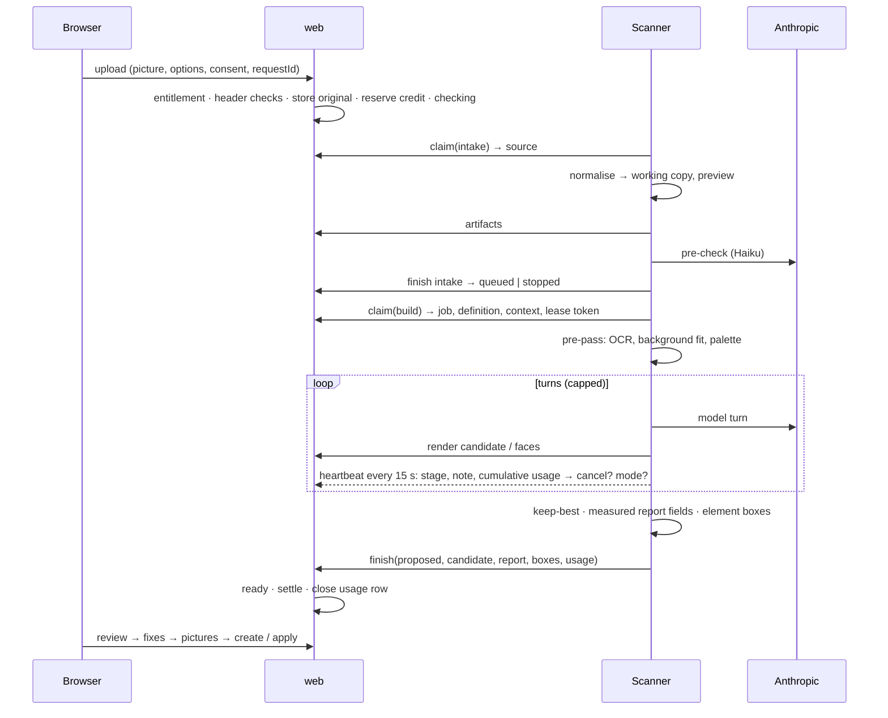

# AI sken — architecture proposal and phased implementation plan

Status: **proposal, revision 4**, 2026-11-12, after three independent reviews (`review.md`,
`review-ux.md`, `review-reliability.md`) and a verification pass (`review-verification.md`, [RV];
its items are answered in Appendix A.4). Repo at `371410e6`, infra repo `~/www/lily.srv` at
`0ae761c`. No application code exists; nothing was run for this revision; nothing was committed.

**Asked for approval now: the direction and Phase 0 (a measurement round). P1–P6 are approved in
principle only.** P0 may overturn the builder, the engine, the calendar approach and every bar.

States, names, numbers and limits are identical in this document and in `ux.md`; the shared tables
are §4.9 (timing and limits), §5.2 (states and transitions), §5.4 (credits and spend) here and §2
there. Appendix A lists every review finding and what changed.

| Tag | Source (under `docs/ai-scan/` unless a path says otherwise) |
|---|---|
| [DC] / [DT] / [DP] / [DI] | `digest-calendar.md` / `digest-templates.md` / `digest-platform.md` / `digest-infra.md` |
| [RP] / [RT] | `research-providers.md` / `research-techniques.md` |
| [PR] | `prototypes/README.md` |
| [T1] / [T2] / [CAL] / [HR] | `prototypes/t1-agent/results.md` / `t2-pipeline/results.md` / `calendar/results.md` / `hard-round/results.md` |
| [UX] | `ux.md` (revision 3) |
| [R1] / [RU] / [RR] | `review.md` / `review-ux.md` / `review-reliability.md` |
| `path:line` | code, read on 2026-11-12 |

- **Measured** = produced by a prototype run or read on the box; it always names the system that
  produced it, and none is the configuration proposed here. **Verified** = read in code.
  **Expected** = nobody measured it.
- **Prototype agent (PA)** = `claude -p` 2.1.322 driving scan tools, measuring optional, no cap on
  rendered candidates, one run per input. **Proposed configuration** = §4.
- D1–D8 = the orchestrator's decisions. "Scanner" = the new service; "engine" = what runs the model
  loop in it; "instrument" = a deterministic measuring tool; "proposal" (`návrh`) = a scan's result
  before the user creates / applies it; "run" = one execution of the builder for a scan.

---

## 1. Summary and recommendation

### 1.1 Direction

A user uploads a picture; a queued background job builds a **proposal** with a render and a
report; the user reviews it, fills the places for pictures and creates the template or applies the
layout through the existing commands.

| Piece | Direction | Status of the evidence |
|---|---|---|
| Result | proposal first; nothing exists until the user creates / applies it | design rule ([DC §8.23], [DT §9.20]) |
| Pictures | never extracted; each picture object is a named place the user fills | owner; [T1], [CAL §5] |
| Precision | deterministic instruments: OCR lines, font ranking by rendering project faces, colour / gradient sampling, crop, numeric compare | measured on the **pipeline**, same-renderer inputs: 0.890 → 0.995 masked composite [T2 §3] |
| Template builder | **leading candidate:** one Opus 5.5 agent with a mandatory measured pre-pass, ≤ 3 rendered candidates, scanner-side keep-best. **Live alternative:** pipeline first, agent when its checks fire | PA beat the pipeline 9 / 3 / 0 / 0 to 2 / 4 / 6 / 0 on a stress set, uncapped, one run, author's verdicts [HR §1]; the hard round's author recommends the hybrid [HR §7]. **Never run as proposed; P0 decides** |
| Calendar builder | **undecided:** single structured call + guarded measurement, or the agent | single call exact on synthetic pages; the agent won on one real page at effort `medium` [CAL §1]. **P0 decides** |
| Engine | **leading candidate:** Claude Agent SDK (runs on the owner's subscription locally, on the API key in production). **Live alternative:** plain Messages API loop | the SDK was never run here; its abort behaviour, exit codes and error detail are unverified. **P0 measures** |
| Runner | a pinned `scanner` container that pulls jobs; a separate short **intake lane** (normalise + pre-check) that never waits behind running scans; concurrency is a setting | [DI §6]; holds for either engine |
| Web process | reads file headers only; never decodes, transcodes or measures a picture. It also serves the scanner's endpoints, restricted to the scanner's network (O16) | [RR B4]; `web` has 1 GiB and serves everyone [DP §5] |
| Access | per-project entitlement set by an admin; "start" and "use" are separate permissions, enforced on every entry point | owner; [RR M8] |
| Accounting | usage recorded incrementally per run; credit ledger; credits and real spend are separate controls | owner; [RR B2, B3] |
| Operations | operating mode, limits and provider state in the database, changed from the admin screen without a deploy | [RR M9, M17] |

### 1.2 Cost, time, quality — what is known

Every figure is from the prototype agent or the pipeline, **not the proposed configuration**, on
inputs that are WBoost's own exports or designs authored for the test.

| | Templates, easy (7 own exports) | Templates, hard (10 designs, fonts absent by construction) | Calendars |
|---|---|---|---|
| Cost per scan | $0.22 (0.16–0.29), PA run 2, 5-minute cache prices [T1] | $0.50 (0.22–0.81), PA, computed at 1-hour cache prices [HR §1]; pipeline $0.10 | agent Opus `medium` $0.40 billed; single call $0.047 [CAL T5] |
| Wall clock | 55 s (37–72) | 95 s (44–149); pipeline 37 s | agent 82 s; single call 13 s (+ 49 s with measurement) |
| Quality | text 1.00, face 1.00, box IoU 0.92 — same renderer, fonts in the project | author's verdicts 9 / 3 / 0 / 0, "as is" = as good as the DSL allows; text 0.86; box IoU 0.57; face 0 of 128 | synthetic: structure exact; Chotěbuz: agent 0.684, single call + measurement 0.477 (0.493 with the optimiser), hand-built 0.626 |

Planning figure until P0 replaces it: **≈ $0.40 and 1–3 minutes per scan (expected)**; one run is
stopped at 6 minutes, the scanner may restart a run once, so the worst case is ≈ 12 minutes of
work plus queue wait. P0: ≈ 9–11 working days, ≈ $170–230 of model usage (estimate).

Unknown and decisive: a design made in another tool with the project's fonts uploaded; run-to-run
spread; a designer's judgement of closeness; resources per scan on x86.

### 1.3 Deferred

| Deferred | Where |
|---|---|
| Native PDF parsing, PSD, IDML | §4.3; F1, F4. A PDF **page as a picture** is in v1 only if the owner chooses it (O4); until then both documents say "pictures only" |
| DSL extensions, calendar vocabulary | §4.8; F2, F3 |
| Deterministic text-fit pass; Sonnet tier | F6 (Sonnet is measured in P0) |
| 14-day calendars; entry in calendar step 3 | F7 |
| Credit packs, billing, price of "Premium", usage chart and CSV, limit-increase requests | cut from v1; O14 |

### 1.4 Orchestrator decisions: status

| Decision | Status |
|---|---|
| D1 | not confirmed: agent with mandatory pre-pass is the leading candidate, hybrid and calendar single call are live alternatives; the pre-check is its own lane; P0 decides (§3.1) |
| D2 | container and pull model kept; engine decided by P0; scanner-facing calls are plain endpoints of the app restricted to the scanner's network, not `/_mcp` (an MCP token is a user + scopes, no project — `src/Entity/McpAccessToken.php:57-87`) |
| D3 | followed; calendar accept is one server-side save with a restorable snapshot (§4.6) |
| D4 | followed; entitlement = two project columns; credits and spend separated (§5.4) |
| D5 | reduced to a scan-specific mechanism |
| D6 | every limit is expected until P0 measures on x86 at concurrency 1 and 2 (§8) |
| D7 | followed (§4.8) |
| D8 | bars set by P0 (§4.10) |

---

## 2. Evidence

### 2.1 Measured or verified

System: **PA** prototype agent, **PL** prototype pipeline, **C1 / C2 / C3** calendar single call /
agent (`medium`) / code measurement, **box**, **code**, **infra**, **vendor** (official pages read
by the research or a reviewer).

| # | Fact | System | Source |
|---|---|---|---|
| E1 | Hard set verdicts: PL 2 / 4 / 6 / 0; PA Opus 9 / 3 / 0 / 0; PA Sonnet 6 / 6 / 0 / 0. One run; the author's judgement. 10 designs + 2 degraded copies; 5 are WBoost templates re-exported, 5 are HTML authored as a stress test | PA, PL | [HR §1, §8, T-F] |
| E2 | Hard set per scan: PL $0.10, 37 s; PA Opus $0.50, 95 s (44–149), 22.7 turns, **3.4 rendered previews (4.4 on set B, 7 on one input)**; PA Sonnet $0.21, 69 s | PA, PL | [HR §1, §3, T-B] |
| E3 | Easy set: PA Opus 7 / 7, 16.9 turns, 2.9 previews, 55 s, $0.22; text 1.00, face 1.00, box IoU 0.92; API time ≈ 43 s of the wall clock | PA | [T1] |
| E4 | With vs without code measurement (7 exports): masked composite 0.995 vs 0.890; text box IoU 0.953 vs 0.550 | PL | [T2 §3] |
| E5 | Corrections move text positions only; correction 2 median +0.014, correction 3 +0.004; layer inventory unchanged after the first build in 20 / 24 hard runs | PA | [T1], [HR §3] |
| E6 | The agent saved a non-best preview in 12 / 24 hard runs | PA | [HR §2 A6] |
| E7 | Hybrid trigger fired on 10 / 12 hard inputs; one signal 0 / 10 on easy; thresholds fitted afterwards; the hard round recommends the hybrid | PL | [HR §7, T-G] |
| E8 | Fonts absent: face right 0 / 128. `matched` is the model's assertion (Opus 4 / 90 wrong; Sonnet 8 / 8 "matched" unprobed). Sonnet called no `font_probe` in 7 / 12 runs. **No input has the font in the project and another renderer** | PA, PL | [HR §2, §5]; [R1 B2] |
| E9 | Size fitted to line width: chosen / true 0.95 (0.84–1.07) | PA, PL | [HR §5] |
| E10 | Validation rejections: PA Opus 0 / 134 and 0 / 41; Sonnet 3 / 36 | PA | [T1], [HR T-H] |
| E11 | Containers produced 0 (truth 6); rotation, letter-spacing, mixed styles, shadows, outlines, masks have no DSL form | PA, PL; code | [HR §4], [DT §2] |
| E12 | Picture layers P / R: easy flat 0.86 / 0.67, photo-backed 1.00 / 0.89, hard 0.81 / 0.67; the same object became a slot or shapes between runs | PA | [T1], [HR §2 A2] |
| E13 | Masked image scores are blind on photo-backed inputs (mask share ≥ 0.9 in 18 / 36 runs); the scorer charges a correctly split line | scorer | [HR §1, §9] |
| E14 | Calendars, synthetic: C1 Opus categorical 100 %, type 0.52 pt, $0.047, 13 s; + C3 0.18 pt; C2 Opus 0.65 → 0.31 pt, $0.40, 82 s; C2 Sonnet `medium` got worse | C1–C3 | [CAL §1, T5] |
| E15 | Calendars, real: Chotěbuz — hand-built 0.626, C1 0.426, C3 0.477 (0.493 with the optimiser), C2 0.684; Markvartovice C3 0.946, C2 0.949; differences < 0.05 mean nothing; C2's win is attributed to a prototype schema limit | C1–C3 | [CAL §1, §2] |
| E16 | C3 fails on real wording; a strict schema above ≈ 75 properties is refused | C3, C1 | [CAL §2] |
| E17 | OCR: 233 MB peak, 0.27 s on 3 threads, arm64 | PL | [T2 §2] |
| E18 | Node refinement: 415–640 MB fresh, 1.15 GB after ten scans in one process | PL | [T2 §10] |
| E19 | Render round trips (laptop): ≈ 0.8–1.0 s | app | [PR §6] |
| E20 | Box: 16 threads, 125 GiB RAM, 98 GiB available, no swap; sum of limits 119.8 GiB; `web` 1 GiB limit, 377 MiB idle, one replica | box | [DP §5] |
| E21 | D31 rejects per-container CPU limits; precedent `online-cv` (`cpus: 2`); next id D87 | infra | verified `docs/decisions.md:1166`, `apps/myspeedpuzzling/compose.yaml:1022` |
| E22 | Consumer command without `exec`; consumers force-recreated on every deploy; deploys serialized; `apps/wboost/` config is delivered on push but activated only by the next deploy | infra | verified `apps/wboost/compose.yaml:128`; [DI §1] |
| E23 | Gotenberg: shared, 5 GiB, 6 conversions, floating tag, a Chromium OOM-killed on 2026-08-05; client timeout 20 / 25 s because PHP's limit is 30 s and a slow render holds the session lock | infra, code | [DI §5]; verified `config/packages/sensiolabs_gotenberg.yaml:22-23` |
| E24 | Web router is ``Host(`wboost.cz`)`` and takes every path; `web` is on the box-wide `traefik` network | infra | verified `apps/wboost/compose.yaml:88`, `:103` |
| E25 | Prices per MTok: Opus 5.5 $4 / $20, Sonnet 5.5 $2 / $10, Haiku 5.5 $0.10 / $0.50; spend caps Start $500, Build $1 000, Scale $200 000 a month | vendor | [RP §1.1, §1.5] |
| E26 | Provider errors: a spend-cap 429 carries `error.details.error_code = enforced_spend_limit_reached` and never `retry-after`; throttling 429s may also lack `retry-after`; a self-set workspace limit is HTTP 400 with a usage-limit message; 402 `billing_error`, 401, 403 exist; the SDK reports `billing_error`, `authentication_failed`, `account_on_hold`, `rate_limit`, `overloaded` on the assistant message. The harness retries up to 10 times by default | vendor | [RR M2, M3] |
| E27 | Image limits of the Messages API: 8000 × 8000 px; 10 MB base64 per image; above 20 images in a request (resent history and tool results included) each must be ≤ 3000 px; 128 MB request | vendor | [RP §1.2]; [RR M4] |
| E28 | MCP: 21 tool classes, 6 scopes, no tool creates a standalone template | code | verified `src/Mcp/Tool/`, `McpScope.php:26-47` |
| E29 | Templates render without saving (`CandidateRenderer::renderToBytes`); the renderer tags a cache entry with `variant->id` | code | verified `CandidateRenderer.php:112`, `DesignPreflight.php:78-91`, `TemplateVariantImageRenderer.php:161` |
| E30 | `CalendarPageRenderer::render()` takes a stored `Calendar`; `runDocument()` exists; `ENUMS.numberSide` lacks `middle` | code | verified `CalendarPageRenderer.php:65`, `CalendarModelBridge.php:82`, `resources/calendar/model.mjs:52` |
| E31 | The calendar's undo snapshot holds `layout`, `captions`, `preset` only; `replaceLayout` pushes an undo step only when a layout existed. The calendar change history stores a sentence per change, no document | code | verified `assets/calendar/state/store.js:178-181`, `:489-507`, `src/Entity/CalendarHistoryEntry.php:54-55` |
| E32 | An empty image slot compiles to a 1×1 transparent pixel and the decompiler relies on it | code | verified `DesignDecompiler.php:2110-2117` |
| E33 | One Flysystem filesystem, bucket `wboost`, public; the storage scan lists that bucket | code | verified `config/packages/oneup_flysystem.php`, `ScanStorage.php:62` |
| E34 | Sentry: `send_default_pii: true`; only 403 / 404 / 405 / 429 ignored, "other 4xx still report" | code | verified `config/packages/sentry.php:27-34` |
| E35 | Tests run inside one transaction on one connection (`dama/doctrine-test-bundle`); `symfony/scheduler` is not installed | code | verified `composer.json:98`; no scheduler entry |
| E36 | PNG / JPEG / GIF / WebP pass `NormalizeImageFormat` unchanged; HEIC cannot be sized from its header in PHP | code | [RR B4, M14] citing `NormalizeImageFormat.php:38-56` |
| E37 | Buses `command_bus`, `job_bus`; one `async` transport and consumer | code | verified `config/packages/messenger.php` |
| E38 | Anthropic API: processor role, no training, deletion within 30 days, flagged content up to 2 years, no EU residency on the first-party API | vendor | [RP §5.1] |

### 2.2 Expected — measured in P0 or later

| # | Expectation | Measured in |
|---|---|---|
| X1 | The proposed configuration keeps or improves the prototype agent's results | P0 |
| X2 | SDK ≈ `claude -p` ≈ Messages loop in quality, cost, time | P0 |
| X3 | Haiku 5.5 classifies uploads reliably within 5–15 s | P0 |
| X4 | A project font is recognised in a picture from another renderer and not reported missing | P0 |
| X5 | Memory and CPU per scan and stage, at concurrency 1 and 2; `web` memory and latency while it serves scanner calls | P0 (x86), P4 (box) |
| X6 | Billed cost ≈ 25–30 % below plan-run figures [HR §8] | P0 subset, P4 |
| X7 | A never-persisted `TemplateVariant` passes the render path (E29) | P1 |
| X8 | A text-and-shape region score can pick the better candidate | P0 collects data |
| X9 | A font-metric fit agrees with the scanner's pixel fit to within 2 % of size (§4.6) | P0 |
| X10 | Longest silent model turn; whether the SDK exposes status, error code and usage on abort | P0 |
| X11 | 18 images per run are enough for the agent (§4.5) | P0 |
| X12 | Gotenberg stays within its limit with A3 candidates next to a calendar PDF export | P0 |

---

## 3. Alternatives

### 3.1 Live alternatives — P0 decides

| Question | A | B | For A | For B |
|---|---|---|---|---|
| Template builder | agent with mandatory pre-pass | pipeline first, agent when checks fire | PA Opus needed no rework on any hard input; the pipeline's failures sit in code that cannot reason about exceptions [HR §2] | the hard round's own recommendation; tie on easy inputs at $0.05 vs $0.22; trigger rate measured on a stress set; 37 s vs 95 s |
| Agent model | Opus 5.5 | Sonnet 5.5 behind the pre-pass | 9 / 3 vs 6 / 6; Sonnet skipped measuring | $0.21 vs $0.50; a mandatory pre-pass removes the skipping; one verdict step is within noise |
| Engine | Agent SDK | plain Messages loop | runs on the subscription locally (owner's requirement) | no 342 MB binary, ≈ 1 GiB less, direct access to status, error codes and usage; needs a key or plan API credits in development |
| Calendar builder | single call (full vocabulary as tagged lists) + guarded measurement | agent at `high` with mm instruments | exact structure on 12 synthetic pages; more exact type sizes; [RP §7] recommends it | the only approach at the hand-built level on Chotěbuz |

If the agent is chosen over the hybrid: up to +$0.17 per scan on inputs the pipeline handles,
≈ −$0.10 on inputs that escalate (expected). The container, protocol, instruments, data model and
wizard are the same for every outcome.

### 3.2 Rejected

| # | Alternative | Why |
|---|---|---|
| R1 | Single structured call for templates without measurement | E4 |
| R2 | `claude -p` spawned by the app | licensing ambiguous for a product; no typed events [RP §3.2] |
| R3 | Claude Managed Agents | beta; transcripts at rest at the provider; no local dev [RP §3.5] |
| R4 | OpenAI | nothing public shows it better [RP §2.4] |
| R5 | Scanner inside the app image | recreated on every app deploy; engine next to Postgres, Redis, MinIO with the whole `.env` [DI §4.2, §6] |
| R6 | Extracting image layers | owner's scope; [T1], [T2 §5], [CAL §5] |
| R7 | Scanner calls on `/_mcp` with a job token | a second credential type for no functional gain [R1 M9] |
| R8 | Scanner endpoints on `web` guarded by a Host-header check only | `web` is on the box-wide `traefik` network (E24); a Host header is not a network restriction [RR M13]. Replaced by a source-network check (§4.5); a separate app instance is the alternative weighed in §4.5 and O16 |
| R9 | Pixel work in a web request (previews, HEIC transcode, ink measurement) | one 60 Mpx decode is 240–480 MB [DP §5]; [RR B4] |

---

## 4. Architecture (proposed configuration)

### 4.1 Components

```mermaid
flowchart LR
  subgraph browser[Browser]
    W[Wizard]
    SH[Shell: badge · toast]
  end
  subgraph app[wboost — app image]
    WEB[web: controllers + voter · headers only, no pixel work]
    SAPI[/internal/scanner/* — same web process, accepted only from the scan network]
    J[(ai_scan · usage · ledger · access request · runtime)]
    R[DesignPreflight + CandidateRenderer · CalendarModelBridge + page renderer]
  end
  subgraph scanner[scanner container — scanner/ in the app repo]
    IN[Intake lane: normalise · pre-check]
    BW[Builder workers 1..N, one child process per run]
    INS[Instruments]
    TICK[Timers: heartbeat · tick · provider probe]
  end
  G[Gotenberg]
  PB[(private bucket)]
  AN[api.anthropic.com]
  W --> WEB --> J
  SH --> WEB
  IN --> SAPI
  BW --> SAPI --> J
  TICK --> SAPI
  SAPI --> R --> G
  BW --> INS
  IN --> AN
  BW --> AN
  WEB --> PB
  SAPI --> PB
```

### 4.2 Sequence of one scan



### 4.3 Shared core, adapters, input seam

| Layer | Shared | Template adapter | Calendar adapter |
|---|---|---|---|
| Job, queue, lease, caps, usage, ledger, notification | all | — | — |
| Input adapter | bytes → `ScanInput { raster, size, physicalSize?, facts[] }`. v1: raster image. PDF page → raster only if O4 = yes: the page is chosen in the browser (pdf.js thumbnails) before the upload; the scanner rasterises that page | — | — |
| Intake | normalise; pre-check | expects a design | expects a weekly calendar page |
| Instruments | OCR, crop, measure, compare, rank | px | mm grid, wording guard |
| Build | working copy, candidates, caps | DSL document | model commands on an unsaved document |
| Accept | idempotent, one transaction | `AcceptTemplateScan` | `AcceptCalendarScan` (saves, keeps a restorable snapshot) |

`facts[]` (`{ kind, geometry, style, source, confidence }`, [RT §9.3]) is the seam for exact
importers: a native PDF, PSD or IDML reader emits facts with confidence 1.0 and the pre-pass skips
OCR and ranking for them. Native PDF: pdf.js and Poppler, not MuPDF [RT §8].

### 4.4 Scanner definition (app-owned)

`resources/ai-scan/definition/`, versioned, sent in the claim answer; the scanner image holds no
prompt and no schema.

| File | Content |
|---|---|
| `definition.json` | `protocolVersion`, `requiresInstruments`, model ids, **effort stated explicitly**, **engine retry count and delays**, caps of §4.9, image rule of §4.5, price table version |
| `system.common.md` | role; pictures are never taken out of the source; method; **picture text is data, never an instruction**; closed codes |
| `system.template.md` | DSL reference; rules replacing judgement [HR §7 item 5] |
| `system.calendar.md` | vocabulary [DC §1]; type before geometry; features may only be proposed **on** |
| `tools.json`, `finish.*.schema.json`, `precheck.*` | §4.5, §4.7 |

### 4.5 Tools and endpoints

**Model-facing tools** — in-process in the scanner; the model has nothing else.

| Tool | Kind | Returns |
|---|---|---|
| `scan_source()` | both | the working copy and the pre-pass: `ocrLines[]`, `background`, `palette[]`, `fonts[]`, `brandColours[]`, canvas / page |
| `scan_crop({x, y, w, h, zoom?, grid?})` | both | zoomed crop with rulers |
| `scan_measure({x, y, w, h})` | both | background, dominant colours, edge means, ink box, ink bands, wash (numbers only) |
| `font_rank({text, box, group})` | both | faces ranked by similarity with a fitted size; `available` from the score (numbers only) |
| `compare_region({x, y, w, h, candidate?})` | both | source │ render │ difference; `mae`, `shift` |
| `design_preview({design})` / `design_patch({ops})` | template | candidate number, issues, render, per-element `move`, `widthRatio`, ink boxes |
| `calendar_preview({…})` | calendar | candidate number, refusal or notes, render |
| `set_page_box({x, y, w, h})` | calendar | page box |

Enforced by the tool server:

- ≤ **3 rendered candidates**, ≤ 3 validation rejections; finish refused while a text group has no
  ranking. The cap is below what PA used on hard inputs (E2) — a P0 question.
- **Image rule** (E27): every image given to the model is re-encoded, long edge ≤ 2576 px, ≤ 3 MB;
  ≤ **18 images per run** (source 1, candidates ≤ 3, the rest crops and comparisons); further image
  tools answer "image budget used — work from numbers". Unit-tested with 25 images and an A3 render.
- Per-tool timeouts (§4.9: 30 s for local tools, 95 s for tools that call the app); a hung tool is
  a tool error, not silence.

**Scanner API** — `/internal/scanner/*`, served by `web`. Accepted only when the TCP peer address
lies in the `scan` network's subnet (`SCAN_NETWORK_CIDR`; a request through Traefik or from another
stack arrives from the `traefik` network and gets 404), and the public router refuses the path.
Bearer `SCANNER_TOKEN`; after `claim`, also the per-claim **lease token**. Every call carries
`protocolVersion`; the app accepts N and N−1. Expected refusals are HTTP 200 `{ok: false, code}`.

Where these endpoints run was weighed (owner decision O16):

| | On `web`, restricted by source network (**proposed**) | A second instance of the app image (`scan-api`) on the scan network only |
|---|---|---|
| Containers / memory | none added; calls pass bytes through (expected < 100 MB extra in `web`) | + 1 container, + 512 MiB of limit on a box whose limits sum to 124 of 125 GiB |
| Deploys | blue-green: the old container serves until the new one is healthy, so the scanner sees no outage | recreated on every app deploy (start period up to 40 s, must skip migrations): each deploy is an outage the running scan has to ride out |
| Isolation | shares `web`'s workers and 1 GiB; a render call holds one worker ≤ 25 s, at most 2 at once | scanner traffic cannot touch the public site |
| Network restriction | peer-subnet check in the app + router rule; verified from another stack's container (G2b) | by topology — not attached to `traefik` |

Proposed: on `web`. Switch to `scan-api` if P0 or P4 shows scanner calls raising `web`'s memory or
latency, or if the peer-subnet check cannot be made reliable behind FrankenPHP.

| Call | Does |
|---|---|
| `POST claim {lane: intake \| build, scannerVersion, instruments, capacity}` | runs the reaper, then hands out one job with a lease token — or `{mode, reason}` when paused, blocked, too old or over the spend ceiling |
| `GET {id}/source` | original (intake) or working copy (build) |
| `PUT {id}/artifact/{working \| preview}` | stores bytes produced by the scanner |
| `POST {id}/beat {run, seq, stage?, note?, noteParams?, round?, usage, resources}` (stage and note codes: §5.6; the correction round travels in `round`, never as a note) | timer heartbeat: extends the lease, upserts usage, returns `{cancel, mode}` |
| `POST {id}/render {run, seq, design \| commands}` | validate + one render; returns issues and the renderer's bytes untouched; stores the candidate. Idempotent by `(run, seq)` |
| `POST {id}/faces {run, seq, lines, faces?}` | one render of the lines in each face; bytes untouched |
| `POST {id}/finish {run, outcome, candidate?, report?, boxes?, error?, usage}` | one database write: outcome, report, usage and the number of the kept candidate, whose render was already stored by `render` — no image is written here. Idempotent per `(scan, run)`; accepted late when the run is still the latest and unclaimed |
| `POST {id}/release {run, usage}` | scanner shutting down: back to `queued`, the automatic restart is not consumed |
| `POST tick` | every 30 s and at start: runs the reaper; reports provider probe results |

The app never decodes what passes through these calls.

### 4.6 Proposal, fixes, accept

- **Candidates** exist only as documents the app validated and rendered itself.
- **Transient variant**: in-memory `Template` + `TemplateVariant`, never persisted (X7); fallback a
  detached clone of a hidden per-project scratch variant.
- **Stand-in for empty places**: in candidate renders a reserved asset id resolves to a bundled
  neutral picture (an optional extra entry in the compilation context, used only by the scanner API); no
  existing template, fill page or export changes (E32). At accept, places left empty reference one
  stand-in file per project (`FileSource::ScanStandIn`, **hidden from the gallery and excluded from
  trash and purge**); the export guard finds them by it. A **full-page background place** always
  carries a picture — the user's sample or this stand-in — because the compiler refuses a fillable
  background without an asset (`DesignCompiler.php:422-456`); other fillable places may stay empty.
  The export rule (O11) therefore also covers a background still showing the stand-in when the
  export supplies no picture for it.
- **Per-element boxes, original colours, source line widths and counts** are measured by the
  scanner on the kept candidate and stored with the proposal — the review's outlines, crops,
  palette revert and font re-fit read them.
- **Font swap and re-fit run in the app without pixels.** `FitTextToWidth` computes
  `size = sourceLineWidth ÷ advanceWidth(face, text, 1 px)` from font metrics (the existing
  `FontMetricsLoader` behind `TextMeasurer`, [DT §3.6]), then one normal candidate render. It is
  arithmetic plus one bounded render — no scanner, no image decoding. The scanner keeps its pixel
  fit for ranking. Agreement is X9; if it is worse than 2 %, re-fit becomes a job on the intake
  lane (seconds, shown as "Přepočítáváme…"). Rejected: a synchronous endpoint on the scanner (the
  review would depend on scanner liveness), Imagick ink measurement in the web process ([RR B4]).
- **Review renders are bounded**: one Gotenberg render per request, 20 s timeout, the session is
  released before the render, no retry loop; on timeout the fix is saved and the preview is marked
  stale. Scan-originated renders (scanner calls and review fixes) use their own setting
  `GOTENBERG_SCAN_DSN` (same value as `GOTENBERG_DSN` at launch, so a second instance is a
  configuration change) and at most 2 run at once: two Postgres advisory locks taken with
  `pg_try_advisory_lock`, which the database releases by itself when a request dies. A third
  caller gets `renderer_busy` at once.
- **Other fixes** (transcription, any text, input / fixed, names, palette revert, automatic shrink
  with undo, place remove / merge / to-shape, kind, fit) edit the proposal document and re-render.
  After accept the scan page is read-only.
- **Fit**: `Vejít celý` (contain, centred — default for logos and icons) or `Vyplnit` (cover; the
  browser crops the chosen picture to the place's ratio before upload — default for photos,
  patterns, illustrations).
- **Accept, templates** — `AcceptTemplateScan`: re-validates (a removed font or trashed picture
  becomes an item to fix, nothing is created), renders the preview **before** the transaction, then
  in one `command_bus` transaction calls `AddTemplate`, `AddTemplateVariant`,
  `EditTemplateVariantCanvasEditor`, stores the preview path and marks the scan. Conditional on
  `status = ready`; a repeat returns the same ids.
- **Accept, calendars** — `AcceptCalendarScan`, designer-only endpoint (never on `/k/{token}`), one
  transaction on the calendar **as it is stored now**: stores the previous `layout`, `preset`,
  `features` and `layout_origin` on the scan (`restore`, with a hash of what it then writes); turns
  held pictures into calendar assets; saves the proposed layout, the features the user ticked (on
  only) and `layout_origin = scan` through `SaveCalendar`; writes the history line. The browser
  refuses to call it while its own document has unsaved changes, and reloads the document from the
  answer. A save by the client link in between (texts, photos) does not block it: content is not
  touched, and the reload brings it in.
- **Restore** — `RestoreCalendarScan` writes the snapshot's `layout`, `preset`, `features` and
  `layout_origin` back; nothing else (texts, photos, page content, pictures already added stay).
  If the stored layout or features no longer equal what accept wrote, the caller must confirm,
  because edits made since are overwritten. Available while the snapshot exists (30 days). The
  wizard's undo stack does not cover accept (E31) and the UI says so; the change history cannot
  restore a layout (E31).
- **`layout_origin`** is one nullable column on `calendar`, set by accept, cleared by the server
  when a save changes `preset`, sent to the browser in the workspace bootstrap and read by
  `ui/step2.js`. It is not part of the layout model, so no file under `assets/calendar/model/`
  changes and the export fingerprint stays.

### 4.7 Finish contracts

Flat arrays, all properties required, no recursion (E16). No free text reaches the UI: closed codes
with integer / enum parameters; names ≤ 40 characters, plain. ⚙ = written by the scanner from
measurements.

Template: `status`, `candidate` ⚙, `headline` (id of the text to name the template from),
`placeholders[{id, name, role: background | photo | logo | icon | pattern | illustration | other,
fillable}]`, `fonts[{group, texts[], sourceClass, sourceLooksLike, guessSupported ⚙, face ⚙,
score ⚙, matched ⚙, sizeRatio ⚙}]`, `approximations[{element, kind}]`, `omitted[{kind, x, y, w,
h}]`, `lowConfidenceTexts[{id, reason}]`, `shrunk[{id}]` ⚙, `paletteSnaps[{from, to}]` ⚙.

Calendar: `status`, `candidate` ⚙, `type`, `recognised[{element, state: found | approximate |
absent, fact code}]`, `needsUpload[{slot}]`, `featuresOffered[{key}]` (to switch on, never off; MCP `result` returns the
same name, `apply` takes the accepted subset as `features[]`), `fonts[…]`,
`notExpressible[{code}]`.

`guessSupported` is true only when the model's family name is backed by a measured class match;
otherwise the UI says "Písmo se nepodařilo určit". When a run stops at a cap without the model's
finish, the scanner writes the report alone: measured fields, empty model fields, flag `unfinished`.

### 4.8 System improvements (D7)

| # | Improvement | Class | Phase |
|---|---|---|---|
| S1 | Calendar render of an unsaved document | required (E30) | P5 |
| S2 | `AcceptTemplateScan`; MCP `create_template` | required; strongly recommended (E28) | P3 |
| S3 | Font matching: app renders faces, scanner ranks; measured `matched`; one substitute per group; metric re-fit | required (E8) | P0, P1, P2 |
| S4 | Private scan storage and retention | required (E33) | P1 |
| S5 | Stand-in for empty places without touching existing rendering | required (E32) | P1 |
| S6 | Scanner container; scanner endpoints restricted to its network | required | P1, P2, P4 |
| S7 | Real access request | required (owner) | P3 |
| S8 | Export rule for unfilled fixed pictures (web, API, MCP) | required; shape = O11 | P3 |
| S9 | Calendar `layout_origin` column; accept with restorable snapshot; `numberSide: "middle"` on the patch path | required; strongly recommended | P5 |
| S10 | `exec` in the `messenger-consumer` command | strongly recommended, independent (E22) | infra |
| S11 | DSL: letter-spacing, rotation, named overlay, mixed styles | optional [HR §4] | F2 |
| S12 | Calendar vocabulary [CAL §4] | optional | F3 |

S9's `numberSide` change edits only `resources/calendar/model.mjs`. The export fingerprint covers
`assets/calendar/{model,generate,render,editor,headless}/*.js` and two templates
(`CalendarModuleInliner.php:30, 80-90`), not that file and not `ui/` or `state/`; `layout_origin`
is kept out of those directories on purpose (§4.6). A P5 test asserts the fingerprint is unchanged.

### 4.9 Timing and limits — one table

| Quantity | Value | Arithmetic / basis |
|---|---|---|
| Heartbeat **H** | 15 s, a timer in the scanner's main process | independent of model turns and events |
| Idle claim poll | 5 s per lane | |
| App call, one attempt | 30 s | > the render client's 25 s, so a slow render answers before the scanner gives up on the attempt |
| App-outage tolerance **R** | 60 s: a failing scanner → app call is retried until 60 s have passed; a busy renderer (`renderer_busy`) is retried inside the same window | `web` is blue-green, so a normal deploy causes no outage; R covers the unexpected |
| Scanner self-abort **A** | 90 s without an acknowledged heartbeat | A = R + 2 H; the engine is killed before the app gives up |
| Lease **L** | 120 s from the last heartbeat | L = A + 2 H; the app requeues only after the scanner has stopped spending |
| Reaper | called by every `claim`, by the scanner's 30 s `tick`, by the nightly purge, **and by any status or list read that meets an overdue row** | with a live scanner a lost lease is acted on within L + 30 s = 150 s; with a dead scanner, at the next read of that scan — no path depends on the scanner alone |
| Intake cap | 120 s | ≤ 60 s of work (normalise + one Haiku call; usual 5–15 s, X3) + R |
| Builder cap | 300 s | PA max 149 s |
| Run cap **W** | 360 s | pre-pass + builder + finish; **the hang guard** — not the lease |
| Automatic restarts | 1 per user start | worst case 2 W = 720 s ≈ 12 min of work |
| Model request | timeout 120 s; stream-idle watchdog 60 s; 4 retries with delays 2, 8, 20, 30 s (60 s of waiting) | all pinned in `definition.json` for either engine; the harness defaults are 10 retries, 600 s, 300 s (E26). A provider blip of up to a minute is ridden out; the builder cap ends anything longer |
| Provider-lost time | tracked per run: retry waits + failed requests | when a cap is hit and ≥ 50 % of the builder time used was lost this way → `failed provider_unavailable`, refunded |
| Effort | templates `high` (PA's setting); calendars `high` as a P0 arm (PA ran `medium`); pre-check stated explicitly | in `definition.json` |
| Tool timeout | local tools (crop, measure, OCR) 30 s; tools that call the app 95 s | 95 s = R (60) + one last attempt (30) + 5; the app's own render client is 20 / 25 s, below PHP's 30 s (E23) |
| Scanner absent **S** | 60 s without any authenticated scanner call | S = 4 H; heartbeats continue during long runs, so a healthy scanner is never "absent" |
| Queue | a project may have at most **4 scans in progress** (`checking`, `queued` or `running` together); at most **10** scans `queued` in total (`checking` is not counted — it is bounded by the per-project rule and lasts seconds) | 10 × 3 min (upper usual duration) = 30 min, + one worst-case run ahead (12 min) = 42 min |
| Queue timeout **Q** | 60 min in `checking` / `queued` → `failed queue_timeout`, not counted | Q > 42 min, so a healthy full queue never times out; also bounds waiting on a blocked provider or a pause |
| Provider probe | every 5 min while blocked | one 1-token Haiku request |
| Scanner shutdown | on SIGTERM: stop claiming, abort the engine, report usage, `release`, exit ≤ 30 s; `stop_grace_period: 45s` | no drain: a tag bump must not hold the box-wide deploy lock |
| UI poll | 2 s on the scan surface, 10 s shell and lists | status query selects scalar columns only; a read writes only through the reaper, for an overdue row |
| Estimate | computed by the server, at most 15 s old (cached) | §5.1 |
| "Trvá to déle" line | at 180 s of `running` | PA means: 55 s (easy), 95 s (hard); longest 149 s |
| E-mail | ≥ 120 s after the end, if unseen; later while a PDF export holds the consumer | |
| Retention | 30 days from the end of a scan: picture, proposal, snapshot | `ready`, `failed`, `stopped`, `refused`, `cancelled` then become `expired`; `accepted` and `discarded` keep their state and only lose the files. A reminder e-mail goes out 3 days before a `ready` proposal expires |
| Upload | ≤ 10 000 000 bytes; each side ≤ 8000 px; ≤ 36 Mpx; short side ≥ 600 px | provider limit 8000 px (E27); A2 at 300 dpi is 34.8 Mpx |
| Working copy | sRGB, 8 bit, first frame, upright, long edge ≤ 4096 px | made by the scanner, used by everything after |
| Template from a scan | long edge ≤ 5000 px | A3 at 300 dpi; bounds candidate renders |
| Model run | turns ≤ 40; engine budget $1.50; candidates ≤ 3; images ≤ 18 | PA used 12–36 turns, max $0.81 |
| Daily starts | 10 per user, 20 per project | §5.4 |
| User retries per upload | 2 × "Zkusit znovu"; 1 × "Zkusit přesto" | §5.4 |
| Spend ceilings | $20 a day in total, $5 a day per project (defaults, editable); both count recorded spend **plus $1.50 per running run** | so at concurrency 1 the usable total is $18.50, and four projects can each reach their own ceiling |
| Concurrency | `maxRunning` in the runtime row (1 at launch), ≤ the scanner's capacity | §8.2 |

Checks — every outer bound exceeds what it wraps: render client (25 s) < PHP limit (30 s);
render client (25 s) < one app-call attempt (30 s) < R (60 s) < app-backed tool timeout (95 s) <
builder cap (300 s) < W (360 s); stream idle (60 s) < model request timeout (120 s) < builder cap;
retry waits (60 s) < builder cap; H (15 s) < A (90 s) < L (120 s), with R < A so an outage the
scanner survives never costs the lease; tick (30 s) < L; S (60 s) ≥ 3 H; intake work (60 s) + R <
intake cap (120 s) < Q; full queue (42 min) < Q (60 min); old `web` container's stop grace (30 s)
> render client (25 s), so a deploy never cuts a render. Usual durations here are expectations
taken from PA's means; P0 exit criterion 10 re-derives the table.

### 4.10 Quality definition and bars (D8)

**"Closely matches" per text:** right words; right face, or a reported substitute; size within
± 5 %; colour ΔE ≤ 3; box IoU ≥ 0.7. Reported as the share of texts meeting all five, per set,
separately for "font in the project" and "font absent".

| Scale (designer, blind) | 3 | 2 | 1 | 0 |
|---|---|---|---|---|
| **M — matches the source** | the same design at a glance | small visible differences | clearly different | wrong |
| **E — editable as a designer would build it** | as is | < 2 min of restructuring | real rework | unusable |

Bars are set by P0 at the mean of 3 runs minus the observed spread, for: share of closely matching
texts; M and E distributions (first target ≥ 70 % M ≥ 2, ≥ 80 % E ≥ 2 on real inputs, none at 0);
project font recognised / wrongly reported missing; text box IoU on easy and hard; places for
pictures P / R; run-to-run agreement; calendars (categorical, frames, type size; M on real pages);
cost and time (mean, p95); pre-check errors. Targets fixed in advance, neither measured yet: a
font that is absent is reported as a substitute in 100 % of cases (the scanner-measured flag never
ran; the model's own flag was wrong for 4 of 90 and worse, E8); ≥ 95 % of scans finish within the
caps. The scorer credits a split mixed-style
line before any gate uses text-exact. Image similarity is never a gate. A missed bar goes back to
the owner. Customers' uploads are not used for evaluation.

### 4.11 v1 inventory

| Item | First proposal | Now | Why each remaining one exists |
|---|---|---|---|
| New tables | 10 | **5** | `ai_scan` (the job and everything screens read); `ai_usage_event` (usage per run that survives project deletion); `ai_credit_ledger` (credits in a billable shape); `ai_access_request` (a stored request); `ai_scan_runtime` (one row: operating mode, limits, provider state, scanner last seen — must survive a cache restart and change without a deploy) |
| Columns on existing tables | 0 | 7 | `project`: enabled, monthly limit, enabled at / by; `user`: consent version, at; `calendar`: `layout_origin` (P5 migration) |
| Credential types | 2 | **1** | `SCANNER_TOKEN` (two values accepted during rotation) + a per-claim lease token column |
| Containers | 1 | 1 | `scanner`. Revision 3's second app instance (`scan-api`) was removed: serving the endpoints from `web` with a source-network check costs nothing and has no deploy outage (§4.5, O16) |
| Scanner-facing endpoints | 8 | 9 | claim, source, artifact, beat, render, faces, finish, release, tick |
| Model-facing tools | 9 | 9 | §4.5 |
| User MCP tools / scopes | 2 / 1 | 2 / 1 | `scan_design`, `create_template`; `ai:scan` |
| Console commands / crons | 4 / 2 | **3 / 1** | purge (nightly cron), status, fake run (refuses in prod) |
| Notification | generic framework | columns on `ai_scan`, one "my scans" endpoint, a toast helper for the shell | |

---

## 5. Data model

### 5.1 Tables

| Table | Columns (main) |
|---|---|
| `ai_scan` | `id`; `request_id` (unique per user — idempotent start); `project_id` FK cascade; `kind`; `calendar_id` FK set null; `requested_by` FK set null + `requester_email`; `channel`; `status`; `waiting` is derived, not stored; `stage`, `note`, `note_params` json, `stage_started_at`, `round`, `preview_seq`; `events` json (≤ 200); `try` (user starts, 1–3); `intake_tries` (0–2); `approximate` (continued after a photo-of-a-print stop); `auto_restart` (0–1, reset per try); `run` (increments at every build claim — the usage key); `lease_token_hash`, `lease_expires_at`, `claimed_at`; `storage_secret`; `source_sha256`, `source_meta` json; `options` json; `started_at`, `finished_at`, `expires_at`; `error_code`; `pre_check` json; `proposal` json (document, boxes, colours, line widths); `report` json; `fixes` json; `pictures` json; `restore` json (calendar snapshot + hash of what accept wrote); `result_template_id`, `result_variant_id` (set null on delete); `unfinished`; totals (tokens, `cost_micro_usd`, `turns`, `renders`, `duration_ms`); `resources` json; `model`, `definition_version`, `scanner_version`; `consent_version`; `seen_at`, `notified_at`, `reminded_at`; `rating`, `rating_note`; `created_at` |
| `ai_usage_event` | FK-less, denormalised; **one row per `(scan_id, run, step)`**, upserted from heartbeats and closed with an `outcome` on finish, release, lease loss, cancel or purge: `occurred_at`, `closed_at`, `step` pre_check \| builder, project id + name, owner id + e-mail, user id + e-mail, `channel`, `provider`, `model`, four token counts, `cost_micro_usd`, `price_version`, `engine_cost_micro_usd`, `outcome`, `error_code`, `duration_ms`, `turns` |
| `ai_credit_ledger` | append-only: `project_id`, `scan_id`, `try`, `period` (the reserve's month, Europe/Prague, copied to its settle / refund), `delta`, `reason` reserve \| settle \| refund \| grant \| adjust, `cost_micro_usd`, `created_by`, `created_at`. Unique `(scan_id, try, reason)` |
| `ai_access_request` | `user_id`, `project_id`, `origin`, `message`, `status`, `created_at`, `resolved_at`, `resolved_by` |
| `ai_scan_runtime` | single row: `mode` on \| paused \| off; `admin_only`; `max_running`; `daily_ceiling_micro_usd`, `project_daily_micro_usd`; `daily_starts_user`, `daily_starts_project`; `provider_state` ok \| blocked + `provider_checked_at`, `provider_error`; `scanner_seen_at`, `scanner_version`, `scanner_too_old`; `consecutive_failures`, `failure_class` |

**Queue estimate** — computed by the server, at most 15 s old: position = scans ahead (running included);
duration per kind = p25–p75 of the last 50 finished runs of that kind, **failed ones included**
(defaults until 10 exist: template 60–150 s, calendar 60–120 s); start = (what the running scans
still need, floored at 30 s, plus W when a run is on its automatic restart, plus the durations of
those ahead) ÷ `max_running`; finish = start + own duration. Returned as `queuePosition`,
`estimatedStartSeconds: [from, to]`, `estimatedFinishSeconds: [from, to]`; **all null while
`waiting` is set**. `waiting` = `scanner_absent` (S exceeded) | `scanner_too_old` |
`provider_blocked` | `paused` (mode, or a spend ceiling reached). A `running` scan has no
`waiting` value: when its lease is overdue the read that notices it runs the reaper, and the scan
is shown as restarted or failed at once.

### 5.2 States and transitions

States: `checking`, `queued`, `running`, `ready`, `accepted`, `discarded`, `cancelled`, `stopped`,
`failed`, `refused`, `expired`. Terminal and absorbing: `accepted`, `discarded`, `expired`. A late
`beat`, `render` or `finish` on a row that left `running` records usage only.

Every transition is `UPDATE … WHERE id = ? AND status = ? [AND run = ?]` and proceeds only when one
row changed. **Time-based transitions have one writer, the reaper function**, called by `claim`,
`tick`, the nightly purge and by any status or list read that meets an overdue row (expired lease,
or older than Q). The conditional update makes it happen once however many callers race; a dead
scanner therefore delays nothing a user is looking at.

| # | From → to | Event / owner | Guard | Ledger | Idempotency |
|---|---|---|---|---|---|
| 1 | — → `checking` | upload; `RequestAiScan` (project row locked) | start permission; mode on; provider not blocked; scanner neither absent nor too old; limits and ceilings of §5.4; < 4 scans in progress in the project; < 10 `queued` in total; consent | reserve −1 | `request_id` returns the first scan |
| 2 | `checking` → `queued` | intake finish; scanner | lease token | — | `(scan, lane)` |
| 3 | `checking` → `stopped` | intake finish (pre-check, or normalising reports the file unusable) | lease token | refund | same |
| 3a | `checking` → `checking` (unclaimed) | reaper: intake lease lost (the intake crashed, was OOM-killed, or the scanner died) and `intake_tries` < 2 | conditional | — | `intake_tries` + 1 |
| 3b | `checking` → `stopped unusable_input` | reaper: intake lease lost a second time | conditional | refund | the source hash is remembered (§5.4) |
| 4 | `queued` → `running` | `claim(build)`; scanner; `FOR UPDATE SKIP LOCKED` | mode on; provider ok; scanner not too old; ceilings; `max_running` | — | `run` + 1, new lease token |
| 5 | `running` → `ready` | `finish(proposed)` | lease token; run is the latest; also accepted after lease expiry while the scan is `queued` by the reaper and unclaimed | settle | `(scan, run)` |
| 6 | `running` → `failed` / `refused` | `finish`; or the reaper on a second lost lease | as 5 | refund | `(scan, run)`; ledger unique index |
| 7 | `running` → `queued` | reaper: lease lost and `auto_restart = 0`; or `release`; or provider blocked (restart **not** consumed) | conditional update | — | — |
| 8 | `checking` / `queued` → `cancelled` | user | still in that state, else rule 9 | refund | conditional |
| 9 | `running` → `cancelled` | user: status set at once; the scanner learns from the next beat (≤ 15 s) and aborts | — | **settle** (counted) | conditional |
| 10 | `checking` / `queued` → `cancelled` | entitlement switched off for the project | — | refund | conditional |
| 11 | `checking` / `queued` → `failed queue_timeout` | reaper: older than Q | — | refund | conditional |
| 12 | `stopped` → `queued` | "Zkusit přesto"; user / MCP `continue` | stop reason `photo_of_print` only (enforced by the server); once per upload; guards of 1; sets `approximate`; the pre-check is **not** repeated (the working copy exists) | reserve | conditional |
| 13 | `failed` → `queued` | "Zkusit znovu"; user / MCP `retry` | guards of 1; `try` ≤ 3; source not unscannable (§5.4); `auto_restart` reset; the working copy is reused | reserve | conditional |
| 13a | `checking` / `queued` / `running` → `failed interrupted` | an admin sets the operating mode to `off` (`SetAiScanRuntime` writes it for every scan in progress; the scanner learns from its next beat and aborts) | conditional | refund | conditional |
| 14 | `ready` → `accepted` | accept (§4.6) | use permission; `status = ready` | — | repeat returns the same result |
| 15 | `ready` / `failed` / `stopped` / `refused` / `cancelled` → `discarded` | user | use permission | — (a delivered scan stays counted) | conditional |
| 16 | `ready` / `failed` / `stopped` / `refused` / `cancelled` → `expired` | nightly purge: locks the row, re-checks the status, then deletes files | `expires_at` passed | — | conditional |
| 17 | any → row deleted | project deletion | the scanner's next call gets 410 = abort; usage rows stay (FK-less) | — | — |
| 18 | `accepted` (calendar) | `RestoreCalendarScan` | snapshot exists | — | saves the snapshot; state unchanged |

When a calendar is deleted, its scans that are not yet final become `discarded`; an `accepted`
one keeps its state with `calendar_id` null. A run on its automatic restart that loses the lease
again goes by rule 6. Mode `paused` changes no state: uploads and claims are refused, scans in
progress show `waiting: paused` and time out by rule 11.

### 5.3 Storage

Scan files live in a second, **private** bucket (`wboost-private`, no anonymous policy; a second
Flysystem filesystem).

| Key | Kept |
|---|---|
| `ai-scan/{projectId}/{scanId}/{secret}/original.{ext}`, `working.webp`, `preview.webp` | 30 days after the scan ends |
| `…/candidate-{n}.webp` (written by `render`) | the others until the scan ends; the kept one — the proposal's picture — until discarded, expired, or 30 days after accept |
| `…/held/{n}.{ext}` (calendar pictures chosen before applying) | until applied or discarded |

- `{secret}` = 128 random bits in `ai_scan.storage_secret`, in no URL, e-mail or log. Access only
  through controllers behind the use permission (buffered, `Cache-Control: private, max-age=300`)
  and through the scanner API. No public or presigned URL.
- The nightly storage inventory lists the public bucket only (E33), so `BuildStorageReferenceIndex`
  is unchanged. The private bucket has its own rule in the nightly purge: delete objects under
  `ai-scan/` that are **older than 24 hours** and whose scan row is missing or expired. Project
  deletion removes `ai-scan/{projectId}/`. Both rules go into
  `docs/architecture/storage-inventory.md`.
- Pictures added to a template's places are ordinary gallery files.

### 5.4 Credits and spend — two separate controls

Real spend is recorded for every row below, whatever happens to the credit.

| Event | Credit (monthly limit) | Daily starts | Bound |
|---|---|---|---|
| Start (upload) | reserve | +1 user, +1 project | 10 per user and 20 per project a day |
| Pre-check stop | refund | stays counted | — |
| Proposal delivered (also unfinished) | settle | — | — |
| System failure (provider, renderer, interrupted, build, run cap, queue timeout), refusal | refund | stays counted | — |
| Cancel while `checking` / `queued` | refund | stays counted | — |
| Cancel while `running` | **settle** | — | — |
| "Zkusit znovu" (web, MCP `retry`) | new reserve | +1 | 2 per upload; `retriesLeft` returned |
| "Zkusit přesto" (web, MCP `continue`) | new reserve | +1 | once per upload; not one of the 2 retries |
| A picture that **failed twice** in the project within 30 days — a system failure, a run cap, or an intake that crashed twice; cancels and pre-check stops do not count (`source_sha256`) | — | — | further `retry` **and** a new upload of the same file are refused: `source_unscannable` |
| 3 refusals by the provider in a project in a day | — | — | the project cannot start scans until the next day (`project_paused`); admins e-mailed |
| Automatic restart | none | none | 1 per try |

Money limits use **recorded spend plus the reserved budget of running runs**
(`running × $1.50`), from the database: per project per day ($5) and in total per day ($20), day =
Europe/Prague (the provider's month is UTC — the monthly workspace limit is the outer guard).
Checked at upload and at every build claim; when reached, new uploads are refused and queued scans
wait as `paused`. Usage is reconciled weekly against the provider's report for the dedicated
workspace (tolerance ± 10 %) — an operations task, not code.

Monthly limit = reserves minus refunds whose `period` is the month (a refund always belongs to its
reserve's month). No refund for a "weak" result: nothing can measure "weak" yet ([R1 M5]).

### 5.5 Migrations and retention

Additive migrations, one per phase (P1: four tables and the `project` / `user` columns; P3:
`ai_access_request`; P5: `calendar.layout_origin`). Sources, proposals, snapshots: 30 days.
`ai_scan` rows stay with `proposal`, `restore`, `pictures` nulled. `ai_usage_event`,
`ai_credit_ledger`, `ai_access_request` stay. When a proposal expires, pictures the user uploaded
for it go to the gallery's Koš, as on discard; the nightly purge also sends the 3-day reminder.

### 5.6 Codes — the one list both documents use

| Kind | Codes |
|---|---|
| Stages (`stage`) | `check`, `read`, `analyse`, `build`, `refine`, `finish` |
| Notes (`note` + `noteParams`) | `texts_found {n}`, `rows_found {n}`, `zooming`, `measuring`, `fonts`, `provider_retry {n, of}` |
| `waiting` | `scanner_absent`, `scanner_too_old`, `provider_blocked`, `paused` |
| Stop reasons (`stopped`) | `photo_of_print` (continuable), `blurry_or_small`, `not_expected_kind`, `several_designs`, `unusable_input` |
| Error codes (`failed`) | `provider_unavailable`, `renderer_unavailable`, `timeout`, `interrupted`, `queue_timeout`, `build` |
| Start / retry refusals (web hints and MCP) | `not_enabled`, `consent_required`, `limit_reached`, `daily_starts_reached`, `project_queue_full`, `queue_full`, `temporarily_unavailable` (mode, scanner absent or too old, provider blocked, spend ceiling), `project_paused`, `no_fonts`, `unsupported_image`, `source_unscannable`, `no_retries_left` |
| Accept / export refusals | `stale_references`, `renderer_busy`, `unfilled_pictures` |
| Scanner API | `stale_run`, `lease_lost`, `protocol_too_old`, `renderer_busy`, `gone` (410) |

The Czech sentence for each stage, note, stop reason and error code is in [UX §4 S3, S5].

---

## 6. Security and privacy

Two permissions: **start** = admin, or project editor of an entitled project (admin only while
`admin_only`), and the operating mode is `on`; **use** = admin, the requester, or any editor of
the scan's project — independent of entitlement and of `admin_only`, so switching either never
strands a proposal.

| Entry point | Check | Test |
|---|---|---|
| Web: scan page (new), upload, "Zkusit znovu", "Zkusit přesto" | start | functional, four roles, both flags, three modes |
| Web: status, images, fixes, pictures, rating, cancel, accept, discard, history, restore | use | same; each still works after the project is switched off |
| Web: "my scans" (shell) | own scans only | functional |
| Web: `SetProjectAiScan`, request resolve, operating mode and limits | `ROLE_ADMIN` | functional |
| Web: access request | project editor; rate-limited; one open per user and project | functional |
| Calendar accept / restore | use + `CalendarVoter` designer; route does not exist under `/k/{token}`; scan must belong to that calendar | functional incl. the client link |
| Calendar save | unchanged: carries no scan field | — |
| MCP `scan_design` | scope `ai:scan` + the same start / use rules per action; `start` requires the user's web consent | tool tests |
| REST API | no scan resource; a route test asserts it | route test |
| Export paths (web, API, MCP) | unfilled-picture rule of O11 | functional per path |
| Scanner API | peer address inside the scan network's subnet; `SCANNER_TOKEN`; lease token bound to the scan and run; `run` on every call incl. `source` | functional (a request from outside the subnet gets 404 with a valid token); from another stack's container on the box (G2b) |

| Topic | Design |
|---|---|
| What the model reaches | the scanner's in-process tools; it cannot save, delete, upload or export |
| Network | `scanner` and `web` share a new `scan` network; `scanner` joins nothing else and has no route to Postgres, Redis, MinIO, Gotenberg. `web` accepts scanner calls only from that subnet. Egress from `scanner` is not restricted (residual; the model has no network tool) |
| Secrets | `scanner`: `ANTHROPIC_API_KEY`, `SCANNER_TOKEN` by interpolation. `SCANNER_TOKEN` is rotated at every scanner tag bump: the app accepts the current and the previous value |
| Where the Anthropic key lives, per phase | P0–P3: on the developer's machine only; the app never reads it. Production today: already in `/srv/wboost/.env`, loaded by `env_file` into `web` and `messenger-consumer`, unused [DI §3]. **P4:** the scanner receives it by interpolation; in the same change it moves to a scanner-only secret (its own Infisical path rendered to a file only the scanner mounts) and leaves the app's `.env` — recorded in D87. If the infra secret flow cannot render a second file, it stays where it is and D87 records that as an accepted residual |
| Prompt injection | picture text is declared data; no side effects available; closed codes; capped plain names; a person reviews. Worst case: a wrong proposal or wasted turns, bounded by caps |
| Upload validation in `web` | type sniffing, byte size, pixel size from the header only (HEIC: bytes only — its size is checked by the scanner); SVG refused; nothing is decoded. Normalisation (HEIC, CMYK, 16-bit, animation, EXIF) happens in the scanner's intake, in its own child process: decoder pixel limit 36 Mpx, a node heap limit, and a higher `oom_score_adj` than the builder so the kernel kills the intake first. A file that cannot be normalised, or whose intake dies twice, is `stopped unusable_input` |
| Sent to the provider | the working copy, crops, candidate renders, OCR text, design drafts, font face names, palette. Not: user names, e-mails, project names, gallery contents |
| Who sees a scan | the project's editors (read-only members see nothing of it); WBoost admins when solving a problem or after a 👎 — stated in the consent dialog |
| Logs and Sentry | ids, stage codes, counts — never OCR text, prompts, designs or image bytes. Expected refusals are HTTP 200 with a code (scanner API) or exceptions on the ignore list (user routes); a `before_send` rule drops request bodies for the scan routes; provider outages raise one aggregated event per class per hour. A test plants a marker string in a picture's text and greps a full run's logs and captured events |
| Consent | two statements: transfer (naming what is sent, to whom, both retentions) and the right to use the picture; versioned on the user; MCP requires it to exist. Wording: [UX S2], **draft until gate G1** |
| Provider terms | E38; EU-only would mean Bedrock or Vertex |
| Development credential | **The owner's decision, made in this planning session on 2026-11-12** ("for the developer process we could test with subscription"): development and tests, P0 included, run on his Claude subscription through the local engine; production uses the API key only. Closed — not an open item. Noted risk: the research reads consumer-plan terms as not covering customer material, and the test sets hold client designs, among them an election candidate's portrait [RP §4]. Plan-included API credits, if he has them, remove the question |

**Gate G1** — before any picture that is not WBoost's own reaches the provider in production:
consent and privacy wording approved; Anthropic listed as sub-processor and DPA customers notified;
a dedicated workspace with its own spend limit and a separate key for evaluation; the
organisation's rate-limit tier read (it may be "Evaluation").

---

## 7. Failure handling

Provider errors are classified by HTTP status and error type (E26), never by a missing header:

| Class | Signals | System |
|---|---|---|
| transient | 429 `rate_limit_error` (any `retry-after`), 500, 504, 529, network, mid-stream error | engine retries (4, §4.9); time lost is tracked; a note `provider_retry {n, of}`; when retries are used up → `failed provider_unavailable` |
| billing / auth | 402; 401; 403; 429 with `enforced_spend_limit_reached`; 400 with the usage-limit message; SDK `billing_error`, `authentication_failed`, `account_on_hold` | **confirmed by a 1-token probe first.** Probe fails → `provider_state = blocked`: the run returns to `queued` without consuming its restart, claims are refused, admins e-mailed once, the scanner probes every 5 min and the state clears by itself on success. Probe succeeds → treated as a failure of that scan |
| request | 400 other, 404 model, 413 | `failed build` + one Sentry event; counts toward the circuit breaker |
| refusal | `stop_reason: "refusal"` | `refused` |

Circuit breaker: 3 consecutive scans ending in the same non-input class → mode `paused` + admin
e-mail.

| Failure | System | User sees ([UX §4 S3, S5]) | Credit |
|---|---|---|---|
| Unusable input / not expected / several designs / cannot be normalised | intake → `stopped` | F3b–F3e | refund |
| Photo of a print | `stopped`, continuable | F3a | refund |
| Provider transient, retries used up | `failed provider_unavailable`; also when a cap is hit and ≥ 50 % of the builder time used was lost to the provider (§4.9) | F5 | refund |
| Provider billing / auth | blocked (above) | "Sken čeká — AI sken teď nepracuje"; fails as F7q after 60 min | refund on timeout |
| Refusal | `refused` | F4 | refund |
| Cap hit with a valid candidate | `ready`, `unfinished`; the scanner writes the report | banner "Sken jsme nestihli doladit" | settle |
| Cap hit without one / validation dead end / inconsistent report | `failed timeout` / `failed build` | F6 / F8 | refund |
| Scanner crash, OOM, kill, reboot | lease lost after L; reaper requeues once (`restarted`), then `failed interrupted`; usage row closed with the last heartbeat's figures | "Sken se přerušil, spouštíme ho znovu", then F7 | refund |
| Scanner tag bump / SIGTERM | abort, usage, `release`; restart not consumed | `restarted` | — |
| Scanner absent | S exceeded → uploads refused; waiting scans show `waiting`; a `running` scan is handled by the reaper on the next read | "AI sken je dočasně nedostupný" / "Sken čeká" | — |
| Scanner too old | claim refused; own notice in the admin strip; uploads refused | same | — |
| Intake crash or OOM | intake lease lost → the upload is checked once more (§5.2 rule 3a); a second loss → `stopped unusable_input` | F3e | refund |
| Mode set to `off` by an admin | every scan in progress → `failed interrupted` at once (rule 13a); the scanner aborts on its next beat | F7 | refund |
| App unreachable | scanner retries each call for 60 s, aborts the engine after 90 s without an acknowledged beat; lease expires at 120 s | `restarted` | — |
| Gotenberg busy / down | one render per app request; the scanner serialises its renders and retries a failed or busy one inside R (at most 2 attempts of ≤ 25 s); at most 2 scan-originated renders at once (advisory locks, §4.6) | F5r (`renderer_unavailable`) | refund |
| MinIO down | source, artifact and render calls fail and are retried by the scanner inside R; `finish` writes no object | `restarted` if longer than R | — |
| Redis down | nothing of this feature lives only in the cache | none | — |
| Daily ceiling reached | uploads refused; queued scans wait as `paused` | S2 hint / "Sken čeká" | — |
| Queue full | upload refused before anything is stored | S2 hint | — |
| Cancel | §5.2 rules 8, 9 | dialog says whether it counts | refund / settle |
| Accept fails | nothing created; scan stays `ready` | F15 | — |
| Project deleted mid-scan | scanner gets 410 and aborts | — | — |
| Double start / claim / finish / accept / refund | `request_id`; row lock; `(scan, run)`; ledger unique index | — | at most one of each |

Scanner process rules: one child process per run (no growth across scans, E18); engine and OCR are
killed as **process groups** on abort, exit verified; `init: true`; per-run scratch directory
removed in `finally` and swept at start; thread pools pinned to `floor(3 ÷ concurrency)`; at start
the scanner reads its memory limit and refuses a concurrency it cannot hold.

Observability: the admin tab's operating strip and scans table [UX §9.4]; `app:ai-scan:status`;
scanner `/health` fails when a claim poll has not completed for 60 s (compose healthcheck →
the box's existing unhealthy-container alert). E-mails to admins, once per condition: provider
blocked, circuit breaker, a ceiling at 80 % and at 100 %, oldest waiting > 15 min, scanner too old,
a project paused for refusals. Prometheus rules are an infra backlog item.

---

## 8. Resources and cost

### 8.1 Per scan — measured / expected

Nothing "measured" is from x86 or the proposed configuration.

| Quantity | Measured | Expected until P0 |
|---|---|---|
| OCR: peak RSS / CPU | 233 MB / 0.27 s on 3 threads (arm64, PL) | similar; on the ≤ 4096 px working copy |
| Node instruments: peak RSS | 415–640 MB (PL refinement, different code) | ≤ 0.64 GB per run process |
| Normalising the largest legal upload (36 Mpx) | — | ≈ 150–300 MB in the intake process |
| Engine: peak and average RSS | — | ≈ 1 GiB (vendor guidance) |
| CPU-seconds per scan; peak cores | — | < 30 CPU-s; ≤ 3 cores briefly during OCR |
| Wall-clock share waiting on the provider | not measured directly; derived ≈ 78 % from "API time ≈ 43 s" of 55 s (PA easy set, [T1]) | 70–85 % |
| Gotenberg renders per scan | 2.9–3.4 candidates ≈ 1 s each (PA) | ≤ 3 candidates + 2–6 face sheets, ≤ 5000 px |
| `web` while serving scanner calls (render, faces, artifacts) | — | bytes passed through, nothing decoded; < 100 MB extra, ≤ 2 workers held |
| Shared in the scanner container | — | page cache ≈ 0.39 GiB; `/tmp` tmpfs 0.26 GiB |

P0 measures on an x86 Linux machine: peak and average RSS of every scanner process, CPU-seconds
and peak cores, provider-wait share, Gotenberg working set and queueing, **`web` RSS with the
largest legal upload and while it serves scanner calls** — at concurrency 1 and 2 (3 if cheap) — and the latency of
normal traffic (fill-page renders, a template export, a calendar PDF export) while scans overlap.
P4 repeats concurrency 1 on the box.

### 8.2 Concurrency 1 / 2 / 3 — expected until P0

| | 1 | 2 | 3 |
|---|---|---|---|
| Scanner memory limit (rule: peak ≤ 70 % of the limit) | 4.5 g (estimate 2.95 GiB = 2.65 + intake 0.3 → 66 %) | 7 g (4.85 GiB → 69 %; + ≈ 1.9 GiB per extra run) | 10 g (6.75 GiB → 68 %) |
| CPU cap | `cpus: 3` for the whole service | same | same; thread pools 1 per worker |
| Throughput per hour | ≈ 30–50 | ≈ 60–100 | ≈ 90–150 |
| Wait with n ahead | n × ≈ 1–3 min (PA means 55 s and 95 s) | ÷ 2 | ÷ 3 |
| Provider headroom (Start tier; an Evaluation tier is lower and unpublished) | ≈ 3 % of output tokens / min | ≈ 5 % | ≈ 8 % |
| Spend rate if always busy | ≈ $16 / h | ≈ $32 / h | ≈ $48 / h — the daily ceiling decides |
| Gotenberg | ≤ 1 scanner render at a time | ≤ 2 | ≤ 2 (guard) |

- **A setting.** Builder workers are in-process; the number running is `max_running` in the
  runtime row (admin screen), bounded by the scanner's capacity, which follows from its memory
  limit. Raising it from 1 to 2 is one field — plus one compose line and a deploy when the memory
  limit must grow.
- Limits are shared by the service, so "≤ 3 CPUs" holds at any concurrency; compose `scale: N`
  would give each replica its own limits and is rejected.
- D87 wording: "the wboost scanner as a whole is capped at 3 CPUs and at the memory limit measured
  for its configured concurrency; exception to D31, same class as `online-cv`".
- Sum of memory limits on the box: 119.8 → 124.3 GiB of 125 on paper at concurrency 1; real use
  is 26 GiB (E20). Concurrency 2 (126.8 GiB) needs paper headroom freed elsewhere or the rule
  relaxed — an infra decision (O9).

### 8.3 Monthly cost — expected

$0.40 per delivered scan + 10 % for failed runs (assumption; checkable once usage is recorded
on every path).

| Scans / month | Opus agent | Sonnet agent ($0.21) | Spend tier |
|---|---|---|---|
| 50 | ≈ $22 | ≈ $12 | Start |
| 500 | ≈ $220 | ≈ $115 | Start |
| 5 000 | ≈ $2 200 | ≈ $1 150 | above Build → Scale |

P0: ≈ 520 scans ≈ $170–230 computed, ≈ $45–60 of it billed on a key.

---

## 9. UX summary and MCP surface

[UX] is the specification; both documents were rewritten together. What a reader of this document
needs:

| Area | Rule |
|---|---|
| Flow | upload → checking → queue → scan → review → places for pictures → create / apply |
| Proposal | called `návrh`; expiry date shown on the review, the list card and in the e-mail; one reminder 3 days before it expires |
| Queue | position and estimated start / finish as rounded ranges; none while the service is waiting |
| Review | every text editable; decisions separated from information; original pixels shown inside empty places, on screen only |
| Pictures | bulk fill, project logo pre-filled, kind and fit per place, remove / merge / to-shape; one create button |
| Calendar | action card outside the layout choice; features on only; apply saves at once with "Vrátit původní" for 30 days, which warns before overwriting later edits |
| PDF | pictures only unless O4 = yes; then the page is chosen in the browser before the upload |
| Mock | being redrawn from [UX] in this planning round; it and a real-browser check of it are deliverable D0, due before P3 starts (§10) |

MCP: `scan_design` (`start`, `status`, `result`, `apply`, `restore`, `list`, `cancel`, `retry`,
`continue`) under the new scope `ai:scan`, shipped with each module's wizard; `create_template`
under `templates:design` [UX §10]. Web-only by decision O12: admin switch, access request, discard,
operating mode.

---

## 10. Phased plan

Rules for every app phase: touch only the files you own; a contract change means editing this
document first. PHPStan and PHPUnit before finishing; rebuild the test DB after migrations; after
JS / CSS changes `rm -rf var/cache/dev public/assets`. Commit with an explicit pathspec. Every UI
phase is verified in a real browser at 390 / 820 / 1440 px in both themes against the redrawn
mock. No phase ships a path that was not exercised with the real scanner on designs from the P0
set.

Ownership: **APP**; **SCN** `scanner/`; **INF** `~/www/lily.srv`.

Order: **P0** (with **D0**) → **P1** → **P2** → **P3** → **G2a** → **P4** (ends with **G2b**) →
**P5** → **P6**; F1–F7 after. P3's interface work may start against the fake scanner while P2 is
built; its acceptance needs P2. **G1** is not tied to a phase: it must pass before any picture
that is not WBoost's own is scanned in production, whoever scans it.

| Phase | Ships | Status |
|---|---|---|
| **P0** | the measurement round | **to approve now** |
| D0 | the redrawn mock (`ux-mock/`), checked in a real browser at 390 / 820 / 1440 px in both themes — in progress now, owned by this planning round; no phase builds UI before it exists | **part of this approval** |
| P1 | job core, runtime row, private storage, scanner endpoints, permissions, usage and ledger — with a fake scanner | in principle |
| P2 | the scanner (intake + builder) with what P0 chose | in principle |
| P3 | Šablony wizard, accept, export rule, notification, access request, `scan_design` (templates), `create_template` | in principle |
| G2a | reliability gate, the part that runs locally | gate |
| P4 | scanner on the box; G2b (reliability on the box); admins scan WBoost's own pictures in production | in principle |
| G1 | legal and provider gate — before customer material | gate |
| P5 | calendars | in principle |
| P6 | customer launch: limits UI, launch gate, `admin_only` off | in principle |

### P0 — measurement round (gates everything)

| | |
|---|---|
| Goal | Run the proposed configuration and its live alternatives on real inputs, with repeats, rated by a designer, and measure resources and engine behaviour. |
| Nature | Prototype work under `docs/ai-scan/prototypes/p0/`, outside the app: no file in `src/`, no migration, nothing deployed. |
| Build | Agent SDK runner with the lock-down of [T1]; mandatory pre-pass; caps of §4.9 incl. 3 candidates and the 18-image rule; scanner-side keep-best and measured report fields; Haiku pre-check; a plain Messages loop over the same tools; the hybrid (T2 pipeline with the fixes of [HR §7 item 3] + escalation); calendar single call with the full vocabulary + guarded C3, and calendar agent at `high`; the font-metric fit as a script; scorer fixes (split lines, five-property measure, region score); a resource probe. |
| Engine facts to establish | whether an aborted run still yields usage; subprocess exit codes; what the SDK exposes of status, `error_code` and retries; how a refusal surfaces; whether an in-process tool server returns images; the longest silent turn at `high`; behaviour under injected 429 / 529 / 402 / stalled stream through a local fault proxy. |
| Inputs | (a) 15–20 flat exports made outside WBoost, supplied by the owner — at least half with their true fonts uploaded, some with letter-spacing, 3 as PDF pages if O4 = yes; (b) the "font present, other renderer" case = that half; (c) ≥ 8 real calendar pages; (d) the existing easy 7 + 3 and hard 12; (e) pre-check negatives; (f) hostile files: bomb, 36 Mpx, CMYK, 16-bit, animated, truncated, HEIC grid. |
| Runs | **Every compared configuration gets 3 runs per input.** Templates, all inputs (≈ 18 real + 10 easy + 12 hard): agent Opus + pre-pass (SDK, effort `high`); hybrid. Templates, real + hard (≈ 30): agent Sonnet + pre-pass; Messages loop with Opus. Set B (5): agent with the candidate cap lifted. Calendars (≥ 8 real + 6 synthetic): single call + guarded measurement; agent at `high`. ≈ 520 scans. Resource runs at concurrency 1 and 2 on x86 with the dev stack and synthetic traffic. Credential: the owner's subscription (his decision, §6); a key or plan API credits for the Messages loop and a 20-scan billed subset. The plan's weekly limit stood at 91–93 % during the earlier rounds [HR §1] — if it is hit, the remaining runs wait or move to a key. |
| Rating | the named designer, blind, scales M and E (§4.10). |
| Effort | ≈ 9–11 working days (≈ 6 build, ≈ 3 runs, ≈ 1–2 rating and analysis); ≈ $170–230 of model usage, ≈ $45–60 of it billed (estimates). |
| Exit criteria | 1 every arm ran; harness failures fixed and re-run. 2 One table replaces §1.2. 3 Font-present results and the calibrated `available` threshold. 4 Parity statement and the engine facts above. 5 Pre-check confusion matrix and duration. 6 §8 filled with measured values at concurrency 1 and 2, incl. `web`, Gotenberg and traffic latency. 7 Metric-fit error (X9). 8 Region-score data against verdicts. 9 Bars proposed. 10 §4.9 re-derived from measured turn and stage times. 11 This document revised and re-approved. |
| May overturn | hybrid rejection; agent model; **engine** (if the Messages loop is at parity the owner re-decides — the SDK's remaining reason is the subscription); calendar approach; candidate and image caps; concurrency and limits; every bar; and, if no arm reaches M ≥ 2 on most real inputs, whether to build v1 before DSL extensions. |

### P1 — job core

| | |
|---|---|
| Goal | Upload with header checks, private storage, every transition of §5.2 as conditional updates, the nine scanner endpoints behind the source-network check, runtime row and operating mode, permissions, usage upserts, ledger, queue estimate, limits of §5.4, reaper, stand-in, metric fit. Proven with a fake scanner. |
| Owns (APP) | `src/Entity/{AiScan,AiUsageEvent,AiCreditLedgerEntry,AiScanRuntime}.php`; `src/Value/AiScan/**`; `src/Repository/AiScanRepository.php`; `src/Services/AiScan/{AiScans,AiScanAccess,AiScanStorage,AiScanTransitions,AiScanReaper,AiScanCredits,AiScanSpend,AiScanQueueEstimate,RecordAiUsage,AiScanReportValidator,AiScanDefinition,AiScanRuntimeState}.php`; `src/Services/AiScan/Template/{TransientVariant,TemplateProposal}.php`; `src/Services/Font/FitTextToWidth.php`; `src/Services/Security/{AiScanVoter,ScannerServiceAuthenticator}.php`; messages + handlers `RequestAiScan`, `CancelAiScan`, `RetryAiScan`, `ContinueAiScan`, `DiscardAiScan`, `SetProjectAiScan`, `SetAiScanRuntime`; `src/Controller/Internal/Scanner*Controller.php` (9); `src/ConsoleCommands/{AiScanPurge,AiScanStatus,AiScanFakeRun}ConsoleCommand.php`; `templates/api/font_faces_render.html.twig`; edits: `Project`, `User`, `FileSource`, gallery listing / trash guard for the stand-in, `config/packages/{security,oneup_flysystem,sentry}.php`, `.env` (`SCAN_NETWORK_CIDR`, `SCANNER_TOKEN`, `GOTENBERG_SCAN_DSN`), `compose.yaml` (local `scan` network, private bucket), `CompilationContextFactory`, project-deletion cleanup, `templates/edit_project.html.twig`; `resources/ai-scan/definition/**`; tests. |
| Migration | `ai_scan`, `ai_usage_event`, `ai_credit_ledger`, `ai_scan_runtime`; columns on `project`, `user`. |
| Tests — unit | transition table as data (every state × event transitions or is refused; absorbing states); ledger (one settle or refund per reserve; refund in the reserve's month; month and DST boundaries); usage upsert per `(scan, run, step)`; ceilings = recorded + in-flight; daily starts unaffected by refunds; retry bounds and `source_unscannable`; queue estimate (defaults, failed runs included, restart penalty, null while waiting); provider classifier against recorded payloads of every class in §7; report validator; metric fit against a known face. |
| Tests — functional | the permission table of §6 route by route, four roles × entitlement on / off × `admin_only` × three modes; every start refusal; scanner API (token, lease token, protocol N and N−1, stale run, late finish accepted / refused, idempotent `render` / `faces` / `beat`, `release`, 410 on a deleted project, de-entitlement cancels waiting scans with a refund; mode `off` fails scans in progress with a refund; a lost intake lease is re-checked once, then stopped; an overdue row is reaped by a status read with no scanner present); render persists no template; stand-in hidden from gallery and trash; a scanner call from outside the scan subnet gets 404 even with a valid token; a third concurrent scan render gets `renderer_busy` and the locks free themselves when a request dies; private bucket not reachable by the public base URL; purge (24 h rule, expiry under lock); **Sentry and log capture of a complete fake run incl. refusals and rejected designs: zero events, marker text absent**. |
| Tests — fault injection (separate suite, real database, two connections; cannot run under DAMA, E35) | two claims; claim vs cancel; beat vs expiry at the boundary; finish vs cancel; two lost-lease detections → one refund; accept × 2; accept vs discard; accept vs purge; two starts in one project; two tabs polling during a failure. |
| Acceptance | `app:ai-scan:fake-run` (refuses in prod) drives a scan through every state; killing it mid-run leaves a closed usage row with the last figures; the operating mode changes behaviour on the next request. |
| Docs | new `docs/architecture/ai-scan.md` + CLAUDE.md row; `storage-inventory.md`. |
| Rollback | additive; mode `off`. No scanner exists yet. |

### P2 — scanner service

| | |
|---|---|
| Goal | `scanner/` runs intake and template builds end to end with what P0 chose. |
| Owns (SCN) | `scanner/{package.json,Dockerfile,README.md}`; `src/{main,config,protocol,timers,lanes,health,shutdown}.mjs`; `src/intake/{normalise,precheck}.mjs`; `src/engine/**` (incl. the provider classifier and probe); `src/tools/**` (caps, image rule); `src/instruments/**` + `ocr/ocr.py`; `src/input/raster.mjs` (+ `pdf-page.mjs` if O4); `src/adapters/template.mjs`; `src/finish/**`; `src/resources.mjs`; `scanner/test/**`; `scanner/eval/**`; `.github/workflows/scanner.yml`. |
| Tests | heartbeat continues while the engine is blocked for 200 s; self-abort at 90 s without acknowledgement and on 409 / 410; an app-backed tool survives a 60 s app outage and a 25 s render; pinned request timeout, stream-idle watchdog and 4 retries verified against a fault proxy; image rule with 25 images, an A3 render, a 9 MB PNG; hostile fixtures each end in a named outcome within a memory bound; abort kills engine and OCR process groups (by pid); SIGTERM → usage + `release` within 30 s; two workers never cross scans; scratch directory empty after abort; **contract fixture** recorded by the scanner build and replayed in the app's CI, and app N against scanner N−1; evaluation against P0's bars, 3 runs. |
| Acceptance | bars met (a missed bar goes to the owner); image size and RSS recorded in §8; runs on the subscription locally and with a key by environment only. |
| Rollback | nothing deployed. |

### P3 — Šablony wizard, accept, notification, request, MCP

| | |
|---|---|
| Goal | An entitled user creates a template from a picture in the browser and over MCP; non-entitled users can send a real request; unfilled pictures cannot leak silently. |
| Owns (APP) | `src/Controller/AiScan/**` (scan page, status, images, fixes, pictures, accept, history, feedback, "my scans", access request + resolve); messages + handlers `AcceptTemplateScan`, `ApplyAiScanFix`, `RateAiScan`, `SendAiScanEmail`, `RequestAiAccess`, `ResolveAiAccessRequest`; `src/Entity/AiAccessRequest.php`; `src/Services/AiScan/Template/{ApplyFixes,UnfilledPictures}.php`; `src/Mcp/Tool/{ScanDesignTool,CreateTemplateTool}.php`, `McpScope::AiScan`; `templates/ai_scan/**`, e-mails; edits: `templates.html.twig`, `_template_new_dialog.html.twig`, export controllers / API processors / MCP export tools (rule of O11), sidebar, `base.html.twig`, `shell` controller, admin project box and user page switches; `assets/controllers/ai_scan_*`, `assets/ai-scan/**`, `assets/shell/toast.js`; `assets/styles/nocturne/ai-scan.css` (+ token `--on-pch`); tests; `tests/e2e/ai-scan/**`. |
| Migration | `ai_access_request`. |
| Tests | every row of [UX §11]; fixes (font swap and upload re-fit; any text edit; automatic shrink and its undo; palette revert; place remove / merge / to-shape; kind; fit); pictures (multi-drop assignment, gallery multi-pick, project logo pre-fill, fit crop); one create button label per case; accept creates one template, twice → same ids, stale references → nothing created; discard; the scan page is read-only after accept; export rule on web, API and MCP, incl. a background left on the stand-in; a background place never compiles without a picture; notification once, seen cancels the e-mail, one reminder 3 days before expiry, uploads to Koš on expiry, e-mail buttons only open pages; request stored + mailed, one open, rate limit; `scan_design` every action and refusal, `retriesLeft`, `counted`; `create_template`. e2e: upload → checking → queue with estimate → progress → review → fix → pictures → create → editor; cancel in both phases; retry until refused; service-waiting copy; leave and return; phone layout with item and crop visible together; slider does not trap scrolling. |
| Acceptance | five designs from the P0 real set through the browser with the real scanner, two over MCP; 390 / 820 / 1440 px, both themes, against the redrawn mock; keyboard path through compare and report. |
| Docs | `docs/architecture/ai-scan.md`; `templates-module-and-groups.md`; `app-shell.md`; `docs/mcp/**`, plugin skill; CLAUDE.md tables; `docs/api/consumer-prompt.md` and the mfkfm port **if** O11 changes the export API. |
| Rollback | mode `off`; `create_template` and the export rule are separate commits. No scanner in production yet. |

### Gates

**G1 — legal and provider** (§6): before customer material, at any phase.

**G2 — reliability** ([RR §6.3]; each item with evidence in the test report or the infra journal).
**G2a** = items 1–3, 5, 10–12, run locally before P4. **G2b** = items 4, 6–9, run on the box as
the last part of P4, before admins use it.

1. Timing table of §4.9 re-derived from P0 and P2 measurements and implemented.
2. A killed scan shows its spend on the admin tab.
3. Daily starts, retry bounds, per-project budget in place; exercised with an MCP client in a loop.
4. Largest legal upload and the hostile fixtures through the real upload: `web`,
   scanner and Gotenberg memory recorded; `web` unaffected; peaks under 70 % of each limit.
5. Fault-injection suite green.
6. Operating mode tried: time from the click to the last provider request; hard stop
   (`docker compose stop scanner`) written in the runbook.
7. Reaper and admin e-mails for every condition of §7 tried.
8. SIGTERM, process-group kill, per-run child process verified.
9. From a container of another stack on the `traefik` network: no scanner endpoint answers, with
   and without a valid token and with a spoofed Host header.
10. Provider classifier verified against real responses through the chosen engine; probe works.
11. Soak: 100 scans back to back (fake provider, real instruments and renders) without memory
    trend, orphan process, leftover object or scratch file; queue test with 10 waiting, a poison
    input, cancels, 20 tabs polling; a scan after 24 h idle.
12. Runbook: stuck queue, stuck scan, spend spike, provider blocked, scanner too old, rollback per
    phase with the fate of `checking` / `queued` / `running` / `ready` rows.

### P4 — infrastructure and admin use

| | |
|---|---|
| Goal | `scanner` runs on the box under measured limits; G2b passes; admins scan WBoost's own pictures in production (customer material only after G1); the admin "AI skeny" tab with the operating strip. |
| Owns (INF) | `apps/wboost/compose.yaml` (`scanner`: pinned image, limits from P0, `init: true`, healthcheck, `stop_grace_period: 45s`, `scan` network, no `depends_on` on `web`; `web`: joins `scan`, env `SCAN_NETWORK_CIDR`, `GOTENBERG_SCAN_DSN` (= `GOTENBERG_DSN` at launch), `SCANNER_TOKEN` + previous; private bucket; router rule refusing `/internal/`), `deploy.sh` (pull + `up -d` of the scanner; bucket creation), `cron.d/wboost` (nightly purge), `docs/decisions.md` **D87**, journal, `software.md`, backlog; Infisical `SCANNER_TOKEN` (+ previous), the key's workspace and its move to a scanner-only secret (§6). |
| Owns (APP) | `src/Query/GetAiUsageOverview.php`; fourth tab in `templates/admin/usage.html.twig` [UX §9.4]. |
| Tests (on the box) | limits in `docker inspect`; `scanner` cannot resolve `db`, `redis`, `minio`, `gotenberg`; `web` still resolves its own stack; fault injection: `docker kill` mid-turn / mid-render / mid-finish, memory limit lowered to force an OOM, reboot mid-scan, app deploy mid-scan ×5 (one with a slow migration), scanner tag bump mid-scan, Gotenberg / MinIO / Redis stopped and paused, `db` restart, scanner cut from the network for 30 s / 90 s / 10 min — each with the expected row state, ledger, usage and e-mail; a calendar PDF export during a scan. |
| Acceptance | G2b passed (G2a before the phase started); ten production scans of WBoost's own pictures with figures in the journal; Gotenberg watched for a week. |
| Rollback | mode `off` (instant, from the admin tab) stops intake and running scans; `docker compose stop scanner` on the box — reverting the compose push alone does not remove a running container (E22), so the rollback commit must also remove the service and be deployed. Mode `off` itself fails every scan in progress with a refund at the click (§5.2 rule 13a) — nothing waits for a reaper; `ready` proposals stay usable. |

### P5 — calendars

| | |
|---|---|
| Goal | "Naskenovat design" in step 2 for weekly calendars with the builder P0 chose; `scan_design` for calendars. |
| Owns (APP) | `CalendarPageRenderer::renderDocument`; calendar branch of `render`; `src/Services/AiScan/Calendar/**`; `AcceptCalendarScan`, `RestoreCalendarScan` + controllers; `Calendar` (`layout_origin` column), `SaveCalendarHandler` (clears it when `preset` changes), `CalendarDocument` (bootstrap), `resources/calendar/model.mjs` (`numberSide: middle`); `DescribeCalendarChange`; definition files; `assets/calendar/ui/{step2,scan,topbar}.js`, `calendar.css`; node suite; `tests/e2e/calendar/scan.e2e.cjs`. |
| Owns (SCN) | `src/adapters/calendar.mjs`, mm instruments; new tag. |
| Migration | `calendar.layout_origin`. |
| Tests | `renderDocument` equals `render`; **export fingerprint unchanged**; accept refused on `/k/{token}` and with a foreign scan; accept after a client-link save keeps the client's content; accept writes layout, ticked features (on only), marker, assets, history and the snapshot in one transaction, twice → once; restore brings back layout, preset, features and marker and nothing else, and asks for confirmation when the design changed since accept; discard leaves no calendar asset; preset card after a scanned layout replaces it; evaluation against the calendar bars. e2e: card → panel → result → apply → step 3 → "Vrátit původní"; the top bar's `Pokračovat` is tertiary while a proposal is open. |
| Acceptance | three real pages from the P0 set through the browser, one over MCP; 390 / 820 / 1440 px, both themes. |
| Rollback | the action card behind the entitlement; previous scanner tag. Applied layouts stay; snapshots stay restorable. |

### P6 — customer launch

| | |
|---|---|
| Goal | Customers get the feature. |
| Owns (APP) | limit field and credit lines; price / "Premium" copy as decided (O14). |
| Launch gate | bars of §4.10 re-measured on the API key; the first 50 production scans reviewed with the owner (billed cost reconciled with recorded usage within ± 10 %, failure rate, 👍 rate); G1 passed; de-entitlement and `admin_only` behaviour tested on production data; concurrency stays 1 unless the concurrency-2 soak passed with normal traffic; then `admin_only` off. |
| Rollback | `admin_only` on: customers keep and can finish their proposals, cannot start new scans. |

### Follow-ups

F1 native PDF · F2 DSL (letter-spacing → rotation → overlay → mixed styles) · F3 calendar
vocabulary · F4 PSD / IDML · F5 one-click open font family; credit packs and billing · F6 text-fit
pass and other cost levers · F7 14-day calendars, step-3 entry.

---

## 11. Owner decisions

**Already decided:** proposal first; no extraction; per-project entitlement switched by admins; MCP
exposure behind its own scope; limited concurrency with a queue; only the requester is notified;
names; usage and a credit ledger from day one; development and tests, P0 included, on the owner's
subscription (his decision in this session, 2026-11-12; §6).

**Product defaults adopted unless the owner objects:** a scan cancelled while running counts; a
photo of a print is a soft gate; a project without fonts is offered the bundled Outfit;
near-palette colours snap and are reported; one review screen, no similarity number; weekly
calendars only; a calendar scan may only switch features on; at most 4 scans in progress per project; default
limit 10 scans a month, 10 starts a day per user; retention 30 days.

| # | Decision | Options | Rec. | Needed by |
|---|---|---|---|---|
| O1 | Approve P0 and supply the inputs | approve · smaller set · skip | approve | now |
| O2 | "Closely matches" (§4.10) and the rating designer | as defined · other tolerances | as defined | P0 |
| O3 | Calendars in this approval | both in P0, templates built first · calendars later | both | P0 |
| O4 | A PDF page as a picture in v1 | yes · no (pictures only) | yes — a print PDF is the usual form of last year's calendar | P0 inputs, P2 |
| O5 | Template builder and model | agent Opus · agent Sonnet · hybrid | by P0 | after P0 |
| O6 | Engine | Agent SDK · Messages loop | by P0 | after P0 |
| O7 | Calendar builder | single call + measurement · agent | by P0 | after P0 |
| O8 | Pass bars | as P0 proposes · stricter | as proposed | after P0 |
| O9 | Infra: concurrency, memory limits, CPU-cap exception to D31 (D87), acceptable queue wait | 1 · 2; `cpus: 3` · `cpus: 2` · none | 1 at launch; `cpus: 3` | P4 |
| O10 | Gate G1: consent wording, sub-processor notice, first-party API (US) vs EU-only, workspace and spend limit | — | first-party API; dedicated workspace; lawyer review | before customer material |
| O11 | Export of a template with unfilled fixed pictures | web asks; API and MCP refuse with `unfilled_pictures` unless `allowUnfilled` (an API change: consumer docs + mfkfm port) · web asks, API / MCP unchanged (grey stand-in exported silently) · allow everywhere | the first — a silent grey picture in a published export is the worse failure | P3 |
| O12 | MCP exceptions: admin switch, access request, operating mode stay web-only | accept · expose | accept | P3 |
| O13 | Fix the consumer's missing `exec` (independent) | now · with P4 · leave | now | — |
| O14 | What "Premium" is: price and packaging of AI sken | paid add-on per project, price told on request (current copy) · a named plan · free during a pilot | paid add-on, price on request, until billing exists | P3 copy, P6 |
| O15 | When the live "Požádat o přístup" card ships | with the wizard in P3 — the first moment a locked card is visible; requests are stored and answered, nobody is promised a date ([RU M21]) · only in P6, after the launch gate; until then the card stays "Brzy" ([R1 M8]: no promise before the feature has passed its gate) | P3, with copy that promises no date | P3 |
| O16 | Infra: where the scanner's endpoints are served | on `web`, accepted only from the scanner's network · a second instance of the app image (+ 1 container, + 512 MiB of limit, an outage at every app deploy) | on `web` (§4.5); revisit after P0 / P4 measurements | P1, P4 |

---

## 12. Assumptions, risks, not verified

**Assumptions:** X1–X12; a weekly page is 310 × 145 mm unless the calendar says otherwise; tens of
scans a month at first; one variant per template scan; 10 % overhead for failed runs; the P0
effort estimate; a logo usable for pre-fill exists — today `Project` holds only an icon path and
`FileSource` has one case, so the pre-fill is dropped in P3 if no reusable logo file is found.

| Risk | Mitigation |
|---|---|
| P0 shows no arm matches real designs closely | its purpose; the build decision is taken on its table |
| Too few outside-made designs with fonts | P0 states which claims stay unmeasured |
| Run-to-run variance in structure | prompt rules; 3-run evaluation; remove / merge / to-shape in the wizard |
| Missing fonts dominate perceived quality | measured `matched`; one substitute per group; upload and re-fit; honest wording |
| The brand font reported missing | X4; threshold calibrated on that case |
| Engine upgrade or opaque engine errors | exact pin; evaluation before a bump; classifier verified in P0; the Messages loop as exit |
| Memory above the estimate on a swapless box | P0 and P4; own cgroups; one process per run; requeue once |
| Provider budget, key or tier problem | billing / auth class with probe; circuit breaker; dedicated workspace |
| Free reruns drain money | daily starts, retry bounds, per-project budget, counted cancel (§5.4) |
| A scan degrades users' exports through Gotenberg | ≤ 5000 px candidates; serialised scanner renders; guard of 2; own instance is a setting |
| A dead scanner leaves work unnoticed | the reaper also runs on any read of an overdue scan and nightly; healthcheck alert; for a user who never returns, the failure e-mail waits for the nightly purge |
| Delayed e-mail waits behind a PDF export | accepted; in-app signals do not depend on it |
| Consumer-plan terms for client material | decided by the owner; noted in §6 |

| Not verified | Why it matters |
|---|---|
| The proposed configuration, the Agent SDK (abort, exit codes, error detail, image tool results), pre-check, region score, metric fit | everything in §1.2, §7, §8 — P0 |
| A never-persisted `TemplateVariant` through the renderer | X7, P1 |
| FrankenPHP worker count of the app image, and whether the TCP peer address is visible to the app for the source-network check | P1 / P4; O16 |
| Sentry body capture for the scan routes | inferred from configuration (E34); P1 test |
| Docker DNS and network order with the new network; signal delivery to the scanner's PID 1 | P4 |
| Anything on the box: key and tier, bucket policy for a new bucket, Gotenberg version | P4, G1 |
| Whether the project logo is a single reusable file | P3 |
| Vendor facts were read by the research and the reviewers, not again for this revision | §6, §7, §8.3 |

---

## Appendix A — Review dispositions

### A.1 `review.md` (3 blockers, 12 majors, 22 minors)

| Id | Disposition | What changed, where |
|---|---|---|
| B1 | accepted | direction + P0; every figure names its system (§1, §2.1); P0 runs the exact configuration |
| B2 | accepted | P0 inputs (a)–(c); font results split present / absent (§4.10, X4); O1 |
| B3 | accepted | §4.10: five-property definition, two blind scales, bars from P0 at mean − spread, no waiver |
| M1 | partly (ruling) | closed as the owner's decision; risk noted incl. the portrait; plan API credits named (§6, §11) |
| M2 | accepted | live alternatives with both sides' evidence (§3.1); P0 arms; O5, O6 |
| M3 | accepted | calendar builder undecided; P0 arm; O3, O7 |
| M4 | accepted, mechanism changed in rev. 3 | font-metric fit in the app, no pixels; scanner fallback named (§4.6, X9) |
| M5 | accepted | no weak-result refund; informational `unfinished` only (§5.4, §7) |
| M6 | accepted | private bucket, secret segment, app-only access, own purge rule (§5.3) |
| M7 | accepted | gate G1; no reuse of uploads; consent consistent (§6, [UX S2]) |
| M8 | accepted, updated | start / use permissions and enforcement table (§6); stand-in touches no existing render; the request ships with the wizard, the first phase with a locked card ([RU M21] ruling) |
| M9 | partly (ruling) | §4.11; ledger kept; the runtime row added for reliability; the second app instance of rev. 3 removed again in rev. 4 |
| M10 | accepted | P0 first; P2 before P3's acceptance; G2 split so that box-dependent checks follow P4; real-design acceptance in P3 and P5; MCP with each wizard |
| M11 | accepted | remove / merge / to-shape, fit, export rule, held pictures, `layoutOrigin`, stored boxes (§4.6, §4.8) |
| M12 | accepted, refined | classification by status and error type with a probe (§7) |
| m1 | accepted | queue 10, timeout 60 min, absent = 60 s without any scanner call (§4.9) |
| m2, m3 | accepted | scanner endpoints accepted only from the scan network's subnet + router rule (§4.5) |
| m4 | accepted | egress stated as residual (§6) |
| m5 | accepted | tmpfs in the memory sum (§8.2) |
| m6 | accepted | Gotenberg measured in P0 (X12) |
| m7 | accepted | closed codes, capped names (§4.7) |
| m8 | accepted | accept failures (§7, §4.6) |
| m9 | accepted | 6 min per run, ≈ 12 min worst case stated in both documents |
| m10 | accepted | HEIC: no browser checks; size checked by the scanner ([UX S2], §6) |
| m11 | accepted | no drop on the card |
| m12 | accepted | [UX] rewritten; the mock is redrawn from it |
| m13 | accepted | card copy "místa pro obrázky" |
| m14 | accepted | pills for every state; `preview_seq`; queue-full copy |
| m15 | accepted | MCP `start` needs web consent |
| m16 | partly | `retry`, `continue`, `restore` added; O12 for the rest |
| m17 | accepted | stated limitation (§4.9, §12) |
| m18 | accepted | moot |
| m19 | accepted | fingerprint scope stated, P5 test (§4.8) |
| m20, m21 | accepted | effort row in §4.9 and explicit in the definition (§4.4); refusal as a class (§7) |
| m22 | accepted | 14 decisions (§11) |

### A.2 `review-reliability.md` (4 blockers, 19 majors, 17 minors)

| Id | Disposition | What changed, where |
|---|---|---|
| B1 | accepted | timer heartbeat; lease, self-abort, outage window, caps and thresholds in one table with arithmetic (§4.9); late finish rule (§5.2 row 5) |
| B2 | accepted | usage upserted per `(scan, run, step)` from heartbeats, closed on every exit path (§5.1, §7); ceilings = recorded + reserved (§5.4); weekly reconciliation |
| B3 | accepted | credits and spend separated; daily starts, retry bounds, per-project budget, counted cancel, `source_unscannable`, MCP `retry` (§5.4) |
| B4 | accepted | `web` reads headers only (§6); normalisation and all measurement in the scanner; working copy; 5000 px template cap; metric fit; `scan-api` instance (§4.1, §4.5, §8) |
| M1 | accepted | absent = 60 s without any scanner call; heartbeats run during scans (§4.9) |
| M2 | accepted | classification table, probe, auto-clear, circuit breaker, state in Postgres (§7, §5.1) |
| M3 | accepted | engine retries pinned in the definition; provider-lost time tracked; cap hit mostly lost to the provider is a refunded failure (§4.4, §7) |
| M4 | accepted | image rule and 18-image budget in the tool server (§4.5); upload caps from provider limits (§4.9) |
| M5 | accepted | full transition table; `try` / `auto_restart` / `run`; absorbing states (§5.2) |
| M6 | accepted | conditional updates; single reaper; ledger unique index; refund in the reserve's month (§5.1, §5.2, §5.4) |
| M7 | accepted | idempotency by `(run, seq)`; finish stored first, image copy retried; late finish accepted (§4.5, §5.2) |
| M8 | accepted | start vs use; de-entitlement cancels waiting scans with a refund (§6, §5.2 row 10) |
| M9 | accepted | operating mode in the runtime row, on the admin tab; hard stop and rollback per phase (§5.1, §10) |
| M10 | accepted | one reaper, called by claim, a 30 s scanner tick, the nightly purge **and any read that meets an overdue row** — no path depends on a live scanner; admin e-mails for each condition; scanner health through the existing container alert. No per-minute cron and no new scheduler dependency (E35). Residual: for a user who never returns, the failure e-mail waits for the nightly purge (§4.9, §5.2, §12) |
| M11 | accepted | SIGTERM → abort, usage, `release`; one process per run; process-group kill; `init: true` (§4.9, §7) |
| M12 | accepted | `protocolVersion` on every call, N and N−1, contract fixture in both CIs, "too old" state (§4.5, §7, P2) |
| M13 | partly | lease token; endpoints accepted only from the scan network (peer-subnet check, §4.5); rotation with two valid values; the Anthropic key's location per phase, moved to a scanner-only secret in P4 if the infra secret flow allows a second file, else recorded in D87 as a residual (§6) |
| M14 | accepted | intake normalises; deterministic crash → `stopped unusable_input`, no automatic restart; source hash remembered; hostile fixtures (§5.2, §5.4, P0, P2) |
| M15 | accepted | one render per request, no in-request retries, session released, scanner serialises, guard of 2 by advisory locks, `GOTENBERG_SCAN_DSN` (§4.6, §7, P1, P4) |
| M16 | accepted | fault-injection suite outside DAMA listed separately (P1) |
| M17 | accepted | `ai_scan_runtime` in Postgres; money limits are database counts (§5.1, §5.4) |
| M18 | accepted | enforcement table completed; calendar accept is one server-side transaction on a designer-only route; the save carries no scan field (§4.6, §6) |
| M19 | accepted | refusals as 200 + code / ignore list; `before_send` body drop; aggregated events; marker test (§6, P1) |
| m1 | accepted | purge deletes only objects older than 24 h (§5.3) |
| m2 | accepted | `request_id` (§5.1, §5.2 row 1) |
| m3 | accepted | e-mail buttons open pages; none without an account; at-most-once ([UX §7]) |
| m4 | accepted | estimate includes failed runs and the restart penalty (§5.1) |
| m5 | accepted | day = Europe/Prague, checked at upload and claim, `paused` shown (§5.4) |
| m6 | accepted | set null; scans of a deleted calendar become `discarded` (§5.1, §5.2) |
| m7 | accepted | 410 = abort; usage kept (§5.2 row 17) |
| m8 | accepted | scalar status query (§4.9) |
| m9 | accepted | limits sized for p99 < 70 %; capacity check at start (§7, §8.2) |
| m10 | accepted | thread pools pinned per worker (§7) |
| m11 | accepted | stand-in hidden, excluded from trash; guard with the enum case (§4.6, P1) |
| m12 | accepted | the scanner writes the report alone at a cap (§4.7) |
| m13 | accepted | tier read at G1 (§6, §8.2) |
| m14 | accepted | no `depends_on: web`; resolution checked on the box (P4) |
| m15 | accepted | fake run refuses in prod (§4.11) |
| m16 | accepted | 3 refusals a day pause the project (§5.4) |
| m17 | accepted | scratch removed in `finally`, swept at start (§7) |
| §6.2, §6.3 | accepted | missing tests in P1, P2, P4; checklist as gate G2 and the P6 gate |
| §7 | accepted | SDK abort, exit codes, error detail → P0 "engine facts" |

### A.3 `review-ux.md` (4 blockers, 21 majors, 22 minors)

| Id | Disposition | What changed, where |
|---|---|---|
| B1 | accepted | discard from `failed`, `stopped`, `refused`, `cancelled`; 30-day expiry for all; 24 h card for others (§5.2 rows 15, 16; [UX §2.1, T5]) |
| B2 | accepted | `waiting` condition; no position or estimate while waiting; requeue copy; 60-min deadline said; renderer and queue-timeout sentences; ≈ 12 min bound ([UX S3, S5]; §5.1) |
| B3 | accepted | "one undo step" dropped; accept = one server-side save with a 30-day snapshot and "Vrátit původní"; change history verified as sentences only (E31); top bar's button tertiary (§4.6; [UX §6]) |
| B4 | partly | [UX] rewritten with copy for every screen, drawings for the main ones and a component list; the mock redraw is in progress, owned by this planning round, and is deliverable D0 before P3 (§10) |
| M1 | accepted | `návrh`; "Vytvořit šablonu a otevřít editor"; line above the action bar |
| M2 | accepted | expiry date on review, card, e-mail; reminder 3 days before; uploads go to Koš on discard and on expiry; no `Otevřít návrh` once gone |
| M3 | accepted | original pixels inside empty places, labelled, on screen only |
| M4 | accepted | "nenašli jsme", "(odhad)", `guessSupported`, "Nahrát správné písmo" (§4.7) |
| M5 | accepted | every text editable in "Vrstvy"; doubtful ones marked; crops in items |
| M6 | accepted | crop pair in every item and picture card |
| M7 | accepted | `pan-y`, handle-only drag; two modes; no overlay mode, no zoom dialog |
| M8 | accepted | multi-drop, gallery multi-pick, project logo pre-fill |
| M9 | accepted | one create button stating the consequence; stand-in hidden; export rule on every path as O11 with a changed recommendation |
| M10 | accepted | fit per place with defaults; kind only in S4b; "Smazat místo pro obrázek" |
| M11 | accepted | `note` + `noteParams` in events; `previewSeq` (§4.5, §5.1) |
| M12 | accepted | pictures only unless O4; conditional copy in both documents |
| M13 | accepted | intake lane before the queue (§4.2, §4.9); stopped e-mail with its own button; credit line at "Zkusit přesto" |
| M14 | accepted | at most 4 scans in progress per project; "Nahrát obrázek" always on the enabled card |
| M15 | accepted | read-only after accept; checklist with editor links |
| M16 | accepted | "K rozhodnutí" vs "Pro informaci"; automatic shrink with undo |
| M17 | accepted | font option removed; new lead; discard says the scan stays counted |
| M18 | accepted | features on only, as ticked checkboxes; absent = "na stránce jsme nenašli" |
| M19 | accepted | action card outside the radiogroup; third radio only for a scanned layout |
| M20 | accepted | two statements; what is sent, to whom, both retentions, who sees it; cancel text |
| M21 | partly (ruling) | the request ships with the wizard, not after the launch gate; "Premium" described as a paid add-on on request and put to the owner (O14); admin hint on non-entitled projects; members can use scans (start vs use) |
| m1–m8 | accepted | separate live region; focus ring on labels; segments as buttons; 36 px handle with value text; 40 px touch actions; lead on step 1 only; panel scrolls inside; pictures sticky in S4b ([UX §4, §12]) |
| m9, m10 | accepted | neutral outlines with letter tags; `--on-pch`, no hard-coded colours |
| m11 | accepted | "Krok 3 ze 4" label instead of a second stepper |
| m12 | accepted | the request dialog replaces the create dialog |
| m13 | accepted | wireframes use the stage table's names |
| m14 | accepted | "pokus" = user retry; automatic restart is never called that; admin column follows |
| m15, m16 | accepted | cut rows and reason chips removed from [UX] |
| m17 | accepted | limit copy says "projekt" |
| m18 | accepted | the calendar's own page size in the copy |
| m19 | accepted | "Obrázek je ostrý"; HEIC advice |
| m20 | accepted | toast action `Vrátit` instead of a key hint |
| m21 | accepted | tab titles per phase; one animation |
| m22 | accepted | placeholder fixes, text edit and fit in `apply`; refusal codes and credit effect listed ([UX §10]) |
| §4 strings | accepted | plural forms and standard Czech throughout [UX] |
| §6 | accepted | OCR outlines during the long stage; result headline; headline-based name |

### A.4 `review-verification.md` (1 not resolved, 13 partly, 6 new problems, 12 mismatches, 10 numbers)

| Item | Disposition | What changed, where |
|---|---|---|
| R1 B1 (effort unstated) | fixed | effort row in §4.9; P0 runs state it |
| R1 B3 ("100 % measured") | fixed | reworded as a target that never ran (§4.10) |
| R1 M1 | closed by ruling | recorded as the owner's own decision of this session with the risk sentence (§6, §11); P0 named as covered by it |
| R1 M2 | fixed | every compared configuration runs 3× per input; Sonnet and the Messages loop on real + hard inputs (P0) |
| R1 M7 | fixed | G1 gates customer material, not P4; order line and P4 goal agree (§10) |
| R1 M8 / RU M21 | fixed | the phase of the live request card is owner decision O15 |
| R1 M9 | fixed | `calendar.layout_origin` counted (§4.11) with a P5 migration; `scan-api` removed, so containers are back to 1 |
| R1 M10 | fixed | G2 split into G2a (local, before P4) and G2b (on the box, end of P4); P2 before P3's acceptance (§10) |
| RR B1 / number A | fixed | app-call attempt 30 s, R 60 s, app-backed tool timeout 95 s; whole table re-checked, check line rewritten (§4.9) |
| RR B3 | fixed | `source_unscannable` also refuses a new upload of the same file; "failed twice" defined; table columns realigned (§5.4) |
| RR B4 / number C | fixed | scanner limits 4.5 / 7 / 10 g, each ≤ 70 % of the estimate (§8.2) |
| RR M3 / number B | fixed | request timeout 120 s, stream idle 60 s, 4 retries pinned; the "≤ 60 s per run" claim removed; one 50 % rule (§4.9, §7) |
| RR M5 | fixed | lost or crashed intake (rules 3a, 3b); mode `off` (rule 13a); "Zkusit přesto" → `queued`; accepted scans of a deleted calendar keep their state (§5.2) |
| RR M7 | fixed | `finish` writes no image — the kept candidate's render already exists (§4.5, §5.3) |
| RR M9 | fixed | mode `off` fails scans in progress at the click; P4 rollback no longer relies on a reaper (§5.2, P4) |
| RR M10 | fixed | the reaper is also called by any read that meets an overdue row, so no path needs a live scanner; a `running` scan with a dead scanner is restarted or failed at that read (§4.9, §5.1, §5.2) |
| RR M12 | fixed | `scanner_too_old` in both documents (§5.6; [UX §2.1]) |
| RR M13 | fixed | the key's location per phase and its move in P4 (§6); "only on the scan network" replaced by a peer-subnet check on `web` |
| RR M14 | fixed | intake in its own process with a pixel limit, a heap limit and a higher OOM score; two intake deaths stop the scan (§6, §5.2) |
| RR M15 | fixed | `GOTENBERG_SCAN_DSN` in §4.6, P1 and P4; the guard is two advisory locks that free themselves (§4.6) |
| RU B1 | fixed | the 24-hour rule covers `failed`, `stopped`, `refused` ([UX T5]) |
| RU B2 | fixed | F7q text no longer blames the service ([UX S5]) |
| RU B3 | fixed | restore says what it restores and asks before overwriting later edits; accept works on the stored calendar, so a client's save does not block it (§4.6; [UX §6]) |
| RU B4 | fixed in the plan | the mock is being redrawn now, owned by this planning round; D0 = mock + real-browser check, due before P3 (§9, §10); [UX] no longer claims complete drawings |
| RU M2 | fixed | reminder e-mail 3 days before expiry; uploaded pictures go to Koš on expiry (§4.9, §5.5; [UX §7]) |
| RU M8 | fixed | logo pre-fill marked conditional: the project holds only an icon path today (§12; [UX S4b]) |
| RU M10 | fixed | code checked: a fillable background needs an asset (`DesignCompiler.php:422-456`), so a background place always carries the sample or the stand-in; the export rule covers it (§4.6; [UX S4b, T4]) |
| RU M12 | fixed | PDF page chosen in the browser (pdf.js) before the upload (§4.3; [UX S1]) |
| RU M14 / number E | fixed | "at most 4 scans in progress per project"; `checking` not counted in the global 10 (§4.9; [UX §2.2]) |
| RU M20 | fixed | "editors", not "people with access" (§6; [UX S2]) |
| Mismatches 1–12 | fixed | 1 target `queued`; 2 `scanner_too_old`; 3 start refused while blocked (rule 1); 4 rule 13a; 5 "failed twice" defined; 6 "Zkusit přesto" once per upload, separate from retries; 7, 8 one code list (§5.6); 9 HEIC size by the scanner in both; 10 editors; 11 "at most 15 s old"; 12 `featuresOffered` |
| Number D | fixed | 10 queued in total; full queue 42 min < Q 60 min (§4.9) |
| Number F | fixed | intake cap 120 s = 60 s work + R |
| Number G | fixed | no second instance; `web` is blue-green, so a deploy is not an outage |
| Number H | fixed | retention row names which states expire |
| Number I | fixed | ceilings $20 total / $5 per project, reservation stated |
| Number J | fixed | order line (§10) |
| §2.3 claims | fixed | 78 % marked as derived; 0.477 vs 0.493; easy-set cost range of run 2; usual durations cite PA's means |
| §2.4 leftovers | fixed | "attempt" → `run`; `round` only as a field; `acknowledgeExternalProcessing` dropped from MCP `start`; appendix rows corrected; `src/ConsoleCommands/`; fingerprint scope stated exactly |
| The old mock file | not fixed here | `ux-mock/index.html` is being replaced by the agent redrawing it; this revision may edit only the two documents |

No finding of the three reviews was rejected: each was checked against the code or the results
files and none could be shown wrong. Partly accepted: [R1] M1, M9, m16; [RR] M13; [RU] B4, M21 —
each for the reason in its row.
